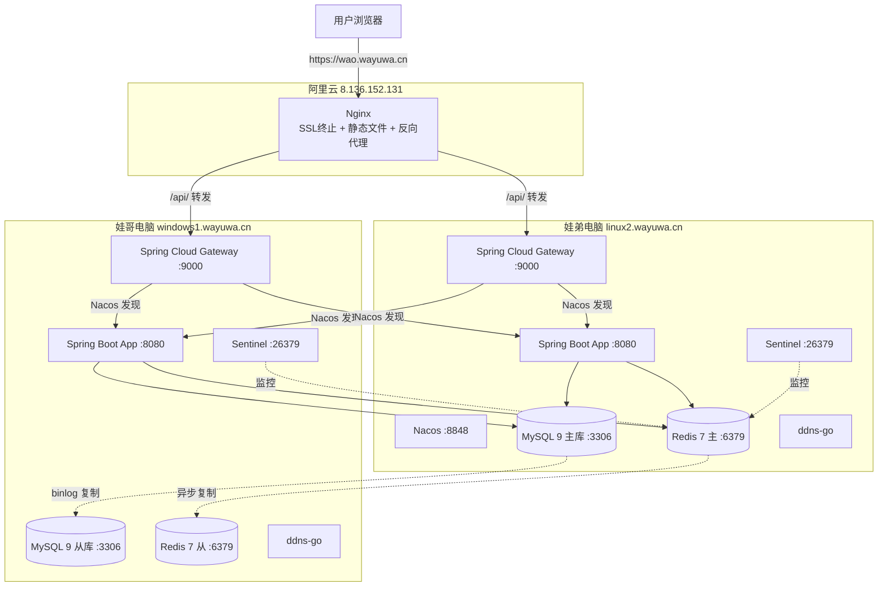
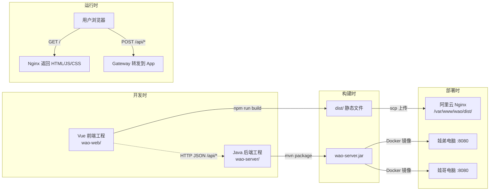
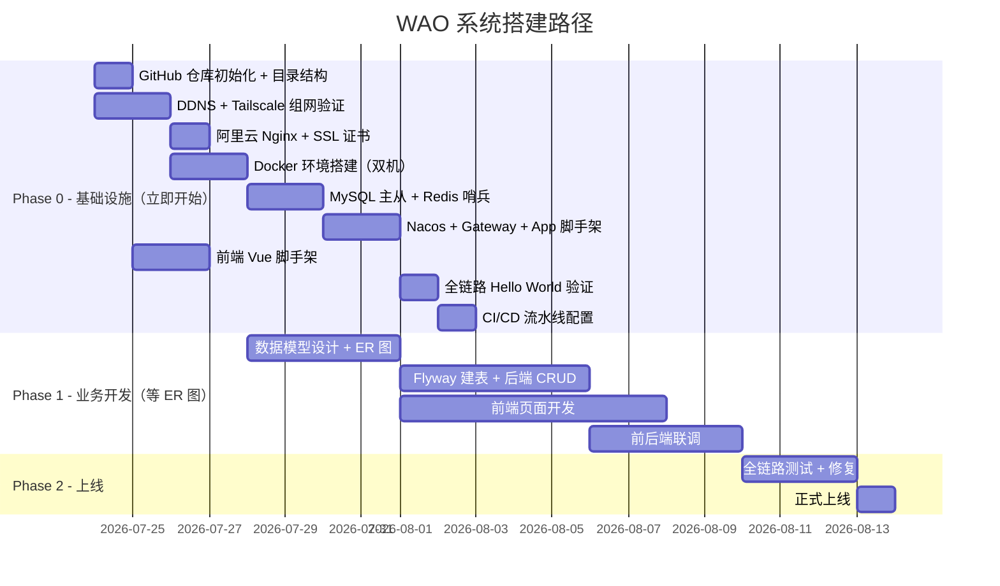

# WAO 系统技术架构方案

## 一、项目概述

### 1.1 项目定位

WAO 系统是一个由两名 Java 服务端工程师（娃哥、娃弟）主导设计与架构的个人项目。本项目的核心特征是全链路 AI 驱动开发：UI 设计由 Claude Design 完成并已达到满意状态，后续的编码、部署、CI/CD、运维等所有执行环节均由 AI 完成。两人的角色是系统设计者与提示词工程师——负责定义架构、编写和迭代提示词、验收 AI 产出物。

后续工作模式：输入项目背景和约束 → AI 生成最优提示词 → AI 执行 → 人工验收。

### 1.2 服务器资源

| 名称 | 角色 | 系统 | 配置 | 硬盘 | 网络 | 域名/IP |
|------|------|------|------|------|------|---------|
| 娃弟的电脑 | 主节点 | Ubuntu | 20 核 / 32G | 500G | 公网动态 IP | linux2.wayuwa.cn |
| 娃哥的电脑 | 从节点 | Windows 11 Pro | 20 核 / 32G | 100G | 公网动态 IP | windows1.wayuwa.cn |
| 阿里云服务器 | 接入层 | Ubuntu | 2 核 / 2G | 50G | 固定 IP，开放 80/443 | 8.136.152.131 |

### 1.3 关键约束

**动态公网 IP**：两台家用服务器 IP 由运营商动态分配，通过 DDNS（ddns-go）保持域名实时解析。

**云服务器 2H2G**：仅承载 Nginx（SSL 终止 + 静态文件托管 + 反向代理），不运行 Java 进程。

**Windows 11 Pro**：通过 WSL2 Ubuntu 24.04 内的原生 Docker Engine 运行容器，不依赖 Docker Desktop，因此定为从节点。

**硬盘差异**：主节点 500G 承载主库数据；从节点 100G 承载从库 + 备份，需定期清理。

### 1.4 开发环境与 AI 工具

| 开发者 | 开发机 | 系统 | AI 工具 | GitHub 账号 |
|--------|--------|------|---------|-------------|
| 娃弟 | linux2.wayuwa.cn | Ubuntu | Claude（Claude Code） | wayuwadi |
| 娃哥 | windows1.wayuwa.cn | Windows 11 Pro | Codex（OpenAI Codex CLI） | wayuwage |

两人角色对等，均可参与前端、后端、部署等任何模块的开发。分工按迭代任务动态分配，不做固定绑定。

### 1.5 GitHub 组织与仓库

| 项目 | 值 |
|------|------|
| Organization | https://github.com/wayuwacn |
| Repository | wayuwa-wao |
| 默认分支 | main（protected，仅接受 PR 合并） |
| 成员权限 | wayuwage / wayuwadi 均为 org owner |
| CI/CD | Linux 自建 Jenkins（GitHub Webhook 推送 main 触发部署） |

### 1.6 AI 协作开发规范

两个不同的 AI 工具（Claude 和 Codex）在同一个仓库上协作，核心挑战是上下文一致性——两个 AI 必须对架构、规范、进度有相同的理解。以下规范解决这个问题。

#### 1.6.1 SDD（Spec-Driven Development）模式

本项目的开发流程是"先写规格，再让 AI 实现"：

```
人工编写 Spec（规格文档）→ AI 读取 Spec + AGENTS.md → AI 生成代码 → 人工 Review → 合并
```

Spec 文档包括：
- API 契约：OpenAPI 3.0 YAML（放 `docs/api/` 目录）
- 数据模型：ER 图 + 建表 DDL（放 `docs/database/`）
- 页面交互说明：每个页面的输入/输出/状态流转（放 `docs/pages/`）
- 业务规则：核心逻辑的伪代码或决策表（放 `docs/specs/`）

SDD 的好处：两个不同的 AI 读同一份 Spec，产出一致性远高于口头描述需求。Spec 也是验收标准——AI 产出物是否符合 Spec，人工对照即可判断。

#### 1.6.2 AI 上下文文件（AGENTS.md / CLAUDE.md / codex.md）

仓库中维护三层 AI 上下文文件：

```
wayuwa-wao/
├── AGENTS.md          # 通用项目上下文（两个 AI 都读）
├── CLAUDE.md          # Claude Code 专用指令（娃弟的 AI 读）
├── codex.md           # Codex CLI 专用指令（娃哥的 AI 读）
└── docs/
    └── architecture.md  # 本技术方案（AGENTS.md 中引用）
```

**AGENTS.md（核心，两个 AI 共读）**：

```markdown
# WAO 项目 - AI 开发上下文

## 项目概述
WAO 是一个前后端分离的 Web 系统，由两名 Java 工程师设计，AI 执行全部编码。

## 技术栈（不可更改）
- 前端：Vue 3 + Vite + TypeScript + Ant Design Vue + Pinia
- 后端：Java 17 + Spring Boot 3 + MyBatis-Plus
- 网关：Spring Cloud Gateway + Nacos 2.x
- 数据库：MySQL 9（主从）+ Redis 7（哨兵）
- 部署：Docker Compose，详见 docs/architecture.md

## 代码规范
- 后端包名：cn.wayuwa.wao.*
- 前端目录：wao-web/src/
- API 路径前缀：/api/
- 接口文档：SpringDoc 自动生成
- 提交信息：Conventional Commits（feat/fix/docs/refactor/test/chore）

## 目录结构
[引用第七章 Monorepo 结构]

## 当前进度
[每次迭代后更新]

## 禁止事项
- 不得修改技术栈选型
- 不得在代码中硬编码密码/Token（使用环境变量）
- 不得直接推送 main 分支
- 不得删除或覆盖 docs/ 下的已有文档
```

**CLAUDE.md（Claude Code 专用，娃弟使用）**：

```markdown
# Claude Code 项目指令

继承 AGENTS.md 中的所有规范。额外指令：

## 行为约束
- 修改代码前先阅读 docs/architecture.md 相关章节
- 每次修改后端接口时，同步更新 docs/api/ 下对应的 OpenAPI YAML
- 生成代码后主动运行 mvn compile 验证编译通过
- 涉及数据库变更时，生成 migration SQL 放 docs/database/migrations/

## 偏好
- 使用组合式 API 风格编写前端代码（<script setup>）
- 后端 Service 层方法必须有 JavaDoc
- 单元测试覆盖 Service 层核心逻辑
```

**codex.md（Codex CLI 专用，娃哥使用）**：

```markdown
# Codex 项目指令

继承 AGENTS.md 中的所有规范。额外指令：

## 行为约束
- 修改代码前先阅读 docs/architecture.md 相关章节
- 前端组件使用 <script setup lang="ts"> 单文件组件
- 新增页面时同步更新 src/router/index.ts
- API 调用统一封装在 src/api/ 目录，不直接在组件中 fetch

## 偏好
- 组件命名：PascalCase（如 UserList.vue）
- 状态管理：优先使用 Pinia composable 风格
- 样式：使用 Ant Design Vue 组件，自定义样式用 scoped CSS
```

**初始化注意事项**：

- AGENTS.md 中的"当前进度" section 每次迭代后必须更新，这是两个 AI 了解对方工作的唯一窗口
- 两个专用文件（CLAUDE.md / codex.md）只放工具特定的行为指令，项目规范统一放 AGENTS.md，避免两处维护不一致
- 禁止在上下文文件中写入密码、Token、内网 IP 等敏感信息（用 `${ENV_VAR}` 占位）
- 架构方案（docs/architecture.md）发生变更时，AGENTS.md 中的摘要必须同步更新

#### 1.6.3 分支策略与 PR 流程

```
main (protected)
 ├── feat/backend-user-auth      ← 娃弟 (Claude)
 ├── feat/frontend-login-page    ← 娃哥 (Codex)
 ├── feat/gateway-jwt-filter     ← 娃弟 (Claude)
 ├── fix/redis-sentinel-config   ← 娃弟 (Claude)
 └── docs/api-user-module        ← 娃哥 (Codex)
```

分支命名：`<type>/<scope>-<description>`，type 取值：feat / fix / docs / refactor / test / chore。

PR 规则：
- 每个 PR 必须关联至少一个 Spec 文档或 Issue
- PR 描述中写明：改了什么、为什么改、如何验证
- 对方人工 Review 后合并（AI 生成的代码必须人工过目）
- CI 通过（编译 + 测试）是合并前置条件
- 合并方式：Squash Merge（保持 main 历史整洁）

#### 1.6.4 API 契约优先

前后端协作的核心原则：先定接口，再各自开发。

```
1. 娃弟（后端）在 docs/api/ 下编写 OpenAPI YAML
2. 娃哥（前端）根据 YAML 生成 TypeScript 类型定义和 mock 数据
3. 后端实现接口，前端对接 mock 开发页面
4. 联调时前端切换 proxy 到真实后端
```

OpenAPI 文件示例（`docs/api/user.yaml`）：

```yaml
openapi: 3.0.3
info:
  title: WAO User API
  version: 1.0.0
paths:
  /api/auth/login:
    post:
      summary: 用户登录
      requestBody:
        content:
          application/json:
            schema:
              type: object
              required: [username, password]
              properties:
                username: { type: string }
                password: { type: string }
      responses:
        '200':
          description: 登录成功
          content:
            application/json:
              schema:
                type: object
                properties:
                  accessToken: { type: string }
                  refreshToken: { type: string }
                  expiresIn: { type: integer }
        '401':
          description: 认证失败
```

#### 1.6.5 ADR（Architecture Decision Records）

每个重要技术决策记录一份 ADR，放 `docs/adr/` 目录。两个 AI 在实现前查阅 ADR 了解"为什么这样做"，避免推翻已有决策。

文件命名：`docs/adr/001-jwt-auth.md`、`docs/adr/002-tailscale-network.md`

格式：

```markdown
# ADR-001: 使用 JWT 无状态认证

## 状态：已采纳

## 上下文
WAO 系统前后端分离，需要一种跨请求的身份验证机制。

## 决策
采用 JWT（HS256），Gateway 层统一校验，App 层不重复验证。
Access Token 2h + Refresh Token 7d（存 Redis）。

## 后果
- 优点：无状态，水平扩展无需共享 Session
- 缺点：Token 签发后无法主动失效（通过 Refresh Token + Redis 黑名单缓解）
- 后续微服务拆分时需改为 RS256 非对称签名
```

#### 1.6.6 模块归属与冲突避免

两人角色对等，按迭代任务动态认领模块，不做固定绑定。避免冲突的规则：

| 目录 | 冲突风险 | 协作规则 |
|------|----------|----------|
| wao-server/ | 中 | 按功能模块拆分（如 user/、order/），同一模块同一时间只有一人修改 |
| wao-web/ | 中 | 按页面/组件拆分，同一页面同一时间只有一人修改 |
| wao-gateway/ | 低 | 变更频率低，修改前在 Issue 中知会对方 |
| deploy/ | 高 | 任何变更必须 PR + 对方 Review 后合并 |
| docs/ | 低 | Spec 谁写谁负责，ADR 共同维护 |
| .github/ | 低 | 变更需 PR + 对方 Review |

核心原则：同一文件同一时间只有一个分支在修改。开始新任务前先 `git pull` 并检查是否有人正在改同一模块（看 open PRs）。deploy/ 和 .github/ 是基础设施，任何变更必须双方确认。

#### 1.6.7 本地开发与测试流程

```
本地编码（AI 生成）→ 本地编译验证 → 本地 Docker Compose 起全套环境 → 接口测试 → Push 分支 → PR → CI → Review → Merge → CD 部署
```

本地开发环境（docker-compose-dev.yml）：

```yaml
# 本地开发用，一键起 MySQL + Redis + Nacos
services:
  mysql-dev:
    image: mysql:9.0
    ports: ["3306:3306"]
    environment:
      - MYSQL_ROOT_PASSWORD=dev123
      - MYSQL_DATABASE=wao
  redis-dev:
    image: redis:7-alpine
    ports: ["6379:6379"]
  nacos-dev:
    image: nacos/nacos-server:v2.4.3
    ports: ["8848:8848", "9848:9848"]
    environment:
      - MODE=standalone
```

后端本地启动：`mvn spring-boot:run -Dspring-boot.run.profiles=dev`
前端本地启动：`cd wao-web && npm run dev`（Vite :5173，proxy 到 :8080）

测试通过的标准：
- 后端：`mvn test` 全部通过
- 前端：`npm run build` 无报错
- 接口：核心 API 用 curl 或 Postman 验证返回正确
- 联调：前端页面能正常调通后端接口

#### 1.6.8 补充协作建议

**共享提示词库**：在 `docs/prompts/` 目录沉淀常用提示词模板（如"生成 CRUD 接口""生成 Vue 页面""编写单元测试"），两人复用，保持 AI 产出风格一致。

**Conventional Commits**：所有提交信息遵循规范格式，AI 生成代码时要求它按此格式写 commit message：

```
feat(server): add user login API with JWT
fix(web): correct router guard redirect loop
docs(api): update OpenAPI spec for user module
```

**定期同步**：两人每次开始新迭代前，先更新 AGENTS.md 中的"当前进度"，确保对方的 AI 能读到最新状态。重大架构变更先写 ADR 达成共识，再各自让 AI 实现。

**AI 产出验收清单**：
- 代码能编译通过
- 符合 AGENTS.md 中的代码规范
- 不引入 Spec 之外的额外依赖
- 不包含硬编码敏感信息
- 相关文档已同步更新

---

## 二、技术栈

| 层级 | 选型 | 说明 |
|------|------|------|
| 前端框架 | Vue 3 + Vite + TypeScript | 组合式 API，类型安全 |
| UI 组件库 | Ant Design Vue | 后台管理系统组件完整 |
| 状态管理 | Pinia | Vue 3 官方推荐 |
| 路由 | Vue Router 4 | history 模式 |
| 后端框架 | Java 17 + Spring Boot 3 | 主技术栈 |
| 服务网关 | Spring Cloud Gateway | API 路由、负载均衡、限流 |
| 注册/配置中心 | Nacos 2.x | 服务发现 + 动态配置 |
| ORM | MyBatis-Plus | 开发效率高 |
| 数据库 | MySQL 9（自建，主从复制） | linux2 已有 MySQL 9，直接用最新版本 |
| 缓存 | Redis 7（自建，主从 + 哨兵） | 自动故障转移 |
| 接入层 | Nginx（阿里云服务器） | SSL 终止 + 静态文件 + 反向代理 |
| 容器化 | Docker + Docker Compose | 全部服务容器化 |
| 代码仓库 | Git 单工程（Monorepo） | 前后端 + 部署 + CI/CD 同仓 |
| CI/CD | Jenkins LTS（Linux 主节点） | Webhook 推送即构建部署 |
| DDNS | ddns-go | 动态 IP 自动更新 DNS |

---

## 三、系统部署架构

### 3.1 整体拓扑



### 3.2 请求链路

用户访问 `https://wao.wayuwa.cn` 时，请求经过以下链路：

1. DNS 解析 wao.wayuwa.cn → 8.136.152.131（固定）
2. Nginx 接收请求，终止 SSL
3. 若请求路径为 `/`（页面、JS、CSS、图片）→ Nginx 直接返回本地静态文件
4. 若请求路径为 `/api/` → Nginx 反向代理到家用服务器的 Spring Cloud Gateway（:9000）
5. Gateway 通过 Nacos 发现可用的 App 实例，负载均衡后转发到 :8080
6. App 处理业务逻辑，读写 MySQL/Redis，返回 JSON 响应

### 3.3 域名规划

| 域名 | 用途 | 解析方式 |
|------|------|----------|
| wao.wayuwa.cn | 用户访问入口 | A 记录 → 8.136.152.131（固定） |
| linux2.wayuwa.cn | 主节点回源 | DDNS 动态解析 |
| windows1.wayuwa.cn | 从节点回源 | DDNS 动态解析 |

### 3.4 Nginx 配置（阿里云服务器）

Nginx 在本架构中职责极简：SSL 终止、托管前端静态文件、将 /api/ 请求代理到后端 Gateway。不做复杂路由逻辑，所有业务路由由 Spring Cloud Gateway 承担。

```nginx
resolver 223.5.5.5 223.6.6.6 valid=60s ipv6=off;

server {
    listen 443 ssl;
    server_name wao.wayuwa.cn;

    ssl_certificate     /etc/nginx/ssl/wao.wayuwa.cn.pem;
    ssl_certificate_key /etc/nginx/ssl/wao.wayuwa.cn.key;

    # 前端静态文件（Vue 构建产物）
    location / {
        root /var/www/wao/dist;
        try_files $uri $uri/ /index.html;
    }

    # API 请求代理到 Spring Cloud Gateway
    location /api/ {
        proxy_pass http://wao_gateway;
        proxy_set_header Host $host;
        proxy_set_header X-Real-IP $remote_addr;
        proxy_set_header X-Forwarded-For $proxy_add_x_forwarded_for;
        proxy_set_header X-Forwarded-Proto $scheme;
        proxy_connect_timeout 5s;
        proxy_next_upstream error timeout http_502 http_503;
    }
}

upstream wao_gateway {
    server linux2.wayuwa.cn:9000 max_fails=3 fail_timeout=30s;
    server windows1.wayuwa.cn:9000 max_fails=3 fail_timeout=30s;
    keepalive 16;
}

server {
    listen 80;
    server_name wao.wayuwa.cn;
    return 301 https://$host$request_uri;
}
```

DDNS 场景下 Nginx upstream 域名解析刷新：

```bash
# /etc/cron.d/nginx-ddns-reload
*/5 * * * * root nginx -s reload 2>/dev/null
```

### 3.5 端口说明

家用服务器不开放 80/443。只需开放 9000（Gateway）、8080（App）、8848（Nacos）、3306（MySQL）、6379（Redis）、26379（Sentinel）供阿里云服务器回源。用户浏览器中只看到 `https://wao.wayuwa.cn`，无端口号。

### 3.6 DDNS 配置

两台家用服务器各部署 ddns-go，IP 变化时自动更新 DNS 记录。

Ubuntu（娃弟电脑）：

```bash
wget https://github.com/jeessy2/ddns-go/releases/latest/download/ddns-go_Linux_x86_64.tar.gz
tar -xzf ddns-go_Linux_x86_64.tar.gz
sudo mv ddns-go /usr/local/bin/
sudo ddns-go -s install
# 访问 http://localhost:9876 配置，域名填 linux2.wayuwa.cn
```

Windows 11 Pro（娃哥电脑）：

```powershell
# 下载 Windows 版 ddns-go 解压后管理员运行：
ddns-go.exe -s install
# 访问 http://localhost:9876 配置，域名填 windows1.wayuwa.cn
```

检测周期 300 秒。完整链路：IP 变化 → ddns-go 更新 DNS → Nginx 5 分钟内 reload → 请求到达新 IP。

### 3.7 安全加固

#### 防火墙策略

家用服务器暴露公网，必须严格限制入站端口。原则：只开放必要端口，且限定来源 IP。

**娃弟电脑（Ubuntu）ufw 规则**：

```bash
# 默认拒绝所有入站
sudo ufw default deny incoming
sudo ufw default allow outgoing

# 只允许阿里云服务器访问 Gateway
sudo ufw allow from 8.136.152.131 to any port 9000 proto tcp

# 只允许从节点（娃哥电脑）访问数据库和 Redis 复制端口
# 注意：从节点 IP 动态变化，使用 Tailscale 内网 IP（见 3.8）
sudo ufw allow from 100.64.0.0/10 to any port 3306 proto tcp
sudo ufw allow from 100.64.0.0/10 to any port 6379 proto tcp
sudo ufw allow from 100.64.0.0/10 to any port 26379 proto tcp
sudo ufw allow from 100.64.0.0/10 to any port 8848 proto tcp
sudo ufw allow from 100.64.0.0/10 to any port 9000 proto tcp
sudo ufw allow from 100.64.0.0/10 to any port 8080 proto tcp

# SSH 管理（限定来源）
sudo ufw allow from 8.136.152.131 to any port 22 proto tcp

sudo ufw enable
```

**娃哥电脑（Windows 11 Pro）防火墙规则**：

通过 Windows Firewall 高级设置，创建入站规则：
- 9000 端口：仅允许 8.136.152.131
- 3306、6379、26379、8848、8080 端口：仅允许 Tailscale 网段 100.64.0.0/10
- 22/3389 管理端口：仅允许 8.136.152.131

#### Nginx 到 Gateway 传输加密

Nginx（阿里云）到 Gateway（家用服务器）的 /api/ 流量经过公网，必须加密。Gateway 配置自签证书启用 HTTPS：

```yaml
# wao-gateway application.yml 补充
server:
  port: 9000
  ssl:
    key-store: classpath:gateway-keystore.p12
    key-store-password: ${GATEWAY_SSL_PASS}
    key-store-type: PKCS12
```

Nginx 代理配置对应改为 HTTPS 后端：

```nginx
upstream wao_gateway {
    server linux2.wayuwa.cn:9000 max_fails=3 fail_timeout=30s;
    server windows1.wayuwa.cn:9000 max_fails=3 fail_timeout=30s;
    keepalive 16;
}

location /api/ {
    proxy_pass https://wao_gateway;
    proxy_ssl_verify off;  # 自签证书不校验 CA
    proxy_set_header Host $host;
    proxy_set_header X-Real-IP $remote_addr;
    proxy_set_header X-Forwarded-For $proxy_add_x_forwarded_for;
    proxy_set_header X-Forwarded-Proto $scheme;
    proxy_connect_timeout 5s;
    proxy_next_upstream error timeout http_502 http_503;
}
```

自签证书生成（部署时一次性操作）：

```bash
keytool -genkeypair -alias gateway -keyalg RSA -keysize 2048 \
  -storetype PKCS12 -keystore gateway-keystore.p12 \
  -validity 3650 -dname "CN=wao-gateway" \
  -storepass <GATEWAY_SSL_PASS>
```

#### Nacos 凭证初始化

Nacos 默认账号 nacos/nacos 必须在首次部署时修改：

```bash
# 部署完成后立即执行
curl -X PUT "http://localhost:8848/nacos/v1/auth/users?username=nacos&newPassword=<新密码>"
```

同时在 Nacos 配置中开启鉴权：

```properties
# Nacos application.properties
nacos.core.auth.enabled=true
nacos.core.auth.server.identity.key=<自定义key>
nacos.core.auth.server.identity.value=<自定义value>
nacos.core.auth.plugin.nacos.token.secret.key=<Base64编码的32字节以上密钥>
```

App 和 Gateway 连接 Nacos 时携带凭证：

```yaml
spring:
  cloud:
    nacos:
      discovery:
        server-addr: 100.64.0.1:8848
        username: ${NACOS_USER}
        password: ${NACOS_PASS}
```

### 3.8 内网互联（Tailscale）

两台家用服务器之间的数据库复制、Redis 同步、Nacos 通信走公网存在安全风险和稳定性问题（DDNS 刷新窗口期）。通过 Tailscale 组建虚拟内网，所有节点间内部通信走 Tailscale 加密隧道：

```bash
# 两台家用服务器 + 阿里云服务器均安装 Tailscale
curl -fsSL https://tailscale.com/install.sh | sh
sudo tailscale up
```

组网后各节点获得固定内网 IP（100.64.x.x 段），不再受公网动态 IP 影响：

| 节点 | Tailscale IP（示例） | 用途 |
|------|---------------------|------|
| 娃弟电脑 | 100.64.0.1 | MySQL 主库、Redis 主、Nacos |
| 娃哥电脑 | 100.64.0.2 | MySQL 从库、Redis 从 |
| 阿里云 | 100.64.0.3 | 备用 Sentinel |

MySQL 主从复制、Redis 主从同步、Sentinel 通信、从节点 App 连主库等内部流量全部走 Tailscale IP，不走公网域名。防火墙规则中 100.64.0.0/10 网段即 Tailscale 流量。

这解决了两个问题：
1. 内部通信不再依赖 DDNS，IP 固定不变
2. 数据库和缓存端口完全不暴露公网

---

## 四、服务治理：Spring Cloud Gateway + Nacos

### 4.1 为什么用 Spring Cloud 而不是纯 Nginx 做负载均衡

在阿里体系中，日常使用的是 VIPServer（服务发现）+ SLB（负载均衡）+ ConfigServer（配置中心）这套组合。对应的开源方案就是 Nacos（服务发现 + 配置中心）+ Spring Cloud Gateway（网关 + 负载均衡）。

使用 Spring Cloud 套装的原因：

- 与阿里系工作模式一致：服务注册到 Nacos，Gateway 自动发现实例并负载均衡，无需手动维护 IP 列表
- Java 技术栈内闭环：路由规则、限流策略、熔断配置全部在 Java 代码中管理，不需要单独维护 Nginx 配置文件
- 动态感知：Nacos 健康检查自动摘除故障实例，Gateway 实时感知，无需 reload
- 后续扩展：加机器只需启动新实例注册到 Nacos，Gateway 自动纳入负载均衡，零配置变更

Nginx 在本架构中退化为纯粹的"接入层"——只做 SSL 终止和静态文件托管，不承担业务路由。

### 4.2 Nacos 部署

Nacos 以单机模式部署在主节点（娃弟电脑），Docker 运行：

```yaml
# docker-compose 中的 nacos 服务
nacos:
  image: nacos/nacos-server:v2.4.3
  ports:
    - "8848:8848"
    - "9848:9848"
  environment:
    - MODE=standalone
    - SPRING_DATASOURCE_PLATFORM=mysql
    - MYSQL_SERVICE_HOST=mysql-master
    - MYSQL_SERVICE_PORT=3306
    - MYSQL_SERVICE_DB_NAME=nacos_config
    - MYSQL_SERVICE_USER=${DB_USER}
    - MYSQL_SERVICE_PASSWORD=${DB_PASS}
  depends_on:
    mysql-master:
      condition: service_healthy
  restart: always
```

Nacos 控制台：`http://linux2.wayuwa.cn:8848/nacos`（首次部署后必须修改默认密码，见 3.7 节）。

#### Nacos 单点故障降级行为

Nacos 仅部署在主节点（娃弟电脑），主节点宕机时 Nacos 不可用。降级行为如下：

- **Gateway 侧**：Spring Cloud Gateway 本地缓存了服务实例列表（Nacos client 内置缓存机制）。Nacos 不可用时，Gateway 依赖本地缓存继续路由请求，已知的健康实例仍可正常转发。服务不中断。
- **App 侧**：已注册的实例在心跳超时前（默认 15 秒临时实例、30 秒持久实例）仍保留在 Gateway 缓存中。若 App 实例本身也重启了，则无法重新注册，但已运行的实例不受影响。
- **从节点连 Nacos 的窗口期**：从节点的 App 和 Gateway 通过 Tailscale 内网 IP（100.64.0.1:8848）连接 Nacos，不经过公网 DDNS，因此不存在 DDNS 刷新窗口期问题。主节点宕机 = Nacos 宕机 = 连接直接失败，此时靠本地缓存兜底。
- **恢复**：主节点恢复后 Nacos 自动启动（Docker restart: always），各实例重新注册，Gateway 刷新实例列表，一切恢复正常。

结论：Nacos 单点不会导致服务中断，只会导致"新实例无法注册"和"故障实例无法被自动摘除"。对于 2 节点的个人项目，这个降级程度可接受。

### 4.3 Spring Cloud Gateway 配置

Gateway 作为独立 Spring Boot 模块运行（wao-gateway），核心配置：

```yaml
server:
  port: 9000

spring:
  application:
    name: wao-gateway
  cloud:
    nacos:
      discovery:
        server-addr: 100.64.0.1:8848
    gateway:
      discovery:
        locator:
          enabled: true
      routes:
        - id: wao-app
          uri: lb://wao-server    # lb:// 表示从 Nacos 负载均衡
          predicates:
            - Path=/api/**
          filters:
            - StripPrefix=0

management:
  endpoints:
    web:
      exposure:
        include: health,gateway
```

`lb://wao-server` 的含义：从 Nacos 中查找所有名为 `wao-server` 的实例，自动轮询负载均衡。某实例宕机后 Nacos 健康检查摘除，Gateway 不再向其转发。

### 4.4 App 注册到 Nacos

Spring Boot 主应用（wao-server）的 application.yml：

```yaml
spring:
  application:
    name: wao-server
  cloud:
    nacos:
      discovery:
        server-addr: 100.64.0.1:8848
      config:
        server-addr: 100.64.0.1:8848
        file-extension: yaml
```

两台服务器各启动一个 wao-server 实例，均注册到 Nacos。Gateway 自动发现两个实例并轮询。

### 4.5 与阿里系的对应关系

| 阿里内部 | WAO 系统（开源对应） |
|----------|---------------------|
| VIPServer | Nacos Discovery |
| ConfigServer / Diamond | Nacos Config |
| SLB + Tengine | Nginx（接入层）+ Spring Cloud Gateway（业务网关） |
| HSF | Spring Cloud OpenFeign（后续微服务拆分时用） |
| Sentinel（限流熔断） | Spring Cloud Gateway 内置 + Sentinel 组件 |
| MetaQ | RocketMQ（后续需要时引入） |
| Tair | Redis 7 |

---

## 五、前端工程与部署

### 5.1 前端是什么（面向 Java 后端开发者的说明）

前端工程和后端工程是完全不同的运行模式：

**后端（你熟悉的）**：Java 代码编译成 jar 包 → 需要 JVM 进程持续运行 → 接收请求、处理逻辑、返回响应。服务器必须一直跑着这个进程。

**前端（Vue）**：Vue 源代码（.vue 文件、.ts 文件）经过 `npm run build` 编译后，产出物是一堆静态文件——index.html、几个 .js 文件、几个 .css 文件、图片。这些文件不需要任何进程来"运行"，它们就是文件。用户浏览器下载这些文件后，由浏览器自己执行 JavaScript 渲染页面。

类比：后端像是一个餐厅厨房（一直在运转，随时处理订单）；前端像是一本印好的菜单（印完就不需要印刷机了，顾客自己看）。

### 5.2 前端构建产物

```bash
cd wao-web
npm install      # 安装依赖（类似 mvn dependency:resolve）
npm run build    # 编译（类似 mvn package）
```

构建完成后生成 `dist/` 目录：

```
dist/
├── index.html          # 入口 HTML
├── assets/
│   ├── index-a1b2c3.js   # 打包后的 JavaScript
│   ├── index-d4e5f6.css  # 打包后的样式
│   └── logo-xyz.png      # 图片资源
└── favicon.ico
```

这就是全部产物。没有 jar 包，没有进程，没有端口。

### 5.3 前端部署方式

将 `dist/` 目录整个上传到阿里云服务器的 `/var/www/wao/dist/`，Nginx 直接托管这些文件。用户请求页面时，Nginx 把对应的 HTML/JS/CSS 文件返回给浏览器，完事。

```bash
# 部署前端（在本地构建后上传）
cd wao-web && npm run build
scp -r dist/* root@8.136.152.131:/var/www/wao/dist/
```

前端不需要 Docker，不需要在服务器上"启动"，不需要占用家用服务器的资源。

### 5.4 前端如何调用后端

前端代码中通过 HTTP 请求调用后端 API（和 Postman 调接口一样）：

```typescript
// 前端代码中调用后端
const response = await fetch('/api/user/login', {
  method: 'POST',
  body: JSON.stringify({ username, password })
})
```

浏览器发送 `/api/user/login` 请求 → Nginx 看到 `/api/` 前缀 → 代理到 Gateway → Gateway 转发到 App → 返回 JSON → 前端拿到数据渲染页面。

### 5.5 开发阶段联调

本地开发时，前端 Vite 开发服务器（:5173）配置代理，将 /api/ 请求转发到本地后端（:8080），解决跨域：

```typescript
// vite.config.ts
export default defineConfig({
  server: {
    proxy: {
      '/api': {
        target: 'http://localhost:8080',
        changeOrigin: true
      }
    }
  }
})
```

---

## 六、前后端分离方案

### 6.1 什么是前后端分离

传统 Java Web 开发（JSP/Thymeleaf 模式）：HTML 模板放在后端工程里，由 Java 服务端渲染后返回完整 HTML。前端和后端耦合在同一个 war 包中。

前后端分离模式：前端是一个独立工程，后端是一个独立工程。两者唯一的交互方式是 HTTP JSON API。前端不依赖后端的模板引擎，后端不关心页面长什么样。



### 6.2 分离的具体体现

| 维度 | 前端 | 后端 |
|------|------|------|
| 代码语言 | TypeScript / Vue SFC | Java |
| 构建工具 | Vite（npm run build） | Maven（mvn package） |
| 构建产物 | dist/ 目录（HTML+JS+CSS） | jar 包 |
| 运行环境 | 用户浏览器 | JVM（Docker 容器） |
| 部署位置 | 阿里云 Nginx 目录 | 两台家用服务器 |
| 部署方式 | scp 上传文件 | docker compose up |
| 是否需要进程 | 不需要 | 需要（Java 进程常驻） |
| 更新方式 | 覆盖 dist/ 文件即可 | 重建镜像重启容器 |

### 6.3 为什么同一仓库但部署分离

代码在同一个 Git 仓库（Monorepo），但构建和部署是独立的两条流水线。改前端代码只需重新 build + 上传 dist/，不影响后端服务；改后端代码只需重建 Docker 镜像，不影响前端页面。两者互不阻塞。

### 6.4 接口契约

前后端通过 API 接口文档约定数据格式。后端提供 RESTful JSON 接口，前端按约定调用。接口文档由后端代码自动生成（SpringDoc / Swagger），前端据此开发。

---

## 七、代码工程结构（Monorepo）

整个项目使用单一 Git 仓库，前端、后端、部署配置、CI/CD 流水线全部在一个工程中，便于 AI 统一管理和上下文理解。

```
wao/
├── wao-web/                    # 前端 Vue 3 工程
│   ├── src/
│   │   ├── views/              # 页面组件
│   │   ├── components/         # 通用组件
│   │   ├── api/                # 后端接口调用封装
│   │   ├── stores/             # Pinia 状态管理
│   │   ├── router/             # 路由配置
│   │   └── App.vue
│   ├── package.json
│   ├── vite.config.ts
│   └── tsconfig.json
│
├── wao-server/                 # 后端 Spring Boot 主应用
│   ├── src/main/java/
│   │   └── cn/wayuwa/wao/
│   │       ├── controller/     # API 接口层
│   │       ├── service/        # 业务逻辑层
│   │       ├── mapper/         # 数据访问层（MyBatis-Plus）
│   │       ├── entity/         # 数据库实体
│   │       ├── dto/            # 数据传输对象
│   │       └── config/         # 配置类
│   ├── src/main/resources/
│   │   └── application.yml
│   ├── pom.xml
│   └── Dockerfile
│
├── wao-gateway/                # Spring Cloud Gateway 网关
│   ├── src/main/java/
│   ├── src/main/resources/
│   │   └── application.yml
│   ├── pom.xml
│   └── Dockerfile
│
├── deploy/                     # 部署相关
│   ├── docker-compose-master.yml   # 主节点编排
│   ├── docker-compose-slave.yml    # 从节点编排
│   ├── nginx/
│   │   └── wao.wayuwa.cn.conf     # Nginx 站点配置
│   ├── mysql/
│   │   ├── master.cnf
│   │   └── slave.cnf
│   ├── redis/
│   │   ├── master.conf
│   │   ├── slave.conf
│   │   └── sentinel.conf
│   └── scripts/
│       ├── deploy.sh               # 一键部署脚本
│       └── backup_mysql.sh         # 数据库备份脚本
│
├── Jenkinsfile                 # 主站 Jenkins 流水线
├── deploy/jenkins/             # JCasC、安装、备份、隧道与发布脚本
│
├── docs/                       # 设计文档
│   ├── architecture.md         # 本文档
│   ├── er-diagram.md           # 数据库 ER 图
│   └── api-design.md           # 接口设计
│
├── .env.example                # 环境变量模板
├── .gitignore
└── README.md
```

这个结构的好处：AI 在单次对话中可以同时看到前端、后端、部署配置的全貌，修改接口时能同步更新前后端代码，不会出现仓库割裂导致的上下文缺失。

---

## 八、数据层：MySQL 9 主从 + Redis 7 哨兵

### 8.1 MySQL 9 主从复制

linux2.wayuwa.cn 已有 MySQL 9，直接使用最新版本。Docker 镜像使用 `mysql:9.0`。

**主库配置（娃弟电脑）mysql-master.cnf**：

```ini
[mysqld]
server-id=1
log-bin=mysql-bin
binlog-format=ROW
binlog-do-db=wao
binlog-do-db=nacos_config
```

**从库配置（娃哥电脑）mysql-slave.cnf**：

```ini
[mysqld]
server-id=2
relay-log=relay-bin
read-only=1
log-bin=mysql-bin
log-slave-updates=1
```

**建立复制（在从库执行）**：

```sql
-- MySQL 9 语法（CHANGE MASTER TO 已在 MySQL 9 中移除）
CHANGE REPLICATION SOURCE TO
  SOURCE_HOST='100.64.0.1',
  SOURCE_PORT=3306,
  SOURCE_USER='repl',
  SOURCE_PASSWORD='<复制专用密码>',
  SOURCE_LOG_FILE='mysql-bin.000001',
  SOURCE_LOG_POS=0;

START REPLICA;
SHOW REPLICA STATUS\G;
-- 确认 Replica_IO_Running 和 Replica_SQL_Running 都为 Yes
```

复制地址使用 Tailscale 内网 IP（100.64.0.1），不走公网域名。内网 IP 固定不变，无 DDNS 刷新窗口期问题，复制链路不受公网 IP 变化影响。

**读写分离（应用层）**：

```yaml
spring:
  datasource:
    dynamic:
      primary: master
      datasource:
        master:
          url: jdbc:mysql://100.64.0.1:3306/wao
          username: ${DB_USER}
          password: ${DB_PASS}
        slave:
          url: jdbc:mysql://100.64.0.2:3306/wao
          username: ${DB_USER}
          password: ${DB_PASS}
```

数据源地址使用 Tailscale 内网 IP，数据库流量不经过公网。

代码中 `@DS("slave")` 标记读方法。初期可全部走主库，从库纯热备。

### 8.2 Redis 7 主从 + 哨兵

**主节点（娃弟电脑）redis-master.conf**：

```conf
bind 0.0.0.0
port 6379
requirepass <密码>
masterauth <密码>
appendonly yes
appendfsync everysec
```

**从节点（娃哥电脑）redis-slave.conf**：

```conf
bind 0.0.0.0
port 6379
requirepass <密码>
masterauth <密码>
replicaof 100.64.0.1 6379
appendonly yes
appendfsync everysec
```

**哨兵配置（三节点部署）**：

三个 Sentinel 分别部署在娃弟电脑（100.64.0.1）、娃哥电脑（100.64.0.2）、阿里云服务器（100.64.0.3）。quorum=2 表示 3 个哨兵中 2 个认为主节点下线即触发故障转移，避免 2 节点时网络分区导致无法达成多数派的问题。

阿里云服务器只跑一个 Sentinel 进程（内存占用约 10MB），不跑 Redis 数据节点，2G 内存完全无压力。

```conf
# sentinel.conf（三个节点使用相同配置）
port 26379
sentinel monitor mymaster 100.64.0.1 6379 2
sentinel auth-pass mymaster <密码>
sentinel down-after-milliseconds mymaster 5000
sentinel failover-timeout mymaster 60000
sentinel parallel-syncs mymaster 1
```

全部使用 Tailscale 固定内网 IP，无需域名解析，无 DDNS 窗口期问题。

**阿里云服务器 Sentinel 部署（Docker）**：

```yaml
# 阿里云服务器上单独跑一个 sentinel 容器
# docker-compose-sentinel.yml
services:
  redis-sentinel:
    image: redis:7-alpine
    ports:
      - "26379:26379"
    command: redis-sentinel /usr/local/etc/redis/sentinel.conf
    volumes:
      - ./sentinel.conf:/usr/local/etc/redis/sentinel.conf
    restart: always
```

**Spring Boot 连接**：

```yaml
spring:
  data:
    redis:
      sentinel:
        master: mymaster
        nodes: 100.64.0.1:26379,100.64.0.2:26379,100.64.0.3:26379
      password: <密码>
```

### 8.3 备份策略

```bash
#!/bin/bash
# deploy/scripts/backup_mysql.sh - 每天凌晨 3 点在从库执行
BACKUP_DIR=/data/backup/mysql
DATE=$(date +%Y%m%d_%H%M%S)
mkdir -p $BACKUP_DIR

docker exec mysql-slave mysqldump -u root -p<密码> \
  --single-transaction --routines --triggers wao \
  > $BACKUP_DIR/wao_$DATE.sql

gzip $BACKUP_DIR/wao_$DATE.sql
find $BACKUP_DIR -name "*.sql.gz" -mtime +7 -exec rm {} \;
scp $BACKUP_DIR/wao_$DATE.sql.gz root@8.136.152.131:/data/backup/
```

crontab：`0 3 * * * /opt/wao/deploy/scripts/backup_mysql.sh`

### 8.4 各层故障处理

| 层级 | 故障场景 | 处理方式 |
|------|----------|----------|
| Nginx（阿里云） | 云服务器宕机 | 概率极低；若发生，DNS 切备用 IP |
| Gateway | 一台 Gateway 挂 | Nginx upstream 自动摘除，流量走另一台 |
| App 实例 | 一台 App 挂 | Nacos 健康检查摘除，Gateway 不再转发 |
| MySQL 主库 | 主库宕机 | 从库有完整数据，手动提升为主库 |
| Redis 主节点 | 主节点宕机 | 哨兵自动选举从节点为新主，秒级恢复 |

---

## 九、Docker 容器化

### 9.1 后端 Dockerfile

```dockerfile
FROM maven:3.9-eclipse-temurin-17 AS builder
WORKDIR /app
COPY pom.xml .
RUN mvn dependency:go-offline
COPY src ./src
RUN mvn package -DskipTests

FROM eclipse-temurin:17-jre-alpine
WORKDIR /app
COPY --from=builder /app/target/*.jar app.jar
EXPOSE 8080
ENTRYPOINT ["java", "-jar", "app.jar", "--spring.profiles.active=prod"]
```

### 9.2 Docker Compose — 主节点（娃弟电脑）

```yaml
services:
  wao-server:
    build: ./wao-server
    ports:
      - "8080:8080"
    environment:
      - SPRING_DATASOURCE_URL=jdbc:mysql://mysql-master:3306/wao
      - SPRING_DATASOURCE_USERNAME=${DB_USER}
      - SPRING_DATASOURCE_PASSWORD=${DB_PASS}
      - SPRING_DATA_REDIS_SENTINEL_MASTER=mymaster
      - SPRING_DATA_REDIS_SENTINEL_NODES=redis-sentinel:26379
      - SPRING_DATA_REDIS_PASSWORD=${REDIS_PASS}
      - SPRING_CLOUD_NACOS_DISCOVERY_SERVER_ADDR=nacos:8848
    depends_on:
      mysql-master:
        condition: service_healthy
      nacos:
        condition: service_started
    restart: always

  wao-gateway:
    build: ./wao-gateway
    ports:
      - "9000:9000"
    environment:
      - SPRING_CLOUD_NACOS_DISCOVERY_SERVER_ADDR=nacos:8848
    depends_on:
      - nacos
    restart: always

  nacos:
    image: nacos/nacos-server:v2.4.3
    ports:
      - "8848:8848"
      - "9848:9848"
    environment:
      - MODE=standalone
      - SPRING_DATASOURCE_PLATFORM=mysql
      - MYSQL_SERVICE_HOST=mysql-master
      - MYSQL_SERVICE_PORT=3306
      - MYSQL_SERVICE_DB_NAME=nacos_config
      - MYSQL_SERVICE_USER=${DB_USER}
      - MYSQL_SERVICE_PASSWORD=${DB_PASS}
    depends_on:
      mysql-master:
        condition: service_healthy
    restart: always

  mysql-master:
    image: mysql:9.0
    ports:
      - "3306:3306"
    environment:
      - MYSQL_ROOT_PASSWORD=${DB_ROOT_PASS}
      - MYSQL_DATABASE=wao
      - MYSQL_USER=${DB_USER}
      - MYSQL_PASSWORD=${DB_PASS}
    volumes:
      - ./data/mysql:/var/lib/mysql
      - ./deploy/mysql/master.cnf:/etc/mysql/conf.d/my.cnf
    restart: always
    healthcheck:
      test: ["CMD", "mysqladmin", "ping", "-h", "localhost"]
      interval: 10s
      timeout: 5s
      retries: 5

  redis-master:
    image: redis:7-alpine
    ports:
      - "6379:6379"
    command: redis-server /usr/local/etc/redis/redis.conf
    volumes:
      - ./data/redis:/data
      - ./deploy/redis/master.conf:/usr/local/etc/redis/redis.conf
    restart: always

  redis-sentinel:
    image: redis:7-alpine
    ports:
      - "26379:26379"
    command: redis-sentinel /usr/local/etc/redis/sentinel.conf
    volumes:
      - ./deploy/redis/sentinel.conf:/usr/local/etc/redis/sentinel.conf
    restart: always
```

### 9.3 Docker Compose — 从节点（娃哥电脑）

```yaml
services:
  wao-server:
    build: ./wao-server
    ports:
      - "8080:8080"
    environment:
      - SPRING_DATASOURCE_URL=jdbc:mysql://100.64.0.1:3306/wao
      - SPRING_DATASOURCE_USERNAME=${DB_USER}
      - SPRING_DATASOURCE_PASSWORD=${DB_PASS}
      - SPRING_DATA_REDIS_SENTINEL_MASTER=mymaster
      - SPRING_DATA_REDIS_SENTINEL_NODES=100.64.0.1:26379,100.64.0.2:26379,100.64.0.3:26379
      - SPRING_DATA_REDIS_PASSWORD=${REDIS_PASS}
      - SPRING_CLOUD_NACOS_DISCOVERY_SERVER_ADDR=100.64.0.1:8848
    restart: always

  wao-gateway:
    build: ./wao-gateway
    ports:
      - "9000:9000"
    environment:
      - SPRING_CLOUD_NACOS_DISCOVERY_SERVER_ADDR=100.64.0.1:8848
    restart: always

  mysql-slave:
    image: mysql:9.0
    ports:
      - "3306:3306"
    environment:
      - MYSQL_ROOT_PASSWORD=${DB_ROOT_PASS}
    volumes:
      - ./data/mysql:/var/lib/mysql
      - ./deploy/mysql/slave.cnf:/etc/mysql/conf.d/my.cnf
    restart: always

  redis-slave:
    image: redis:7-alpine
    ports:
      - "6379:6379"
    command: redis-server /usr/local/etc/redis/redis.conf
    volumes:
      - ./data/redis:/data
      - ./deploy/redis/slave.conf:/usr/local/etc/redis/redis.conf
    restart: always

  redis-sentinel:
    image: redis:7-alpine
    ports:
      - "26379:26379"
    command: redis-sentinel /usr/local/etc/redis/sentinel.conf
    volumes:
      - ./deploy/redis/sentinel.conf:/usr/local/etc/redis/sentinel.conf
    restart: always
```

### 9.4 前端不用 Docker

前端构建产物是纯静态文件，直接 scp 到阿里云 Nginx 目录。不需要容器化，不需要进程，不需要占用家用服务器资源。

---

## 十、CI/CD 流水线

### 10.1 Jenkins 配置

主站流水线定义在仓库根目录 `Jenkinsfile`，控制器原生安装在 Linux 主节点并只监听
`127.0.0.1:8081`。GitHub 的签名 push Webhook 经阿里云 Nginx 的精确
`/github-webhook/` 路由和反向 SSH 隧道到达 Jenkins。UI 使用 `/jenkins/` 同域入口并接入自动化页面：
Nginx 先校验 WAO 会话，Jenkins 再校验自身管理员账号，匿名公网请求不能到达 Jenkins。JCasC、固定插件清单、
安装与恢复步骤见 `deploy/jenkins/`，完整安全边界见 ADR-099。

### 10.2 部署策略说明

- Maven、两个 Vue 项目和四个 Docker target 在同一次构建中验证，并以完整 Git SHA 标记镜像。
- 固定顺序为 Windows → Linux → 阿里云；Windows 失败时 Linux 保持旧版本，Linux 失败时保持摘流并由 Windows 服务。
- 两个应用节点运行相同 SHA 后才发布静态前端与 Nginx，并验证复制、公共 API、Agent 和飞书登录。
- 同一流水线禁止并发；后续 `main` push 排队，不取消正在执行的数据库迁移或滚动发布。
- 主从节点顺序部署：先主后从，主节点失败则不继续部署从节点

### 10.3 日志管理

Spring Boot 输出到 stdout，Docker 自动收集：

```bash
docker logs -f wao-server            # 实时
docker logs --since 24h wao-server   # 最近 24 小时
```

Docker 日志保留策略（/etc/docker/daemon.json）：

```json
{
  "log-driver": "json-file",
  "log-opts": {
    "max-size": "50m",
    "max-file": "5"
  }
}
```

---

## 十一、认证鉴权与运维保障

### 11.1 认证鉴权设计

采用 JWT（JSON Web Token）无状态认证方案，Gateway 层统一鉴权，App 层不重复校验。

**认证流程**：

1. 用户调用 `/api/auth/login` 提交用户名密码
2. App 验证通过后签发 JWT（含 userId、角色、过期时间），返回给前端
3. 前端将 Token 存入内存（Pinia），每次请求携带 `Authorization: Bearer <token>`
4. Gateway 全局过滤器校验 Token 有效性：过期/篡改 → 返回 401；有效 → 放行并透传用户信息到 App
5. Token 过期后前端调用 `/api/auth/refresh` 刷新，无需重新登录

**Token 策略**：

| 参数 | 值 | 说明 |
|------|------|------|
| Access Token 有效期 | 2 小时 | 短期，降低泄露风险 |
| Refresh Token 有效期 | 7 天 | 存 Redis，支持主动失效（退出登录） |
| 签名算法 | HS256 | 单服务场景够用；后续微服务拆分改 RS256 |
| 存储位置（前端） | 内存（Pinia） | 不存 localStorage，防 XSS 窃取 |

**Gateway 鉴权过滤器**：

```java
@Component
public class AuthGlobalFilter implements GlobalFilter, Ordered {
    
    private static final List<String> WHITE_LIST = List.of(
        "/api/auth/login", "/api/auth/refresh", "/api/public/**"
    );

    @Override
    public Mono<Void> filter(ServerWebExchange exchange, GatewayFilterChain chain) {
        String path = exchange.getRequest().getPath().value();
        // 白名单放行
        if (isWhiteListed(path)) {
            return chain.filter(exchange);
        }
        // 校验 JWT
        String token = extractToken(exchange.getRequest());
        Claims claims = jwtUtil.validate(token);
        if (claims == null) {
            exchange.getResponse().setStatusCode(HttpStatus.UNAUTHORIZED);
            return exchange.getResponse().setComplete();
        }
        // 透传用户信息到下游 App
        ServerHttpRequest request = exchange.getRequest().mutate()
            .header("X-User-Id", claims.getSubject())
            .header("X-User-Role", claims.get("role", String.class))
            .build();
        return chain.filter(exchange.mutate().request(request).build());
    }

    @Override
    public int getOrder() { return -100; }
}
```

**CORS 说明**：生产环境前后端同域（均为 wao.wayuwa.cn），不存在跨域问题。开发阶段通过 Vite proxy 绕过。无需在 Gateway 或 App 中配置 CORS。

### 11.2 SSL 证书自动续期

wao.wayuwa.cn 使用 Let's Encrypt 免费证书，有效期 90 天，必须配置自动续期。

**阿里云服务器上执行（一次性初始化）**：

```bash
# 安装 certbot
sudo apt install certbot python3-certbot-nginx -y

# 首次签发证书（自动配置 Nginx）
sudo certbot --nginx -d wao.wayuwa.cn

# 验证自动续期
sudo certbot renew --dry-run
```

certbot 安装后自动注册 systemd timer，每天检查证书是否即将过期（剩余 < 30 天时自动续期）。续期后需 reload Nginx：

```bash
# /etc/letsencrypt/renewal-hooks/deploy/reload-nginx.sh
#!/bin/bash
nginx -s reload
```

```bash
chmod +x /etc/letsencrypt/renewal-hooks/deploy/reload-nginx.sh
```

证书路径（Nginx 配置中引用）：
- 证书：`/etc/letsencrypt/live/wao.wayuwa.cn/fullchain.pem`
- 私钥：`/etc/letsencrypt/live/wao.wayuwa.cn/privkey.pem`

### 11.3 监控告警

个人项目不部署 Prometheus + Grafana 全套，用最简方案：阿里云服务器上的 cron 健康检查脚本 + 钉钉/邮件通知。

**健康检查脚本（阿里云服务器）**：

```bash
#!/bin/bash
# /opt/scripts/health_check.sh - 每分钟执行

GATEWAY_MASTER="https://linux2.wayuwa.cn:9000/actuator/health"
GATEWAY_SLAVE="https://windows1.wayuwa.cn:9000/actuator/health"
ALERT_FILE="/tmp/wao_alert_sent"

check_and_alert() {
    local url=$1
    local name=$2
    
    if ! curl -sf --max-time 10 "$url" | grep -q '"status":"UP"'; then
        # 避免重复告警（10 分钟内只发一次）
        if [ ! -f "$ALERT_FILE" ] || [ $(($(date +%s) - $(stat -c %Y "$ALERT_FILE"))) -gt 600 ]; then
            # 钉钉机器人告警（替换为你的 webhook）
            curl -s -X POST "<钉钉机器人Webhook>" \
              -H 'Content-Type: application/json' \
              -d "{\"msgtype\":\"text\",\"text\":{\"content\":\"[WAO告警] ${name} 健康检查失败 $(date '+%Y-%m-%d %H:%M:%S')\"}}"
            touch "$ALERT_FILE"
        fi
    else
        rm -f "$ALERT_FILE"
    fi
}

check_and_alert "$GATEWAY_MASTER" "主节点Gateway"
check_and_alert "$GATEWAY_SLAVE" "从节点Gateway"
```

```bash
# crontab
* * * * * /opt/scripts/health_check.sh
```

**后续可扩展**：接入 Uptime Kuma（自部署状态监控面板），或阿里云云监控免费额度。

### 11.4 Nginx 静态资源优化

```nginx
server {
    listen 443 ssl http2;  # 开启 HTTP/2
    server_name wao.wayuwa.cn;

    ssl_certificate     /etc/letsencrypt/live/wao.wayuwa.cn/fullchain.pem;
    ssl_certificate_key /etc/letsencrypt/live/wao.wayuwa.cn/privkey.pem;
    ssl_protocols TLSv1.2 TLSv1.3;
    ssl_ciphers HIGH:!aNULL:!MD5;

    # Gzip 压缩
    gzip on;
    gzip_types text/plain text/css application/json application/javascript text/xml application/xml image/svg+xml;
    gzip_min_length 1024;
    gzip_vary on;

    # 带 hash 的静态资源：长期缓存（文件名含 hash，内容变则文件名变）
    location /assets/ {
        root /var/www/wao/dist;
        expires 1y;
        add_header Cache-Control "public, immutable";
    }

    # index.html：不缓存（确保用户始终拿到最新版本）
    location = /index.html {
        root /var/www/wao/dist;
        add_header Cache-Control "no-cache, no-store, must-revalidate";
    }

    # 其他静态文件
    location / {
        root /var/www/wao/dist;
        try_files $uri $uri/ /index.html;
        expires 7d;
    }

    # API 代理（见 3.7 节 HTTPS 后端配置）
    location /api/ {
        proxy_pass https://wao_gateway;
        proxy_ssl_verify off;
        proxy_set_header Host $host;
        proxy_set_header X-Real-IP $remote_addr;
        proxy_set_header X-Forwarded-For $proxy_add_x_forwarded_for;
        proxy_set_header X-Forwarded-Proto $scheme;
        proxy_connect_timeout 5s;
        proxy_next_upstream error timeout http_502 http_503;
    }
}
```

优化要点：
- HTTP/2 多路复用，减少连接数，提升并发加载速度
- Gzip 压缩 JS/CSS/JSON，传输体积减少 60%~80%
- Vite 构建产物文件名含 content hash（如 `index-a1b2c3.js`），可安全设置 1 年强缓存
- index.html 禁止缓存，确保每次发版用户立即生效

---

## 十二、实施路径

### 12.1 分阶段策略

基础设施搭建（Phase 0）与业务代码开发（Phase 1）完全解耦。Phase 0 不依赖 ER 图和设计稿，可以立即开始。等设计稿就绪、ER 图分析完成后，再进入 Phase 1 填充业务逻辑。



### 12.2 Phase 0 详细步骤（不依赖设计稿，立即执行）

Phase 0 的目标：跑通一个完整的请求链路——浏览器访问 `https://wao.wayuwa.cn`，看到前端 Hello World 页面，点击按钮调用 `/api/hello`，经过 Gateway 转发到 App，返回 JSON。

1. **GitHub 仓库初始化**：创建 wayuwacn/wayuwa-wao 仓库，按第七章目录结构初始化，提交 AGENTS.md / CLAUDE.md / codex.md / .env.example / .gitignore
2. **DDNS + Tailscale**：两台家用服务器 + 阿里云装 Tailscale 组网，验证 `ping 100.64.0.x` 互通；装 ddns-go 验证域名解析
3. **阿里云 Nginx + SSL**：certbot 签发证书，配置 Nginx，验证 `https://wao.wayuwa.cn` 返回默认页面
4. **Docker 环境**：两台家用服务器装 Docker + Docker Compose，配置日志轮转
5. **数据层**：docker compose 起 MySQL 9 主从 + Redis 7 哨兵（三节点），验证复制和故障转移
6. **服务治理**：docker compose 起 Nacos + Gateway + 空 Spring Boot App，验证 Nacos 注册发现、Gateway 路由
7. **前端脚手架**：`npm create vue@latest` 初始化 Vue 3 + TS + Pinia + Router，写一个 Hello World 页面
8. **全链路验证**：前端 build → scp 到阿里云 → 浏览器访问 → 调 API → 返回 JSON
9. **CI/CD**：配置 Linux 自建 Jenkins，GitHub push main 通过签名 Webhook 自动构建部署

### 12.3 Phase 1 启动条件

Phase 1 的前置条件：
- 设计稿确认（娃弟提供）
- ER 图 / 数据模型设计完成
- API 契约（OpenAPI YAML）编写完成

Phase 1 的工作本质是"在已跑通的脚手架上填充业务代码"——建表、写 CRUD、画页面、联调。基础设施不需要任何改动。

---

## 十三、工程实践与进阶设计

### 13.1 统一 API 响应格式

所有后端接口返回统一信封结构，前端只需处理一种格式：

```json
{
  "code": 0,
  "message": "success",
  "data": { },
  "timestamp": 1753372800000
}
```

| code | 含义 | 前端处理 |
|------|------|----------|
| 0 | 成功 | 正常渲染 data |
| 40001 | 参数校验失败 | Toast 提示 message |
| 40100 | 未认证 / Token 过期 | 跳转登录页 |
| 40300 | 无权限 | Toast 提示 |
| 50000 | 服务端内部错误 | Toast "系统繁忙" |

后端实现：

```java
@Data
public class R<T> {
    private int code;
    private String message;
    private T data;
    private long timestamp = System.currentTimeMillis();

    public static <T> R<T> ok(T data) {
        R<T> r = new R<>();
        r.setCode(0);
        r.setMessage("success");
        r.setData(data);
        return r;
    }

    public static <T> R<T> fail(int code, String message) {
        R<T> r = new R<>();
        r.setCode(code);
        r.setMessage(message);
        return r;
    }
}
```

全局异常处理器（`@RestControllerAdvice`）捕获所有未处理异常，统一包装为 `R.fail()`，避免前端收到裸的 Spring 错误页面。

### 13.2 数据库版本管理（Flyway）

两个 AI 同时修改数据库结构时，手动维护 DDL 必然冲突。使用 Flyway 管理 schema 变更：

```
wao-server/src/main/resources/db/migration/
├── V1__create_user_table.sql
├── V2__create_order_table.sql
├── V3__add_user_avatar_column.sql
└── V4__create_index_on_order_status.sql
```

规则：
- 每个变更一个文件，命名 `V{序号}__{描述}.sql`，序号递增，永不修改已提交的文件
- AI 生成建表/改表语句时，必须创建新的 migration 文件，不得修改已有文件
- 应用启动时 Flyway 自动执行未应用的 migration
- 从库通过主从复制自动同步结构变更，无需单独执行

Maven 依赖：

```xml
<dependency>
    <groupId>org.flywaydb</groupId>
    <artifactId>flyway-core</artifactId>
</dependency>
<dependency>
    <groupId>org.flywaydb</groupId>
    <artifactId>flyway-mysql</artifactId>
</dependency>
```

配置：

```yaml
spring:
  flyway:
    enabled: true
    locations: classpath:db/migration
    baseline-on-migrate: true
```

### 13.3 Docker 资源限制与 JVM 调优

32G 内存的机器上跑 6+ 个容器，不做资源限制时一个容器内存泄漏会拖垮所有服务。

**docker-compose 资源限制**：

```yaml
services:
  wao-server:
    # ...
    deploy:
      resources:
        limits:
          memory: 2G
          cpus: '4.0'
        reservations:
          memory: 1G
          cpus: '2.0'

  wao-gateway:
    # ...
    deploy:
      resources:
        limits:
          memory: 1G
          cpus: '2.0'

  nacos:
    # ...
    deploy:
      resources:
        limits:
          memory: 2G
          cpus: '2.0'

  mysql-master:
    # ...
    deploy:
      resources:
        limits:
          memory: 8G
          cpus: '4.0'

  redis-master:
    # ...
    deploy:
      resources:
        limits:
          memory: 2G
          cpus: '2.0'
```

**JVM 参数（Dockerfile ENTRYPOINT）**：

```dockerfile
ENTRYPOINT ["java", \
  "-XX:MaxRAMPercentage=75.0", \
  "-XX:+UseG1GC", \
  "-XX:+HeapDumpOnOutOfMemoryError", \
  "-XX:HeapDumpPath=/tmp/heapdump.hprof", \
  "-jar", "app.jar", \
  "--spring.profiles.active=prod"]
```

`MaxRAMPercentage=75%` 让 JVM 自动感知容器的 memory limit（2G），堆上限设为 1.5G，留 512M 给堆外内存和 Metaspace。

### 13.4 优雅部署（减少停机时间）

当前 `docker compose up -d --build` 会导致短暂停机（容器停止 → 重建 → 启动）。优化为：

```bash
#!/bin/bash
# deploy/scripts/graceful-deploy.sh

# 1. 构建新镜像（不影响运行中的容器）
docker compose build wao-server wao-gateway

# 2. 滚动重启：先起新容器，健康检查通过后再停旧容器
docker compose up -d --no-deps --wait wao-server
# --wait 会等到 healthcheck 通过才返回

# 3. Gateway 同理
docker compose up -d --no-deps --wait wao-gateway

echo "Deploy completed at $(date)"
```

配合 Nginx 的 `proxy_next_upstream`，单节点重启期间流量自动切到另一台，用户无感知。

### 13.5 Tailscale 单点故障应对

Tailscale 是 SPOF——如果 Tailscale 服务挂了（虽然概率极低），所有内部通信中断。应对：

- Tailscale 以 systemd 服务运行，`Restart=always`，进程崩溃后秒级自动恢复
- MySQL 主从复制断连后会自动重试（`CHANGE REPLICATION SOURCE` 中配置的地址不变）
- Redis Sentinel 通信中断后，恢复时自动重新发现主节点
- 极端情况（Tailscale 基础设施故障）：临时切换为 DDNS 公网域名通信，修改 docker-compose 环境变量后重启即可

```bash
# 紧急回退：将 Tailscale IP 替换为公网域名
# 修改 .env 中的 MYSQL_HOST=linux2.wayuwa.cn，然后 docker compose up -d
```

### 13.6 备份恢复演练

备份的价值在于能恢复。每月执行一次恢复演练：

```bash
#!/bin/bash
# deploy/scripts/restore_drill.sh - 每月 1 号执行

BACKUP_FILE=$(ls -t /data/backup/mysql/wao_*.sql.gz | head -1)
RESTORE_DB="wao_restore_test"

echo "=== 备份恢复演练 $(date) ==="
echo "使用备份文件: $BACKUP_FILE"

# 1. 创建临时数据库
docker exec mysql-master mysql -u root -p<密码> -e "DROP DATABASE IF EXISTS $RESTORE_DB; CREATE DATABASE $RESTORE_DB;"

# 2. 恢复
gunzip -c "$BACKUP_FILE" | docker exec -i mysql-master mysql -u root -p<密码> "$RESTORE_DB"

# 3. 验证表数量
TABLE_COUNT=$(docker exec mysql-master mysql -u root -p<密码> -N -e "SELECT COUNT(*) FROM information_schema.tables WHERE table_schema='$RESTORE_DB';")
echo "恢复表数量: $TABLE_COUNT"

# 4. 清理
docker exec mysql-master mysql -u root -p<密码> -e "DROP DATABASE $RESTORE_DB;"

if [ "$TABLE_COUNT" -gt 0 ]; then
    echo "=== 演练成功 ==="
else
    echo "=== 演练失败！备份可能损坏 ==="
fi
```

### 13.7 结构化日志

Spring Boot 输出 JSON 格式日志，便于后续接入日志系统或 AI 分析：

```xml
<!-- logback-spring.xml -->
<configuration>
    <appender name="CONSOLE" class="ch.qos.logback.core.ConsoleAppender">
        <encoder class="net.logstash.logback.encoder.LogstashEncoder">
            <customFields>{"service":"wao-server"}</customFields>
        </encoder>
    </appender>
    <root level="INFO">
        <appender-ref ref="CONSOLE" />
    </root>
</configuration>
```

输出效果（每行一个 JSON）：

```json
{"@timestamp":"2026-07-24T10:30:00.123+08:00","level":"INFO","service":"wao-server","logger":"cn.wayuwa.wao.controller.UserController","message":"User login: admin","traceId":"abc123"}
```

Maven 依赖：`net.logstash.logback:logstash-logback-encoder:7.4`

### 13.8 环境配置策略

三套环境，通过 Spring Profile 区分：

| Profile | 用途 | 数据源 | 特点 |
|---------|------|--------|------|
| dev | 本地开发 | 本机 Docker MySQL/Redis | 关闭鉴权、开启 Swagger |
| prod | 生产部署 | Tailscale 内网主从 | 开启鉴权、关闭 Swagger |

配置文件结构：

```
wao-server/src/main/resources/
├── application.yml          # 公共配置
├── application-dev.yml      # 本地开发
└── application-prod.yml     # 生产环境
```

敏感信息（数据库密码、Redis 密码、JWT 密钥）全部通过环境变量注入，不写入任何配置文件：

```yaml
# application-prod.yml
spring:
  datasource:
    url: jdbc:mysql://${MYSQL_HOST:100.64.0.1}:3306/wao
    username: ${DB_USER}
    password: ${DB_PASS}
```

`.env.example`（提交到 Git，不含真实值）：

```bash
DB_USER=wao_app
DB_PASS=<your-password>
DB_ROOT_PASS=<your-root-password>
REDIS_PASS=<your-redis-password>
JWT_SECRET=<your-jwt-secret>
NACOS_USER=nacos
NACOS_PASS=<your-nacos-password>
GATEWAY_SSL_PASS=<your-ssl-password>
```

每台服务器的 `/opt/wao/.env` 存放真实值，不提交 Git。

---

## 十四、架构图产出清单

| 图表 | 内容 | 状态 |
|------|------|------|
| 部署架构图 | 三台服务器网络拓扑 + 数据流向 | 本文第三章已完成 |
| 代码应用架构图 | Monorepo 模块划分 + 依赖关系 | 本文第七章已完成 |
| 前端架构图 | Vue 组件结构、路由、状态管理 | 待前端脚手架搭建后产出 |
| 后端架构图 | Spring Boot 分层 + Gateway + Nacos | 本文第四章已完成 |
| 业务架构图 | WAO 业务模块与流程 | 待产品模型确定后产出 |
| ER 图 | 数据库表结构与关系 | 待数据模型设计阶段产出 |
