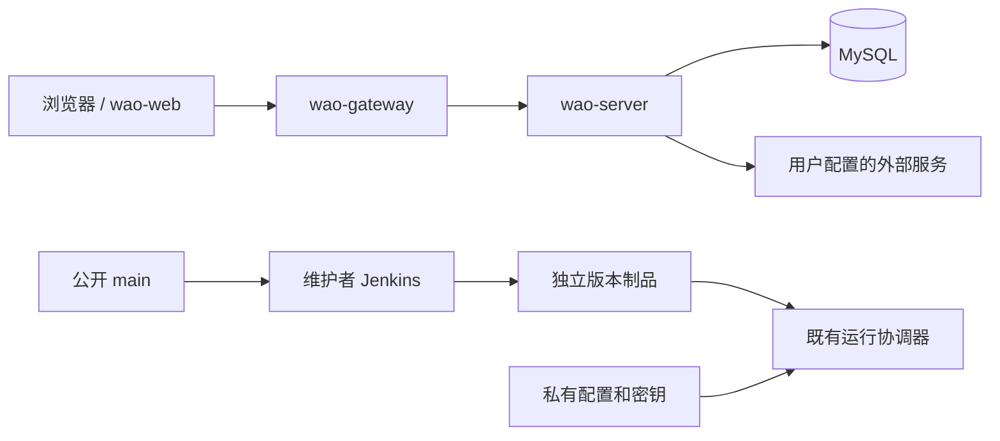

# 当前架构

Vue 3 浏览器界面通过 Spring Cloud Gateway 访问 Spring Boot 业务服务。MySQL 保存账号、任务、项目、文档、文件和共享状态，Flyway 管理结构版本；Redis 和 Nacos 按部署环境提供。

后端使用 Java 17、Spring Boot 3.2.4、MyBatis-Plus、Flyway；前端使用 Vue 3、Vite、TypeScript、Pinia、Vue Router、Ant Design Vue。接口以 `/api/` 为前缀，统一返回 `ApiResponse<T>`。

`wao-game` 提供浏览器放松和练习内容；`wao-cli` 使用用户自己的工作区令牌；`agent-server` / `agent-web` 是可选内容工作台。历史客户端源码保留，当前不构建或发布新客户端。

生产使用 Windows 原生服务和云端 HTTPS 入口。主机、私有路径、凭据和运行状态由服务器管理，旧 Linux 节点方案不再作为部署步骤。

数据库、加密密钥、上传内容和配置独立于 Git 工作目录。代码更新产生新制品，交给既有协调器，不移动或重建用户数据目录。原生产继续使用受保护的历史 migration 资源，保持既有校验和。

任务标签使用 V197 `task_labels(task_id,sub_id,revision,labels_json)` 独立存储，防止旧客户端全文保存丢失新属性。父子转换随原事务迁移关联。个人收集箱为空项目任务，按负责人隔离；前端工作台复用项目清单和详情编辑，象限规则通过成员偏好持久化。详见 [任务工作台规范](specs/task-workspace-labels-2026-10-29.md)。
