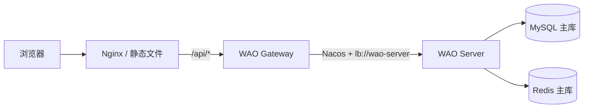

# WAO 架构基线

## 目标

Phase 0 建立一条最小但真实的纵向链路：Vue 页面请求 `/api/hello`，开发环境由 Vite 代理到 `:9000`，生产环境由 Nginx 代理到双节点 Gateway；Gateway 通过 Nacos 发现 `wao-server` 并返回统一 JSON。

## 组件与端口

| 组件           |      端口 | 部署位置                        |
| -------------- | --------: | ------------------------------- |
| Vue 开发服务器 |      5173 | 开发机                          |
| WAO Server     |      8080 | 主、从节点                      |
| WAO Gateway    |      9000 | 主、从节点                      |
| Nacos 2.4.3    | 8848/9848 | 主节点                          |
| MySQL 9        |      3306 | 主、从节点                      |
| Redis 7        |      6379 | 主、从节点                      |
| Redis Sentinel |     26379 | 三个节点                        |
| DDNS-Go        |      9876 | 主、从节点（仅 Tailscale 管理） |
| Nginx          |    80/443 | 云服务器                        |

## 请求链路

## 环境策略

- `dev`：使用本机 Docker 基础设施；Swagger 开启；Nacos 可关闭鉴权。
- `prod`：所有敏感值来自环境变量；Swagger 关闭；服务间通过 Tailscale 地址通信。
- 前端生产制品直接由云服务器 Nginx 托管，不运行 Node.js 进程。
- Windows Server 2025 不安装 Docker Desktop；从节点容器运行在 WSL2 Ubuntu 24.04 的 Docker Engine 中，Windows Tailscale 地址通过受限 `portproxy` 转发到 WSL。

## 版本决策

方案要求 Spring Boot 3 与 Nacos 2.x。Spring Cloud Alibaba 2025.x 已适配 Nacos 3.x，因此 Phase 0 使用官方兼容矩阵中的 Spring Boot 3.2.4、Spring Cloud 2023.0.1、Spring Cloud Alibaba 2023.0.1.0，并部署 Nacos 2.4.3。升级必须先新增 ADR 并完成兼容性验证。

## 安全边界

- Git 只保存 `.env.example`；真实值进入各服务器的私有 `.env` 或 GitHub Secrets。
- 云服务器只暴露 80/443/受限 SSH；Gateway 仅允许云服务器经私网访问。
- MySQL、Redis、Nacos 不暴露到公网。
- Redis 副本和三个 Sentinel 显式宣告各自的 Tailscale 地址，避免跨主机发现到容器内网地址。
