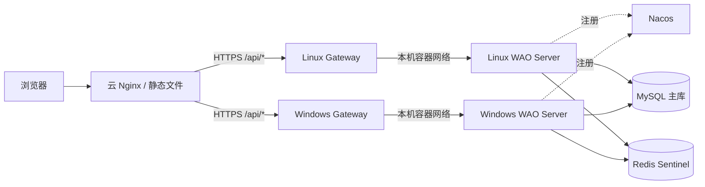

# WAO 架构基线

## 目标

Phase 0 建立一条最小但真实的纵向链路：Vue 页面请求 `/api/hello`，开发环境由 Vite 代理到 `:9000`，生产环境由云 Nginx 代理到双节点 Gateway；每个 Gateway 优先访问同机 `wao-server`，由云 Nginx 在节点层完成故障转移。两个应用实例仍注册到 Nacos，供注册状态、扩容和后续服务治理使用。

## 组件与端口

| 组件           |      端口 | 部署位置   |
| -------------- | --------: | ---------- |
| Vue 开发服务器 |      5173 | 开发机     |
| WAO Server     |      8080 | 主、从节点 |
| WAO Gateway    |      9000 | 主、从节点 |
| Nacos 2.4.3    | 8848/9848 | 主节点     |
| MySQL 9        |      3306 | 主、从节点 |
| Redis 7        |      6379 | 主、从节点 |
| Redis Sentinel |     26379 | 主、从节点 |
| DDNS-Go        |      9876 | 主、从节点 |
| Nginx          |    80/443 | 云服务器   |

## 请求链路

## 环境策略

- `dev`：使用本机 Docker 基础设施；Swagger 开启；Nacos 可关闭鉴权。
- `prod`：敏感值来自环境变量；Swagger 关闭；跨节点通过公网地址和 DDNS 域名通信。
- 前端生产制品直接由云 Nginx 托管，不运行 Node.js 进程。
- Windows 11 Pro 不安装 Docker Desktop；从节点容器运行在 WSL2 Ubuntu 24.04 的 Docker Engine 中，限制为 4 核/8GB，Windows `portproxy` 将公网端口转发到 WSL。原生计划任务以 `wage` 身份保持 WSL 在线，并在开机时恢复端口转发和容器服务。
- 主、从节点检测公网 IPv4 变化并刷新 Nacos 注册；云 Nginx 定期重载以重新解析 DDNS 上游。

## 版本决策

方案要求 Spring Boot 3 与 Nacos 2.x。Phase 0 使用 Spring Boot 3.2.4、Spring Cloud 2023.0.1、Spring Cloud Alibaba 2023.0.1.0 和 Nacos 2.4.3。升级必须先新增 ADR 并完成兼容性验证。

## 网络与凭据边界

- Git 只保存 `.env.example`；真实值进入各服务器私有 `deploy/.env` 或 GitHub Secrets。
- 根据 ADR-005，当前接受 SSH、Gateway、MySQL、Redis、Nacos、Sentinel 与 DDNS-Go 按路由器/安全组规则公网可达，不使用覆盖网络。
- 用户入口只开放 `https://wao.wayuwa.cn`；Gateway 回源使用 TLS，SSH 使用专用部署密钥与固定主机密钥校验。
- Redis 副本和两个 Sentinel 宣告公网可解析主机名，避免跨主机发现到容器内网地址。双 Sentinel 不承诺整机故障下的自动切换；可靠自动故障转移需要新增独立第三仲裁节点。
- 密码库按成员归属：`/api/vault/*` 一律只在当前登录成员自己的分组范围内工作，别人的分组按不存在处理（ADR-024）。
- Gateway 使用同机 `wao-server:8080`，避免服务发现结果依赖家庭路由器的 8080 回环；云 Nginx 的上游健康检查验证 `/api/hello` 全链路，而不只验证 Gateway 进程。
- 正式生产前必须重新评估端口白名单、数据库链路加密、SSH 防爆破和私网/VPN。
