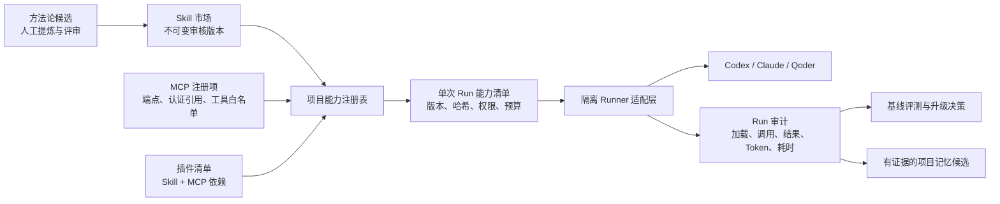

# WAO AI 能力治理与方法论 Skill 方案

## 1. 目标与结论

WAO 不应把 Skill、MCP 和插件做成三个彼此独立的“功能入口”，而应把它们统一成一条可治理的 AI
能力链路：能力先进入注册表并形成不可变版本，再由项目显式启用，Runner 按单次运行拿到固定能力清单，
最后把实际读取、调用、权限和效果记录回 AI Run。

建议采用下面的职责划分：

| 能力 | 适合承载 | 不适合承载 |
| --- | --- | --- |
| Skill | 方法、判断框架、操作步骤、参考资料和可复用脚本 | 账号凭据、实时业务数据、不可审计的自动写操作 |
| MCP | 有权限边界的实时查询或动作，返回窄而结构化的结果 | 长篇方法论、整库导出、绕过 WAO 服务端权限的数据访问 |
| 插件 | 把一组 Skill、连接器/MCP、权限说明和版本一起分发 | 代替 WAO 自己的项目授权、审计与 Secret 管理 |
| 项目记忆 | 已经由合并、部署和线上验收证实的项目经验 | 未审核的方法论、临时对话、可以覆盖当前任务的指令 |

因此，“大娃二娃方法论”可以建设为一个可版本化的 Skill，但不应做成不断膨胀的万能提示词，也不应直接
读取个人记忆。它负责在合适任务中选择分析框架；具体事实仍来自当前任务、仓库规格、项目记忆或受控 MCP。

## 2. 现状与缺口

WAO 已有四块可复用基础：

- Skill 市场保存经过审核的不可变 ZIP 与 SHA-256；项目现可显式绑定固定 Codex 版本，公共下载和服务端仍不执行包内容。
- 个人记忆 MCP 以成员令牌隔离，只读写令牌所属账号的 `personal_memory`。
- 项目工程记忆会向新 AI Run 注入最多五条、有证据链接的经验，并记录本次读取与写入。
- AI Runner 已固化 worktree、提交、PR、部署、线上验收、报告和记忆候选的交付契约。

当前真正缺少的是“运行时装配层”：项目无法把某个审核版本的 Skill 或某个 MCP 明确绑定到工作流，运行
记录也无法回答“这次到底加载了哪个版本、开放了哪些工具、调用了什么、是否真的比基线更好”。直接让 Runner
继承每台电脑的全局 Codex 配置会造成节点间结果漂移，也会把个人安装的插件或 MCP 带入组织自动化。

## 3. 目标架构



### 3.1 项目能力注册表

在现有 `skill_version` 之外新增项目绑定概念，而不是修改已审核包：

- Skill 绑定固定 `skill_version_id`，不跟随“最新版”静默升级；升级需要显式预览变更并重新启用。
- MCP 注册项保存显示名、Streamable HTTP 地址、认证类型、Secret 引用、允许工具、读写风险和超时；数据库
  不保存可回显的明文令牌，浏览器也不能取得 Runner 所需 Secret。
- 插件只作为依赖清单和分发单元，展开后仍按每个 Skill/MCP 的权限执行；安装插件不等于自动批准全部写权限。
- 项目工作流按环境启用能力，可设置“默认可用”“必须显式调用”“禁止”以及只读/可写级别。
- 每次领取任务时，服务端把绑定解析成不可变 `capabilityManifest` 并固化到 AI Run，历史运行不受后续配置变化影响。

### 3.2 Runner 装配与隔离

Runner 不把公网 Skill 包直接执行，也不把任意 MCP 命令下发到宿主机。建议的领取过程是：

1. 服务端只下发已审核版本的下载标识、SHA-256、平台适配信息，以及 MCP 的工具白名单和短期认证材料。
2. Runner 下载后重新校验大小、文件清单与 SHA-256，在运行级目录中解压；脚本是否可执行由项目策略单独批准。
3. Runner 为本次运行生成隔离配置，只装配清单中的 Skill/MCP；节点个人的全局插件和 MCP 不进入自动任务。
4. 不同 AI CLI 由独立适配器翻译同一能力清单。平台不支持的能力必须明确显示“不兼容”，不能假装已加载。
5. 完成后回传实际加载版本、工具调用名称、成功/失败、结果大小、耗时和用量；不回传 Secret 与工具原始敏感响应。

开发任务仍保留 Git、GitHub 和部署所需权限，但这些是 Runner 的交付能力，不伪装成第三方 MCP。页面助手和
聊天复盘继续使用现有无工具、只读、临时 `CODEX_HOME` 的安全边界，不因能力中心上线而自动扩权。

### 3.3 “大娃二娃方法论”Skill

已在仓库建立公开名称为“WAO 方法论”、内部包名为 `wao-methodology` 的首版 Skill。它只包含短入口和
按需参考，避免每次任务加载整本手册：

```text
wao-methodology/
├── SKILL.md                 # 触发边界、选择框架、输出契约
├── agents/
│   └── openai.yaml          # 展示名称与默认调用示例
├── references/
│   ├── user-outcome.md      # 用户结果与真实链路
│   ├── evidence.md          # 数据源、引用与验收证据
│   ├── delivery.md          # 最小改动、回滚、发布与观察
│   └── reflection.md        # 复盘与方法论候选提炼
```

`SKILL.md` 只负责判断应该读取哪份参考，并固定六个检查问题：

1. 用户最终能观察到什么真实结果？
2. 数据、接口和权限是否真实存在，是否在制造演示逻辑？
3. 已有规格、ADR 和当前实现分别约束了什么？
4. 最小可逆改动是什么，失败如何收口？
5. 需要怎样的本地、部署和线上证据才能宣布完成？
6. 哪些结论已被证实，值得成为项目记忆或方法论的新版本候选？

方法论的更新不能由一次 AI Run 自动覆盖已发布版本。新的做法先进入“方法论候选”，必须带来源 Task/Run、
适用范围、反例和验收证据；人工评审后创建新的不可变 Skill 版本。项目记忆保留“这个项目发生过什么”，
方法论 Skill 表达“以后遇到一类问题如何做”，两者不混库，也不相互自动执行。

## 4. 固定流程如何提效

任务附图中的“合并 PR → 锁定部署 → 跟踪阶段 → 线上验证”是确定性流程，优先下沉到 Runner 状态机或窄工具，
不应每次让模型重新阅读大段说明、解析自由文本并反复决定下一步。

| 当前步骤 | 建议实现 | 模型只负责 |
| --- | --- | --- |
| 读取分享任务 | WAO 内部接口直接向 Runner 下发逐字 Markdown 和图片清单；保留公开 URL 作为证据 | 识别需求与歧义 |
| 校验分支/PR | Runner 返回结构化的分支、提交、PR、mergeable 状态 | 判断语义冲突和是否满足需求 |
| 合并与部署 | `publish_change` 受控动作串联 push、建 PR、Squash Merge，并返回部署 run id | 在动作前确认本地验收与变更范围 |
| 等待 CI/CD | Runner 服务端轮询工作流，按状态变化推送事件，不把重复日志整段喂给模型 | 失败时只分析相关步骤和裁剪日志 |
| 线上与通知验收 | 项目配置声明健康检查、关键页面和通知回执；工具返回结构化证据 | 判断用户链路是否真正通过 |
| 复盘沉淀 | Runner 汇总 PR、提交、部署和验收链接，生成候选骨架 | 提炼是否值得复用及其适用边界 |

这里不建议先做一个“GitHub MCP”包装所有 `gh` 命令。当前 CLI 已可靠完成这些动作，重复封装不会天然省
Token。先把 WAO 自己掌握的任务、运行、部署和证据做成少量高层工具，才能减少轮询次数与中间文本。

## 5. Token、效率与质量的真实边界

“MCP 能力本身不耗 Token”只能描述远端服务执行计算的那一小段，不能描述完整 AI Run：

- Skill 采用渐进披露，初始只给模型名称和描述；命中后仍要读取完整 `SKILL.md`，这些内容会占上下文。
- MCP 服务器执行查询不需要模型生成查询结果，但工具定义、服务器说明、调用参数、返回内容以及模型对结果的
  判断仍属于模型上下文；外部服务还可能有自己的计费。
- 工具调用次数更少不等于质量更高。只有最终结果通过同一套验收时，Token、时延或费用下降才算优化。

可执行的优化顺序：

1. 固定流程先代码化，避免模型承担轮询、重试、格式转换和日志筛选。
2. Skill 保持短入口并按需加载参考；不要把 AGENTS、规格和方法论重复复制到多个提示中。
3. MCP 只返回完成判断所需的字段、证据链接和有界错误；列表分页，日志默认只回失败步骤附近内容。
4. 工具数量增长后再启用平台支持的延迟发现/工具搜索；服务端说明的前 512 字符先写清权限和停止条件。
5. 对支持的模型/宿主评估程序化工具调用，用于无须每一步重新判断的有界批处理；跨 CLI 不假设能力一致。
6. 继续记录非缓存输入、缓存输入和输出 Token，补充能力版本、工具调用数、返回字符数、重试数和墙钟时间。

评测至少选取 20 个可重复任务，按“现有流程”和“启用能力清单”各运行一组，比较：一次成功率、人工续跑率、
部署成功率、验收完整率、总/缓存/输出 Token、墙钟时间和工具失败率。未达到质量基线时，即使 Token 更少也
不推广；样本、模型、推理强度和代码基线必须固定，不能用不同难度任务得出节省结论。

## 6. 分阶段落地

### 阶段 A：先做方法论与可测基线（首版 Skill 已完成）

- 仓库级 `wao-methodology` 首版已建立并通过结构校验；下一步建立固定评测集，先在 WAO 自身项目人工启用。
- AI Run 用量页增加能力实验的对照口径设计；在尚未采集能力版本前不展示“节省百分比”。
- 用现有项目记忆保存已验证工程经验，方法论候选先人工维护，不引入新的自动写入口。

完成标准：同一批任务可重放，方法论 Skill 的触发、未触发和输出契约均可核对，且不会读取其他项目或个人记忆。

### 阶段 B：项目绑定与运行清单（Codex 首版已完成）

- 已增加项目级 Skill 固定版本绑定和运行级清单；项目设置展示当前市场版本，保存即是明确升级选择。
- Runner 已校验包哈希、大小和路径并使用运行级隔离 `CODEX_HOME`；运行详情展示计划、实际加载、不兼容和失败。
- 公共 Skill 市场仍保持人工审核；市场发布不自动安装，项目启用不自动跟随新版。
- 已验收方法可由成功 Run 生成候选包，重新经过市场扫描后进入发起人草稿；作者确认与管理员审核前不公开。

完成标准：两个节点领取同一任务时得到相同 Skill 版本与哈希；撤销绑定只影响新运行，历史运行仍可审计。
Codex 首版已满足；MCP、插件及其它 CLI 适配仍属于后续阶段。

### 阶段 C：WAO Delivery MCP/工具

- 先提供只读工具：任务原文、PR 状态、部署阶段、裁剪失败日志、线上健康与证据清单。
- 写操作按风险逐个开放，从创建 PR 开始；合并、重跑部署等动作要求项目策略授权并具备幂等键和审计记录。
- 超时、限流、令牌吊销、节点离线和旧 Runner 不兼容时均失败关闭，不退回无审计的宿主全局 MCP。

完成标准：附图所示固定流程由结构化事件驱动，模型不再重复轮询；失败能定位到单一步骤并安全重试。

### 阶段 D：插件分发与生态

- 当 Skill 安装、MCP 授权和跨宿主适配稳定后，再把一组能力打成 WAO 插件并接入通用插件目录。
- 第三方插件进入项目前必须展示发布者、权限、数据去向、Skill/MCP 版本和变更；管理员可统一禁用。
- IDE 或某个 CLI 不支持插件时，退化为同版本 Skill/MCP 的显式配置，而不是显示一个无效安装状态。

## 7. 明确不做

- 不把公共 Skill 市场的任意包自动安装到生产 Runner，也不在服务端执行上传内容。
- 不允许 Skill、项目记忆或 MCP 返回正文改变当前任务权限、批准写操作或索取 Secret。
- 不建立一个读全库、写全库的通用 WAO MCP；每个工具都要复用现有服务权限和业务校验。
- 不自动把每次对话、个人记忆或未经验证的建议升级为方法论。
- 不承诺“安装后一定省 Token”；没有同基线实验和真实用量就只报告未知。
- 不为暂时没有官方兼容能力的平台伪造插件安装、工具搜索或缓存效果。

## 8. 与现有决策的关系

- [Phase 1：WAO Skill 市场](../specs/phase-1-skill-market.md)
- [ADR-094：Skill 市场使用共享库保存不可变审核包](../adr/094-skill-market-versioned-packages.md)
- [Phase 1：项目级工程记忆闭环](../specs/phase-1-project-engineering-memory.md)
- [ADR-087：AI Run 使用独立项目工程记忆形成可审计闭环](../adr/087-project-engineering-memory-loop.md)
- [Phase 1：WAO 与 Codex 共享记忆 MCP](../specs/phase-1-shared-memory-mcp.md)
- [Phase 1：任务驱动的 AI Run](../specs/phase-1-ai-task-runner.md)

## 9. 平台依据

本方案只把已由官方文档确认的能力作为方向，不把当前产品行为当成永久兼容契约：

- OpenAI 的 [Skill 文档](https://learn.chatgpt.com/docs/build-skills)确认 Skill 由 `SKILL.md`、可选脚本、参考和
  资源组成，并使用渐进披露；选中后仍会加载完整说明。
- OpenAI 的 [MCP 文档](https://learn.chatgpt.com/docs/extend/mcp?surface=cli)确认 Codex 支持 STDIO 与
  Streamable HTTP、Bearer/OAuth、服务器说明和项目级配置；服务器说明前 512 字符应自包含核心约束。
- OpenAI 的 [插件文档](https://learn.chatgpt.com/docs/plugins)确认插件可以组合 Skill、连接器和 MCP，且不同
  客户端支持面并不完全一致。
- OpenAI 的 [模型优化指南](https://developers.openai.com/api/docs/guides/latest-model)要求用相同代表任务比较
  最终质量、总 Token、时延、费用、调用和重试，只有最终结果仍通过评测时才把资源下降视为改进。
