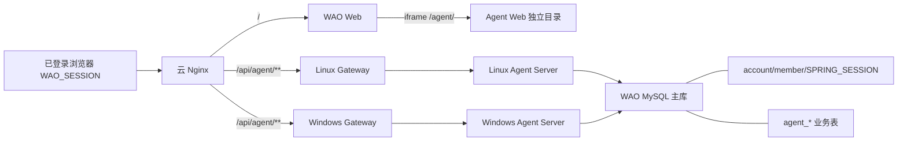

# 自媒体自动化 Agent 技术架构

决策以 [ADR-038](../adr/038-media-agent-shared-session-and-same-origin.md) 为准。ADR-037 的独立仓库目标继续保留，但独立域名、一次性 SSO、独立用户库与 Python Worker 已被取代。

## 系统边界

`wayuwacn/wao-agent` 是独立产品仓库和独立发布单元。首版由 `agent-web` 与一个模块化 Spring Boot `agent-server` 组成，前后端分离；WAO 只承载菜单、页签、同域 iframe、Nginx 路径和 Gateway 路由。

## URL 与路由

| 入口 | 归属 | 行为 |
| --- | --- | --- |
| `/media-agent` | WAO Web | 受登录保护的菜单和页签壳 |
| `/agent/` | Agent Web | 云节点独立静态目录，支持新窗口 |
| `/api/agent/**` | Agent Server | 在 `/api/**` 通用规则前分流 |
| `/api/agent/health` | Agent Server | 无会话部署探针 |

## 身份契约

- Cookie：`WAO_SESSION`，Secure、HttpOnly、SameSite=Lax、Path=/。
- Session 存储：主 MySQL 的 `SPRING_SESSION` 与 `SPRING_SESSION_ATTRIBUTES`。
- 当前账号属性：`wao.accountId`。
- 账号资料：Agent 只读 `account.id/status/member_id` 与 `member.name/initial`。
- 授权：accountId、workspaceId 和 role 只能由服务端推导，浏览器传值不作为鉴权依据。

WAO 修改以上名称或序列化方式时，必须先提供兼容窗口。Agent 生产 profile 不允许本地 Demo 身份补位。

## 数据与迁移

Agent 与 WAO 共用 `wao` schema，以便直接恢复 Session 和账号；Agent 业务表统一使用 `agent_` 前缀。Agent Flyway 历史表为 `flyway_agent_schema_history`，其版本只在 Agent 仓库内递增。WAO 和 Agent 的已执行 migration 都不可修改。

首版表包括 `agent_workspace`、`agent_workspace_member`、`agent_content_draft`、`agent_run`。草稿使用 version 乐观锁；运行状态和结果持久化，应用重启后可继续推进。

## 部署独立性

- Linux 主节点：Agent Compose 加入外部网络 `wao-master`，连接同网的 MySQL 主库。
- Windows/WSL2 从节点：Agent Compose 加入 `wao-slave`，按现有 WAO 配置连接主库。
- 云前端节点：Agent workflow 只替换 `/var/www/wao-agent/dist`；WAO workflow 只替换 `/var/www/wao/dist`。
- 两套 GitHub Actions 分开触发。Agent 发布不重启 `wao-server` 或 `wao-gateway`。

## 演进原则

首版不拆微服务。只有执行任务需要独立资源池、API 与 Worker 发布节奏明显分离、平台回调必须处于独立安全域或队列吞吐达到单进程瓶颈时，才引入消息队列和独立 Worker。平台无正式接口或真实授权时只能显示 Demo 或导出，不伪造发布结果。
