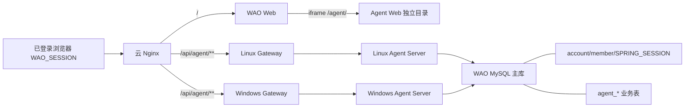

# 自媒体自动化 Agent 技术架构

身份契约延续 [ADR-038](../adr/038-media-agent-shared-session-and-same-origin.md)，当前仓库与发布边界以 [ADR-049](../adr/049-unified-product-monorepo-delivery.md) 为准，菜单接入见 [ADR-039](../adr/039-external-app-menu-registry.md)。

## 系统边界

`agent-web` 与模块化 Spring Boot `agent-server` 已进入 WAO 主仓库。浏览体验仍通过同域 iframe 隔离，Agent Server 仍是独立进程，但它们与 WAO 主站由同一提交、同一条 main CD 一起构建、部署和回滚。

## URL 与路由

| 入口 | 归属 | 行为 |
| --- | --- | --- |
| `/apps/:appId` | WAO Web | 注册表驱动的受登录保护菜单、页签和通用 iframe 壳 |
| `/media-agent` | WAO Web | 兼容旧链接，重定向到 `/apps/media-agent` |
| `/agent/` | Agent Web | 云节点独立静态目录，支持新窗口 |
| `/api/agent/**` | Agent Server | 在 `/api/**` 通用规则前分流 |
| `/api/agent/health` | Agent Server | 无会话部署探针 |
| `/api/agent/videos/**` | Linux Agent Server | 固定走 VPN 主节点，生成、持久化并鉴权播放视频 |

## 外部应用注册表

WAO 从 `system_setting.navigation.external-apps` 读取版本化注册表。`media-agent` 的默认记录指向 `/agent/` 与 `/api/agent/health`；首次读取时会继承旧 `navigation.media-agent.*` 菜单字段。以后新增独立应用只需在“系统设置 → 菜单配置”注册稳定标识、展示字段和入口地址，WAO 不再为每个应用新增组件或路由。

注册表只负责壳层发现与展示。新应用的静态目录、Gateway/Nginx 分流、服务发现和 Session 兼容仍必须按该应用的架构方案实施；是否拆分发布必须另有 ADR，不能由“外部应用”名称自动推导。

## 身份契约

- Cookie：`WAO_SESSION`，Secure、HttpOnly、SameSite=Lax、Path=/。
- Session 存储：主 MySQL 的 `SPRING_SESSION` 与 `SPRING_SESSION_ATTRIBUTES`。
- 当前账号属性：`wao.accountId`。
- 账号资料：Agent 只读 `account.id/status/member_id` 与 `member.name/initial`。
- 授权：accountId、workspaceId 和 role 只能由服务端推导，浏览器传值不作为鉴权依据。

WAO 修改以上名称或序列化方式时，必须先提供兼容窗口。Agent 生产 profile 不允许本地 Demo 身份补位。

## 数据与迁移

Agent 与 WAO 共用 `wao` schema，以便直接恢复 Session 和账号；Agent 业务表统一使用 `agent_` 前缀。Agent Flyway 历史表为 `flyway_agent_schema_history`，其版本只在 `agent-server` 模块内递增。WAO 和 Agent 的已执行 migration 都不可修改。

首版表包括 `agent_workspace`、`agent_workspace_member`、`agent_content_draft`、`agent_run`。草稿使用 version 乐观锁；运行状态和结果持久化，应用重启后可继续推进。

视频生成任务使用 `agent_video_generation`。它只保存提示词、上游任务标识、状态、进度与完成后的
`agent_media_asset` 标识，不保存 API Key 或临时下载地址。由于媒体卷不跨节点共享，Nginx 按
[ADR-073](../adr/073-openai-video-generation-sunset-adapter.md) 把全部视频接口固定到 Linux 主节点。

## 统一部署与运行隔离

- Linux 主节点与 Windows/WSL2 从节点：WAO Compose 同时管理 `wao-server`、`wao-agent-server` 与 `wao-gateway`，Agent 媒体继续使用节点本地持久卷。
- 云前端节点：同一 workflow 分别替换 `/var/www/wao/dist` 和 `/var/www/wao-agent/dist`，路径保持不变。
- Agent 与主服务分别做健康检查、使用独立进程；发布失败时同一批镜像整体回滚，避免前后端契约错版。

## 演进原则

首版不拆微服务。只有执行任务需要独立资源池、平台回调必须处于独立安全域或队列吞吐达到单进程瓶颈时，才引入消息队列和独立 Worker。平台无正式接口或真实授权时只能明确标为不可发布或提供导出，不伪造发布结果；模拟运行和演示工作台不进入生产入口。
