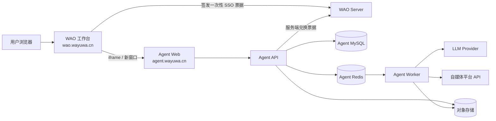
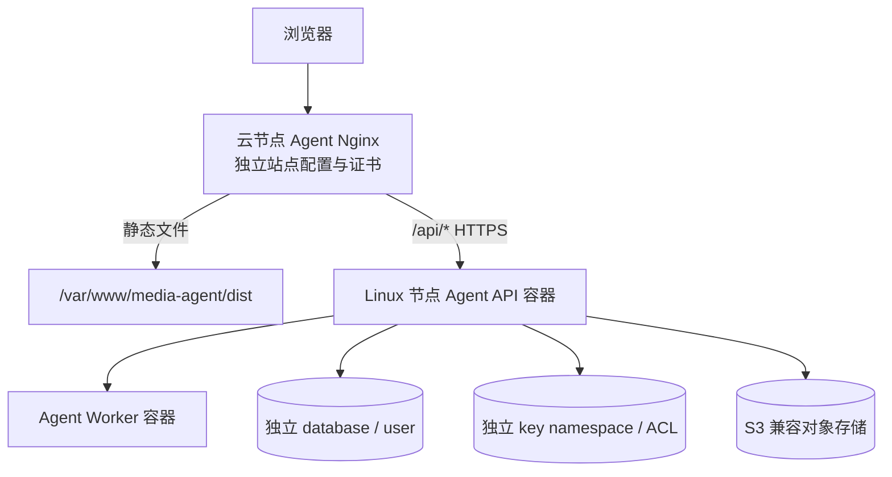
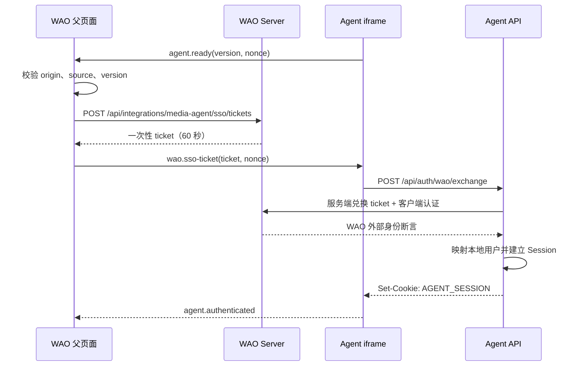

# 自媒体自动化 Agent 技术架构方案

## 1. 方案摘要

自媒体自动化 Agent 是一个独立产品域，默认仓库名 `wao-media-agent`，生产入口为
`https://agent.wayuwa.cn`。WAO 只承担工作台入口和身份签发；Agent 自己承担页面、业务 API、异步执行、
媒体资产、平台连接、发布记录和效果数据。

目标不是把新页面远程加载进 WAO 的 Vue 运行时，而是在 WAO 页签中嵌入一个有清晰安全边界的完整应用。
Agent 每次发版只运行自己的流水线，不重新构建或部署 `wao-web`、`wao-server` 与 `wao-gateway`。

## 2. 设计目标与非目标

### 设计目标

- 发布独立：两个仓库有独立版本、制品、回滚和发布窗口。
- 故障隔离：Agent 页面、Worker、模型或平台故障不影响 WAO 核心页面与 API。
- 体验统一：用户从 WAO 菜单和顶部页签进入，不重复输入账号密码，并可在新窗口继续。
- 数据真实：所有账号、草稿、运行、发布和指标来自持久化数据或平台真实响应。
- 流程可恢复：模型超时、平台限流、Worker 重启和网络抖动不会丢稿或重复发布。
- 集成收敛：WAO 与 Agent 只通过版本化接口和受控浏览器消息通信。

### 非目标

- 不把 Agent 拆成大量微服务。
- 不让 Agent 直接依赖 WAO 表结构、Session 存储或前端组件源码。
- 不在首版承诺所有平台和所有内容形态。
- 不让未经人工确认的生成内容默认自动公开发布。

## 3. 系统上下文



## 4. 部署拓扑

### 4.1 首版



- `agent.wayuwa.cn` 使用独立 Nginx server block、TLS 证书、静态目录和上游，不修改 WAO 的根目录或
  `/api/` upstream。
- 首版 API 与 Worker 部署在具备稳定网络出口的 Linux 节点。流水线只重启 Agent 容器，不重启 WAO 容器。
- 初期可复用现有 MySQL/Redis 物理集群，但必须使用独立 database、数据库用户、Flyway 历史表、Redis ACL
  与 key 前缀；容量或故障域需要扩大时再迁移到独立实例。
- 媒体正文不进入 Git、容器文件系统或 MySQL Blob。使用 S3 兼容对象存储，数据库只保存对象 key、哈希、
  MIME、大小、归属和生命周期状态。

### 4.2 后续高可用

- Agent API 可增加第二实例，由 Agent Nginx upstream 独立负载均衡。
- Worker 按队列积压和平台并发限制水平扩展；调度器使用租约确保同一计划只产生一次任务。
- 对象存储和数据库备份独立验证，不搭便车依赖 WAO 的恢复演练。

## 5. 技术选型

| 层次 | 首版选型 | 原因 |
| --- | --- | --- |
| 前端 | Vue 3、Vite、TypeScript、Ant Design Vue、Pinia、Vue Router 4 | 与 WAO 操作体验接近，但不共享运行时依赖 |
| API / 控制面 | Java 17、Spring Boot 3、MyBatis-Plus、Flyway | 复用现有工程与运维经验，承载事务和权限边界 |
| Agent Worker | Python 3.12 | 适合模型 SDK、媒体处理与平台适配；通过队列与 API 解耦 |
| 主数据 | MySQL 9 | 保存用户、内容版本、工作流、运行、发布与审计 |
| 队列 / 短状态 | Redis 7 Streams | 支持消费者组、重领和低复杂度的首版异步执行 |
| 媒体资产 | S3 兼容对象存储 | 避免大文件进入数据库和部署节点本地盘 |
| 进度推送 | HTTP SSE | 单向进度足够，断线重连简单；首版不引入 WebSocket |
| 部署 | Docker Compose、Nginx、GitHub Actions | 与当前环境一致，但使用独立流水线与目录 |

新仓库独立维护技术基线；升级 Agent 依赖不要求同步升级 WAO，改变上述核心选型时在 Agent 仓库新增 ADR。

## 6. 仓库结构

```text
wao-media-agent/
├── agent-web/                 # Vue SPA
├── agent-server/              # Java API、调度器、SSO、本地权限
├── agent-worker/              # Python Agent、平台适配、媒体处理
├── deploy/                    # Compose、Nginx 模板、部署与恢复脚本
├── docs/
│   ├── specs/
│   ├── adr/
│   ├── api/
│   └── runbooks/
├── .github/workflows/         # Agent 独立 CI/CD
├── AGENTS.md
└── README.md
```

三个代码目录可以在同一 Agent 仓库原子演进，但每个组件生成独立制品。首版不再拆仓，避免一次需求跨多个 PR。

## 7. WAO 接入边界

WAO 只新增以下能力：

1. `ModuleId`、菜单配置和 `/media-agent` 路由。
2. `MediaAgentFrameView`：加载、超时、重试、独立打开、响应式布局和 iframe 生命周期。
3. `POST /api/integrations/media-agent/sso/tickets`：基于当前 WAO Session 创建一次性票据。
4. `POST /api/integrations/media-agent/sso/exchange`：仅供登记过的 Agent 后端兑换票据。
5. Nginx / CSP 允许 `frame-src https://agent.wayuwa.cn`；Agent 响应使用
   `Content-Security-Policy: frame-ancestors https://wao.wayuwa.cn`，不能设置阻止跨源父页面的
   `X-Frame-Options: SAMEORIGIN`。

WAO 不代理 Agent 静态资源和业务 API，也不把 Agent 地址编译成构建产物之外的共享包。生产地址通过
WAO 可部署配置读取，开发环境可指向本地 Agent 地址。

## 8. 身份与 SSO

### 8.1 iframe 握手



票据不进入 query string、localStorage 或日志。新窗口由 WAO 用 `window.open` 创建并执行相同握手；用户直接
访问 Agent 且没有 Session 时，页面引导返回 WAO 入口，不另建一套密码登录。

### 8.2 票据约束

- 使用至少 256 bit 安全随机值，WAO Redis 只保存摘要。
- 有效期 60 秒，使用原子读取并删除保证只能兑换一次。
- 绑定 `clientId`、WAO `accountId`、iframe 握手随机数和允许的 Agent origin。
- Agent 后端使用独立客户端凭据认证兑换请求；凭据只存在部署 Secret。
- 断言至少包含稳定 `subject`、显示名称、签发时间与票据 id，不把 WAO 管理员角色直接映射为 Agent 管理员。
- Agent 表 `agent_user.wao_subject` 建唯一索引；应用内角色由 Agent 工作区成员关系决定。
- Agent Session 采用短空闲期和绝对过期时间。发布等敏感操作要求最近完成身份确认；WAO 无法确认身份时拒绝
  新的敏感操作，但查看已保存草稿可按 Agent 自身降级策略继续。

### 8.3 浏览器消息协议

首版消息使用 `version: 1`，只允许以下类型：

- `agent.ready`：Agent 已加载并携带握手随机数。
- `wao.sso-ticket`：WAO 返回的一次性票据。
- `agent.authenticated`：Agent 已建立本地会话。
- `agent.navigate`：Agent 通知当前内部路径，供打开新窗口时恢复。
- `wao.logout`：WAO 主动要求当前 iframe 清除 Agent Session。

双方必须用精确 origin 调用和校验 `postMessage`，不能使用 `*`。消息 payload 使用运行时 schema 校验，未知
版本或类型直接忽略。长期令牌、平台凭据、草稿正文不通过该通道传递。

### 8.4 SSO 最小契约

WAO 创建票据时由浏览器调用，`accountId` 必须从服务端 Session 解析，不能出现在请求字段中：

```json
POST /api/integrations/media-agent/sso/tickets
{
  "clientId": "media-agent",
  "origin": "https://agent.wayuwa.cn",
  "nonce": "<本次握手随机数>",
  "protocolVersion": 1
}
```

响应继续使用 WAO 的 `ApiResponse<T>`，其中 `data` 只包含一次性 `ticket` 和 `expiresInSeconds`。父页面把
ticket 通过 `postMessage` 交给 iframe，Agent Web 立即 POST 到自己的 `/api/auth/wao/exchange`，不得缓存。

Agent API 再携带独立客户端认证向 WAO 发起服务端兑换：

```json
POST /api/integrations/media-agent/sso/exchange
{
  "clientId": "media-agent",
  "ticket": "<一次性票据>",
  "nonce": "<本次握手随机数>"
}
```

WAO 成功响应的 `data` 只提供 `subject`、`displayName`、`issuedAt`、`expiresAt` 与 `ticketId`。Agent 以
`subject` 查找本地用户，在同一事务内创建映射和默认工作区成员关系，再轮换 Agent Session id。失败统一返回
不可区分账号是否存在的认证错误；服务端日志只记录 `ticketId` 和失败类别。

### 8.5 配置边界

| 应用 | 配置名示例 | 是否 Secret | 用途 |
| --- | --- | --- | --- |
| WAO Web | `VITE_MEDIA_AGENT_ORIGIN` | 否 | iframe 与消息来源白名单 |
| WAO Server | `MEDIA_AGENT_SSO_CLIENT_ID` | 否 | 登记目标应用 |
| WAO Server | `MEDIA_AGENT_SSO_CLIENT_SECRET_HASH` | 是 | 校验 Agent 服务端兑换身份 |
| Agent Web | `VITE_WAO_ORIGIN` | 否 | 父页面来源白名单 |
| Agent Server | `WAO_BASE_URL`、`WAO_SSO_CLIENT_ID` | 否 | 服务端兑换地址与客户端标识 |
| Agent Server | `WAO_SSO_CLIENT_SECRET` | 是 | 兑换票据的客户端认证 |
| Agent Server / Worker | 数据库、Redis、对象存储、平台和模型凭据 | 是 | 独立运行时依赖 |

客户端 Secret 只进入两个仓库各自的部署 Secret，不进入前端环境变量、Compose 文件、终端输出或提交信息。

## 9. Agent 应用组件

### 9.1 前端

- 工作区与成员：切换工作区、应用内角色和审计入口。
- 连接中心：管理平台 OAuth、模型供应商和连接检测。
- 内容工作台：选题、素材、提纲、正文、平台变体、版本对比和自动保存。
- 自动化流程：输入、步骤、审核点、目标平台和计划时间。
- 运行中心：队列、步骤进度、失败原因、取消、重试和成本摘要。
- 发布中心：逐平台状态、远端内容标识、失败重试和效果快照。

### 9.2 Java API / 控制面

- Auth：WAO SSO 兑换、本地 Session、CSRF 与权限。
- Workspace：工作区、成员、角色和配额。
- Content：选题、素材元数据、内容与不可变版本。
- Workflow：流程定义、审核点和运行快照。
- Scheduler：计划触发、租约和 outbox 投递。
- Publication：发布意图、幂等键、逐平台结果和人工确认。
- Connection：平台授权、加密凭据和连接健康状态。
- Audit：敏感操作、授权变化、发布和重试审计。

### 9.3 Python Worker

- 从 Redis Streams 消费任务，按 `runId + stepId + attempt` 幂等执行。
- 通过 LLM Provider Adapter 调用模型，不在业务流程中硬编码供应商。
- 通过 Platform Adapter 处理授权刷新、格式转换、上传、发布、状态查询和指标拉取。
- 媒体处理放在受限临时目录；成功上传对象存储后清理，失败任务按保留策略回收。
- 只回传结构化进度、产物引用、公开错误和用量，不上传密钥、完整请求头或供应商原始凭据。

## 10. 核心数据模型

| 表 | 作用 | 关键约束 |
| --- | --- | --- |
| `agent_user` | WAO 外部身份到本地用户映射 | `wao_subject` 唯一 |
| `workspace` / `workspace_member` | Agent 数据与角色边界 | 成员关系唯一，服务端鉴权 |
| `platform_connection` | 平台账号和加密授权 | 明文不进入查询 DTO |
| `media_asset` | 对象存储元数据 | workspace、hash、object_key 可追踪 |
| `topic` | 选题与输入上下文 | 支持草稿状态 |
| `content_item` / `content_version` | 内容实体与不可变版本 | 当前版本使用乐观锁切换 |
| `workflow_definition` | 流程模板 | 修改产生新版本 |
| `agent_run` / `agent_step_run` | 一次执行及步骤尝试 | 状态机与重试次数持久化 |
| `review_request` | 人工审核 | 决策人、意见与时间可审计 |
| `publish_plan` / `publication` | 计划与逐平台发布 | 幂等键唯一、远端 id 唯一 |
| `metric_snapshot` | 平台真实效果快照 | 带来源和抓取时间 |
| `outbox_event` | 事务内可靠投递 | 已发送时间与重试信息 |
| `audit_log` | 安全与关键业务审计 | 只追加，不保存 Secret |

内容保存使用乐观锁版本号：客户端更新必须携带读取到的版本，冲突返回最新版本并提示合并，定时同步不得覆盖
尚未落库的本地输入。

## 11. API 边界

Agent API 均位于 `https://agent.wayuwa.cn/api/`：

- `/api/auth/*`：SSO 交换、Session 和退出。
- `/api/workspaces/*`：工作区、成员和角色。
- `/api/connections/*`：平台与模型连接。
- `/api/assets/*`：上传凭证、确认和元数据。
- `/api/topics/*`、`/api/content/*`：选题、草稿与版本。
- `/api/workflows/*`、`/api/runs/*`：流程、运行、取消、重试和 SSE。
- `/api/reviews/*`：审核、驳回和批准。
- `/api/publications/*`：计划、发布、重试和真实结果。
- `/api/metrics/*`：平台指标快照。
- `/api/webhooks/{platform}`：平台回调；独立校验签名、时间窗和重放。

公开契约用 OpenAPI 3.0 管理。破坏性变更使用 `/api/v2/` 或兼容窗口；WAO 集成接口同样带版本并在两个仓库
分别保存契约测试样例。

## 12. 可靠执行与发布幂等

1. API 在同一个 MySQL 事务中写 `agent_run` 与 `outbox_event`。
2. Publisher 把 outbox 事件写入 Redis Stream，成功后标记发送时间。
3. Worker 使用消费者组领取；开始步骤前以唯一键创建或锁定 `agent_step_run`。
4. 心跳和租约超时后其他 Worker 可以重领，但先检查步骤持久化结果。
5. 发布步骤以 `workspaceId + contentVersionId + platformConnectionId + publishIntentId` 生成幂等键。
6. 平台支持幂等键时传给平台；不支持时保存远端请求标识，并在超时后先查询远端状态。
7. 每个平台单独落结果，汇总状态允许部分成功；重试只选择未确认成功的平台。

Redis 丢失不能丢业务事实：未投递 outbox 可重新扫描，运行与发布最终状态以 MySQL 为准。

## 13. 安全设计

- 浏览器：严格 CSP、CSRF Token、输出转义、上传类型与大小校验、禁止把票据和 Token 放入 URL。
- 服务端：最小权限数据库用户、对象存储前缀隔离、平台凭据使用信封加密、密钥轮换保留版本号。
- Worker：无入站公网端口；平台访问设置超时、域名 allowlist、响应大小上限和并发限制。
- Webhook：验证平台签名、时间戳和事件 id，重复事件幂等处理。
- 审计：连接新增/删除、角色变化、审核、发布、取消和强制重试均记录操作者与结果。
- 数据删除：先软删除并停止调度，再异步清理对象；工作区删除提供可审计的保留期。
- 日志：票据、Cookie、Authorization、平台 Token、API Key、完整提示中的敏感字段统一脱敏。

## 14. 可观测性与告警

- 每个浏览器请求、运行、步骤和发布意图使用可关联的 `requestId`、`runId`、`stepId`、`publicationId`。
- 指标至少覆盖 API 延迟/错误率、队列深度、Worker 心跳、步骤耗时、模型失败率、平台限流、发布成功率和
  outbox 积压。
- 健康检查拆分：`/actuator/health/liveness` 只看进程，`readiness` 检查数据库、Redis 和必要配置；外部模型或
  平台故障不应让 API 进程被循环重启。
- 告警按故障域发送：Agent 告警不冒充 WAO 全站故障，发布失败必须带工作区、平台、运行链接和脱敏错误。

## 15. 独立 CI/CD

### Pull Request

- 前端执行类型检查、单元测试和构建。
- Java 执行单元/集成测试、Flyway migration 唯一性测试和打包。
- Python 执行格式、类型、单元测试与依赖安全检查。
- 构建三个制品但不部署生产；接口契约测试验证 SSO 和 Worker 消息 schema。

### main 发布

1. 生成不可变版本号并构建 `agent-web`、`agent-server`、`agent-worker`。
2. 备份数据库并执行 Agent 自己的 Flyway migration。
3. 先更新 API/Worker，健康后原子替换 Agent 静态目录。
4. 执行登录握手、创建草稿、队列运行和对象存储读写的 smoke test。
5. 失败只回滚 Agent 制品；已执行 migration 按向前兼容原则处理，不修改历史 migration。
6. 通知明确标记为“自媒体 Agent 发布”，不触发 WAO 的主站部署工作流。

## 16. 容量与演进原则

- 首版限制单工作区并发、单任务素材大小、模型调用次数和平台发布速率，页面展示真实限额。
- 队列积压成为瓶颈时先扩 Worker；API 读写成为瓶颈时再增加实例，不提前拆微服务。
- Redis Streams 无法满足延迟队列、跨区域或长期积压后，再以 ADR 评估 RabbitMQ/Kafka，不在首版同时维护两套。
- Agent 需要深度融入 WAO 全局搜索、通知或任务联动时，新增版本化 API/事件；不能以“同一台 MySQL”为理由跨库。
