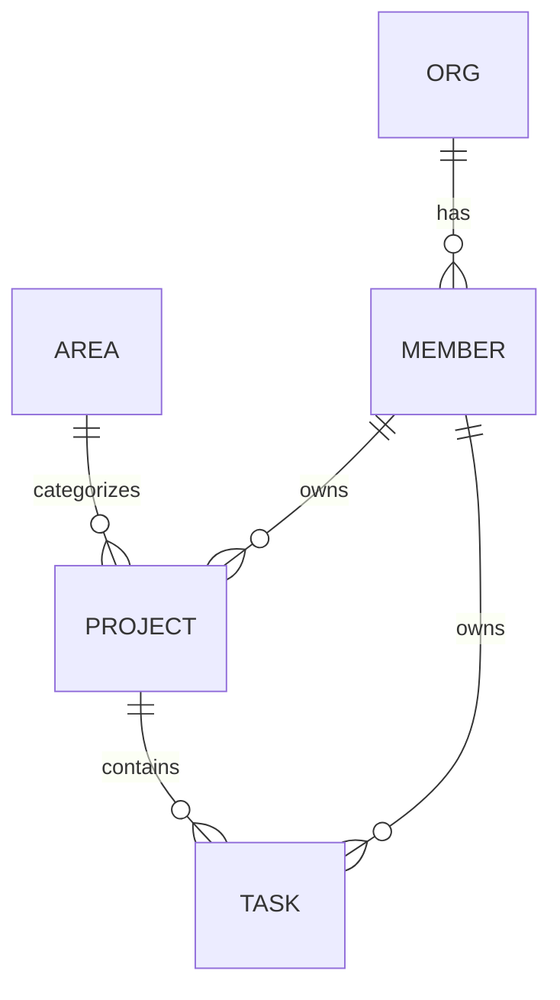

# WAO 数据模型 · 核心域（Phase 1）

来源：`init-design/WAO 架构图与ER图.dc.html` 与前端 `wao-web/src/types/domain.ts`。本轮落地 **组织 / 成员 / 领域 / 项目 / 任务** 五张核心表；知识库、文档、自动化、文件、图床、密码库、日历等域沿用相同模式在后续迭代补充（前端此前已实现，暂以 fixtures 兜底）。

## 设计取舍：关系列 + JSON 文档（混合）

项目与任务是聚合根，含大量可变长嵌套结构（里程碑、趋势、阻塞、动态、步骤、子任务、评论、自定义属性…）。本轮采取**混合建模**：

- **可查询字段**（状态、领域、负责人、截止、进度、优先级、所属项目）落成真实列，支持筛选 / 排序 / 关联查询；
- **富嵌套结构**存入 `detail_json`（MySQL `JSON`），由 Service 用 Jackson 组装为与前端一致的 DTO。

完全规范化（milestone / activity / comment 独立表）留待后续 ADR，一次性拆表会显著增加本轮体量而不改变对外契约。对外 REST 契约（`ApiResponse<ProjectDto>` 等）与最终规范化结果保持稳定。

## ER 概览

## 表与字段字典

### org（组织）
| 列 | 类型 | 说明 |
|---|---|---|
| id | VARCHAR(32) PK | 组织 id |
| name | VARCHAR(128) | 组织名 |
| member_count | INT | 成员数（冗余，展示用） |

### member（成员）
| 列 | 类型 | 说明 |
|---|---|---|
| id | VARCHAR(32) PK | 成员 id |
| name | VARCHAR(64) | 昵称 |
| initial | VARCHAR(4) | 头像首字 |
| color | CHAR(7) | 头像色 #RRGGBB |
| role | VARCHAR(32) | 管理员 / 成员 |

### area（人生领域）
| 列 | 类型 | 说明 |
|---|---|---|
| id | VARCHAR(32) PK | 领域 id（career/health/…） |
| name | VARCHAR(32) | 领域名 |
| color | CHAR(7) | 领域色 |

### project（项目）
| 列 | 类型 | 说明 |
|---|---|---|
| id | VARCHAR(32) PK | 项目 id |
| name | VARCHAR(128) | 名称 |
| area | VARCHAR(32) FK→area | 所属领域 |
| status | VARCHAR(16) | 进行中/有风险/规划中/已完成 |
| health | VARCHAR(16) | 良好/需要关注/风险 |
| progress | INT | 0–100 |
| owner_id | VARCHAR(32) FK→member | 负责人 |
| start_date | VARCHAR(16) | 开始（ISO） |
| due_date | VARCHAR(16) | 截止（ISO） |
| visibility | VARCHAR(64) | 可见范围文案 |
| updated_label | VARCHAR(32) | “26 分钟前”等展示文案 |
| goal | VARCHAR(512) | 一句话目标 |
| detail_json | JSON | members[], milestones[], msDates[], trend[], blockers[], docs[], files[], activity[] |

### task（任务）
| 列 | 类型 | 说明 |
|---|---|---|
| id | VARCHAR(32) PK | 任务 id |
| title | VARCHAR(256) | 标题 |
| project_id | VARCHAR(32) FK→project | 所属项目 |
| status | VARCHAR(16) | 待办/进行中/阻塞/已完成 |
| pr | CHAR(2) | P0–P3 |
| owner_id | VARCHAR(32) FK→member | 负责人 |
| start_date | VARCHAR(16) NULL | 开始 |
| due_date | VARCHAR(16) | 截止 |
| waiting | VARCHAR(64) NULL | 等待他人标记 |
| description | TEXT | 描述 |
| detail_json | JSON | parts[], steps[], subs[], files[], docs[], linkTasks[], comments[], custom[], activity[] |

## 迁移
- `V1__core_schema.sql` 建表。
- `V2__seed_demo.sql` 灌入演示数据（娃哥/娃弟、5 领域、6 项目、14 任务），与前端 fixtures 一致。
- 已执行的 migration 不可修改；后续变更新增 `V3__...`。
