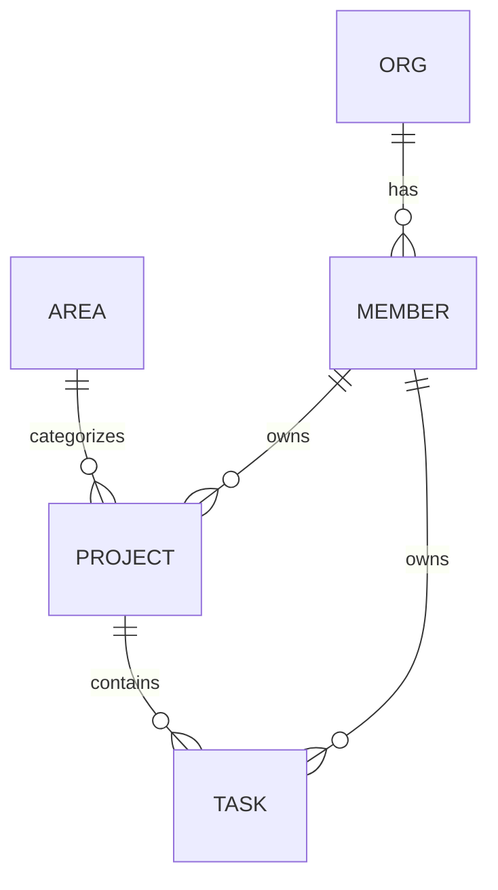
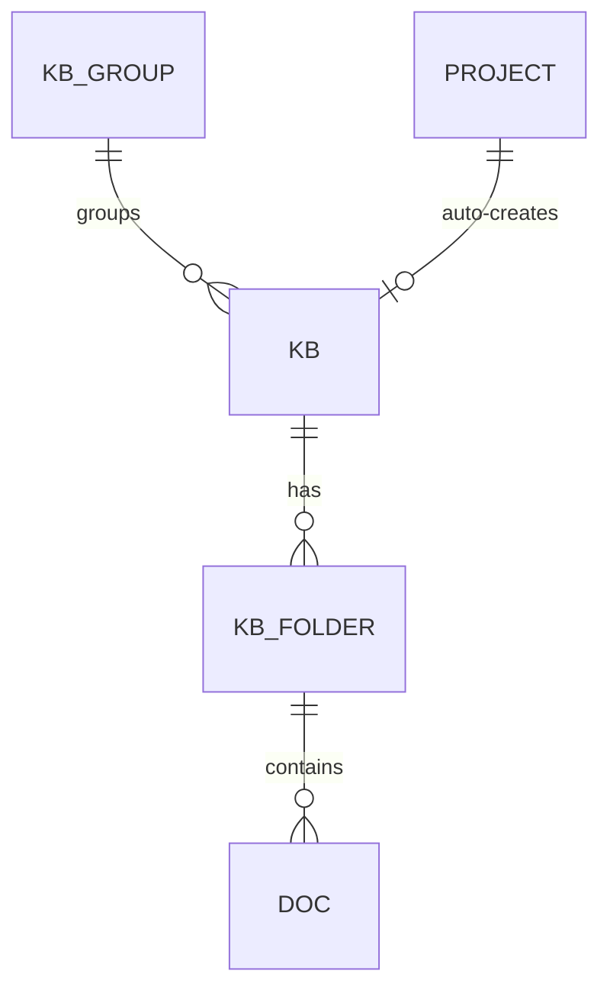

# WAO 数据模型 · 核心域（Phase 1）

来源：`init-design/WAO 架构图与ER图.dc.html` 与前端 `wao-web/src/types/domain.ts`。本轮落地 **组织 / 成员 / 领域 / 项目 / 任务** 五张核心表；知识库、文档、自动化、文件、图床、密码库、日历等域沿用相同模式在后续迭代补充（前端此前已实现，暂以 fixtures 兜底）。

## 设计取舍：关系列 + JSON 文档（混合）

项目与任务是聚合根，含大量可变长嵌套结构（里程碑、趋势、阻塞、动态、步骤、子任务、评论、自定义属性…）。本轮采取**混合建模**：

- **可查询字段**（状态、领域、负责人、截止、进度、优先级、所属项目）落成真实列，支持筛选 / 排序 / 关联查询；
- **富嵌套结构**存入 `detail_json`（MySQL `JSON`），由 Service 用 Jackson 组装为与前端一致的 DTO。

完全规范化（milestone / activity / comment 独立表）留待后续 ADR，一次性拆表会显著增加本轮体量而不改变对外契约。对外 REST 契约（`ApiResponse<ProjectDto>` 等）与最终规范化结果保持稳定。

## ER 概览

## 表与字段字典

### org（组织）
| 列 | 类型 | 说明 |
|---|---|---|
| id | VARCHAR(32) PK | 组织 id |
| name | VARCHAR(128) | 组织名 |
| member_count | INT | 成员数（冗余，展示用） |

### member（成员）
| 列 | 类型 | 说明 |
|---|---|---|
| id | VARCHAR(32) PK | 成员 id |
| name | VARCHAR(64) | 昵称 |
| initial | VARCHAR(4) | 头像首字 |
| color | CHAR(7) | 头像色 #RRGGBB |
| role | VARCHAR(32) | 管理员 / 成员 |

### area（人生领域）
| 列 | 类型 | 说明 |
|---|---|---|
| id | VARCHAR(32) PK | 领域 id（career/health/…） |
| name | VARCHAR(32) | 领域名 |
| color | CHAR(7) | 领域色 |

### project（项目）
| 列 | 类型 | 说明 |
|---|---|---|
| id | VARCHAR(32) PK | 项目 id |
| name | VARCHAR(128) | 名称 |
| area | VARCHAR(32) FK→area | 所属领域 |
| status | VARCHAR(16) | 进行中/有风险/规划中/已完成 |
| health | VARCHAR(16) | 良好/需要关注/风险 |
| progress | INT | 0–100 |
| owner_id | VARCHAR(32) FK→member | 负责人 |
| start_date | VARCHAR(16) | 开始（ISO） |
| due_date | VARCHAR(16) | 截止（ISO） |
| visibility | VARCHAR(64) | 可见范围文案 |
| updated_label | VARCHAR(32) | “26 分钟前”等展示文案 |
| goal | VARCHAR(512) | 一句话目标 |
| detail_json | JSON | members[], milestones[], msDates[], trend[], blockers[], docs[], files[], activity[] |

### task（任务）
| 列 | 类型 | 说明 |
|---|---|---|
| id | VARCHAR(32) PK | 任务 id |
| title | VARCHAR(256) | 标题 |
| project_id | VARCHAR(32) FK→project | 所属项目 |
| status | VARCHAR(16) | 待办/进行中/阻塞/已完成 |
| pr | CHAR(2) | P0–P3 |
| owner_id | VARCHAR(32) FK→member | 负责人 |
| start_date | VARCHAR(16) NULL | 开始 |
| due_date | VARCHAR(16) | 截止 |
| waiting | VARCHAR(64) NULL | 等待他人标记 |
| description | TEXT | 描述 |
| detail_json | JSON | parts[], steps[], subs[], files[], docs[], linkTasks[], comments[], custom[], activity[] |

## 内容 / 参考域（文档表，只读）

文件、图床、日历、日程、AI 建议、目标仍以纯展示为主，采用「文档表」`(id, ord, payload JSON)`：payload 存完整 JSON（与前端类型一致），`ord` 保证展示顺序。读接口经 `ContentMapper`（`@Select payload`）+ `ContentService`（JSON 直通）返回，不为其定义 DTO。表：`file_item, image_item, calendar_event, schedule_item, suggestion, goal`。这些域当前只读；实际的文件上传存储、AI 建议生成等超出本轮范围，留待各自的 spec/ADR 立项。

知识库、自动化、密钥库已从「文档表」升级为关系表（见下），不再只读。

## 知识库域

### kb_group（自建知识库分组）
| 列 | 类型 | 说明 |
|---|---|---|
| id | VARCHAR(32) PK | 分组 id |
| name | VARCHAR(64) | 分组名 |
| ord | INT | 展示顺序 |

### kb（知识库）
| 列 | 类型 | 说明 |
|---|---|---|
| id | VARCHAR(32) PK | 知识库 id |
| name | VARCHAR(128) | 名称 |
| icon | VARCHAR(64) | remixicon 类名 |
| color | CHAR(7) | 主题色 |
| project_id | VARCHAR(32) NULL | 关联项目（项目知识库） |
| auto | TINYINT(1) | 是否自动化沉淀知识库（名称/简介不可改） |
| description | VARCHAR(512) | 简介 |
| group_id | VARCHAR(32) FK→kb_group NULL | 所属自建分组（NULL 时前端按默认分组展示） |
| perm | VARCHAR(16) | 仅自己 / 成员可编辑 |
| ord | INT | 展示顺序 |

### kb_folder（文件夹）
| 列 | 类型 | 说明 |
|---|---|---|
| id | VARCHAR(32) PK | 文件夹 id |
| kb_id | VARCHAR(32) FK→kb | 所属知识库 |
| name | VARCHAR(128) | 文件夹名 |
| ord | INT | 展示顺序 |

### doc（文档）
| 列 | 类型 | 说明 |
|---|---|---|
| id | VARCHAR(32) PK | 文档 id |
| kb_id | VARCHAR(32) FK→kb | 所属知识库（新建文档必填，即建立关联） |
| folder_id | VARCHAR(32) FK→kb_folder | 所属文件夹 |
| title | VARCHAR(256) | 标题 |
| author_id | VARCHAR(32) | 作者（成员 id 或 auto） |
| auto | TINYINT(1) | 是否自动化沉淀 |
| created_label / updated_label | VARCHAR(32) | 展示用时间文案 |
| blocks_json | JSON | 正文块数组（call/h/p/ul/q 互斥） |
| links_json | JSON | 出链数组 `[{type, id}]`，指向 project/task/doc |
| ord | INT | 展示顺序 |

反向链接（backlinks）不落库：`KnowledgeService` 对某文档取全部文档的 `links_json` 动态反查，当前只覆盖「文档 → 文档」的反链；项目 / 任务指向文档的反链留待这两个域也支持文档关联时再补充。

## 自动化域

### automation_job（任务）
| 列 | 类型 | 说明 |
|---|---|---|
| id | VARCHAR(32) PK | 任务 id |
| name | VARCHAR(128) | 名称 |
| icon | VARCHAR(64) | remixicon 类名 |
| schedule_label | VARCHAR(64) | 展示用计划文案（如「每日 06:00」） |
| cron_expr | VARCHAR(64) NULL | 标准 5 段 Cron；非空时由 `JobSchedulerService` 按计划自动执行，留空则仅手动触发 |
| status | VARCHAR(16) | 正常 / 待修复 / 已暂停 |
| last_run_label | VARCHAR(128) | 上次运行展示文案 |
| description / source / target | VARCHAR | 描述 / 数据源 / 输出目标 |
| steps_json | JSON | 执行步骤（描述性文本数组，不是可执行代码） |
| next_fire_at | DATETIME NULL | 下次计划触发时间，调度器轮询用 |
| ord | INT | 展示顺序 |

### automation_run（运行记录）
| 列 | 类型 | 说明 |
|---|---|---|
| id | VARCHAR(32) PK | 运行 id |
| job_id | VARCHAR(32) FK→automation_job | 所属任务 |
| run_time_label | VARCHAR(64) | 展示用开始时间文案 |
| result | VARCHAR(64) | 结果文案（含「成功」/「失败」关键字供前端着色） |
| duration_ms | INT | 模拟耗时 |
| ord | INT | 顺序（0 = 最近一次） |

执行引擎：`steps_json` 是描述性文本而非可执行配置，本轮不接入飞书 / NAS / 邮箱等外部系统的真实调用；`JobSchedulerService` 每分钟轮询到期的 Cron 任务并调用 `AutomationService.executeScheduled` 记录一次模拟运行，这是「真实触发时机 + 模拟执行结果」，不是完整工作流引擎。

## 密钥库域

### vault_group（分组）
| 列 | 类型 | 说明 |
|---|---|---|
| id | VARCHAR(32) PK | 分组 id |
| name | VARCHAR(64) | 分组名 |
| ord | INT | 展示顺序 |

### vault_item（条目）
| 列 | 类型 | 说明 |
|---|---|---|
| id | VARCHAR(32) PK | 条目 id |
| group_id | VARCHAR(32) FK→vault_group | 所属分组 |
| name / icon / user_name / site / note | VARCHAR | 展示字段 |
| secret_ciphertext | VARBINARY(1024) NULL | AES-256-GCM 密文（含 GCM tag） |
| secret_nonce | VARBINARY(32) NULL | 本次加密使用的随机 nonce |
| updated_label | VARCHAR(32) | 展示用更新时间文案 |
| ord | INT | 展示顺序 |

密码加密方案见 `docs/adr/009-vault-server-side-encryption.md`：密钥来自环境变量 `WAO_VAULT_KEY`（base64 32 字节），列表 / 详情接口从不返回明文，只在 `POST /api/vault/items/{id}/reveal` 按需解密一次。这是服务端静态加密，不是零知识端到端加密。

## 迁移
- `V1__core_schema.sql` 核心域建表 + `V2__seed_demo.sql` 种子。
- `V3__content_schema.sql` 内容域建表 + `V4__content_seed.sql` 种子。
- `V5__knowledge_schema.sql` / `V6__knowledge_seed.sql`：知识库域关系表（替换 V3 的 `kb`/`doc` payload 表）。
- `V7__automation_schema.sql` / `V8__automation_seed.sql`：自动化域关系表（替换 V3 的 `job` payload 表）。
- `V9__vault_schema.sql` / `V10__vault_seed.sql`：密钥库域关系表（替换 V3 的 `vault_group` payload 表）。
- 已执行的 migration 不可修改；后续变更新增 `V11__...`。
