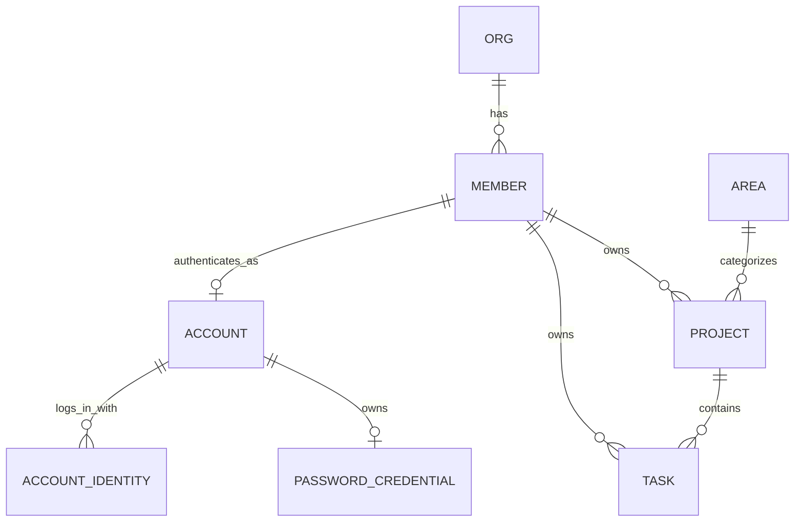
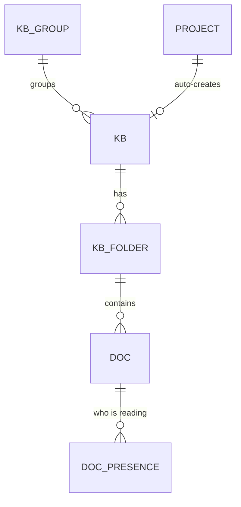

# WAO 数据模型 · 核心域（Phase 1）

来源：`init-design/WAO 架构图与ER图.dc.html` 与前端 `wao-web/src/types/domain.ts`。本轮落地 **组织 / 成员 / 领域 / 项目 / 任务** 五张核心表；知识库、文档、自动化、文件、图床、密码库、日历等域沿用相同模式在后续迭代补充（前端此前已实现，暂以 fixtures 兜底）。

## 设计取舍：关系列 + JSON 文档（混合）

项目与任务是聚合根，含大量可变长嵌套结构（里程碑、趋势、阻塞、动态、步骤、子任务、评论、自定义属性…）。本轮采取**混合建模**：

- **可查询字段**（状态、领域、负责人、截止、进度、优先级、所属项目）落成真实列，支持筛选 / 排序 / 关联查询；
- **富嵌套结构**存入 `detail_json`（MySQL `JSON`），由 Service 用 Jackson 组装为与前端一致的 DTO。

完全规范化（milestone / activity / comment 独立表）留待后续 ADR，一次性拆表会显著增加本轮体量而不改变对外契约。对外 REST 契约（`ApiResponse<ProjectDto>` 等）与最终规范化结果保持稳定。

## ER 概览

## 表与字段字典

账号、身份与共享会话表见 [ADR-016](../adr/016-unified-account-and-session.md) 和 `V12__account_auth.sql`。`account` 关联唯一成员；`account_identity` 以 `(provider, provider_subject)` 保证外部身份唯一；`password_credential` 保存 BCrypt 哈希、失败次数和锁定时间；`SPRING_SESSION*` 保存跨节点 HttpOnly 会话。

### org（组织）
| 列 | 类型 | 说明 |
|---|---|---|
| id | VARCHAR(32) PK | 组织 id |
| name | VARCHAR(128) | 组织名 |
| member_count | INT | 成员数（冗余，展示用） |

### member（成员）
| 列 | 类型 | 说明 |
|---|---|---|
| id | VARCHAR(32) PK | 成员 id |
| name | VARCHAR(64) | 昵称 |
| initial | VARCHAR(4) | 头像首字 |
| color | CHAR(7) | 头像色 #RRGGBB |
| role | VARCHAR(32) | 管理员 / 成员 |

### area（人生领域）
| 列 | 类型 | 说明 |
|---|---|---|
| id | VARCHAR(32) PK | 领域 id（career/health/…） |
| name | VARCHAR(32) | 领域名 |
| color | CHAR(7) | 领域色 |

### project（项目）
| 列 | 类型 | 说明 |
|---|---|---|
| id | VARCHAR(32) PK | 项目 id |
| name | VARCHAR(128) | 名称 |
| area | VARCHAR(32) FK→area | 所属领域 |
| status | VARCHAR(16) | 进行中/有风险/规划中/已完成 |
| health | VARCHAR(16) | 良好/需要关注/风险 |
| progress | INT | 0–100 |
| owner_id | VARCHAR(32) FK→member | 负责人 |
| start_date | VARCHAR(16) | 开始（ISO） |
| due_date | VARCHAR(16) | 截止（ISO） |
| visibility | VARCHAR(64) | 可见范围文案 |
| updated_label | VARCHAR(32) | “26 分钟前”等展示文案 |
| goal | VARCHAR(512) | 一句话目标 |
| detail_json | JSON | members[], milestones[], msDates[], trend[], blockers[], docs[], files[], activity[] |

### task（任务）
| 列 | 类型 | 说明 |
|---|---|---|
| id | VARCHAR(32) PK | 任务 id |
| title | VARCHAR(256) | 标题 |
| project_id | VARCHAR(32) FK→project | 所属项目 |
| status | VARCHAR(16) | 待办/收集中/进行中/AI 进行中/待验证/已完成（「阻塞」已由 V16 迁到「进行中」，等待他人改由 waiting 表达；进入「收集中」会自动分享到飞书群，见 ADR-027） |
| pr | CHAR(2) | P0–P3 |
| owner_id | VARCHAR(32) FK→member | 负责人 |
| start_date | VARCHAR(16) NULL | 开始 |
| due_date | VARCHAR(16) | 截止 |
| waiting | VARCHAR(64) NULL | 等待他人标记 |
| description | TEXT | 描述 |
| detail_json | JSON | parts[], steps[], subs[], files[], docs[], linkTasks[], comments[], custom[], activity[] |

## 内容 / 参考域（文档表，只读）

文件、图床、日历、日程、AI 建议、目标仍以纯展示为主，采用「文档表」`(id, ord, payload JSON)`：payload 存完整 JSON（与前端类型一致），`ord` 保证展示顺序。读接口经 `ContentMapper`（`@Select payload`）+ `ContentService`（JSON 直通）返回，不为其定义 DTO。表：`file_item, image_item, calendar_event, schedule_item, suggestion, goal`。这些域当前只读；实际的文件上传存储、AI 建议生成等超出本轮范围，留待各自的 spec/ADR 立项。

知识库、自动化、密钥库已从「文档表」升级为关系表（见下），不再只读。

## 知识库域

知识库 / 文件夹 / 文档一律**软删除**：`deleted_at` 非空即在回收站，保留 7 天后由调度器物理删除（见 ADR-018）。所有读路径都要带「未删除」条件。

### kb_group（自建知识库分组）
| 列 | 类型 | 说明 |
|---|---|---|
| id | VARCHAR(32) PK | 分组 id |
| name | VARCHAR(64) | 分组名 |
| ord | INT | 展示顺序 |

### kb（知识库）
| 列 | 类型 | 说明 |
|---|---|---|
| id | VARCHAR(32) PK | 知识库 id |
| name | VARCHAR(128) | 名称 |
| icon | VARCHAR(64) | remixicon 类名 |
| color | CHAR(7) | 主题色 |
| project_id | VARCHAR(32) NULL | 关联项目（项目知识库） |
| auto | TINYINT(1) | 是否自动化沉淀知识库（名称/简介不可改） |
| description | VARCHAR(512) | 简介 |
| group_id | VARCHAR(32) FK→kb_group NULL | 所属自建分组（NULL 时前端按默认分组展示） |
| perm | VARCHAR(16) | 仅自己 / 成员可编辑 |
| ord | INT | 展示顺序 |
| notes | TINYINT(1) | 是否小记知识库（全局「新建小记」的落点，不可删除） |
| deleted_at / deleted_by | DATETIME / VARCHAR(32) NULL | 回收站：删除时间与删除人 |

### kb_folder（文件夹）
| 列 | 类型 | 说明 |
|---|---|---|
| id | VARCHAR(32) PK | 文件夹 id |
| kb_id | VARCHAR(32) FK→kb | 所属知识库 |
| name | VARCHAR(128) | 文件夹名 |
| ord | INT | 展示顺序 |
| deleted_at | DATETIME NULL | 回收站：删除时间 |
| cascade_del | TINYINT(1) | 1 = 随知识库一起被删，恢复知识库时一并恢复，回收站不单独展示 |

### doc（文档）
| 列 | 类型 | 说明 |
|---|---|---|
| id | VARCHAR(32) PK | 文档 id |
| kb_id | VARCHAR(32) FK→kb | 所属知识库（新建文档必填，即建立关联） |
| folder_id | VARCHAR(32) FK→kb_folder | 所属文件夹 |
| title | VARCHAR(256) | 标题 |
| author_id | VARCHAR(32) | 作者（成员 id 或 auto） |
| auto | TINYINT(1) | 是否自动化沉淀 |
| created_label / updated_label | VARCHAR(32) | 升级前的展示用时间文案，仅老数据还在用 |
| created_at / updated_at | DATETIME NULL | 真实时间戳，对外优先取它，缺失才回落上面的文案 |
| rev | INT | 正文版本号，每次内容更新 +1，供协同端判断服务端有没有更新的版本 |
| blocks_json | JSON | 正文块数组（call/h/p/ul/q 互斥） |
| links_json | JSON | 出链数组 `[{type, id}]`，指向 project/task/doc |
| ord | INT | 展示顺序 |
| deleted_at / deleted_by | DATETIME / VARCHAR(32) NULL | 回收站：删除时间与删除人 |
| cascade_del | TINYINT(1) | 1 = 随父级一起被删，恢复父级时一并恢复 |

### doc_presence（文档协同在场）
| 列 | 类型 | 说明 |
|---|---|---|
| id | VARCHAR(96) PK | 合成主键 `<doc_id>:<member_id>`，一个人对一篇文档只有一条 |
| doc_id / member_id | VARCHAR(32) | 谁在看哪篇 |
| line | INT | 光标所在的顶层块序号，-1 表示只在查看 |
| editing | TINYINT(1) | 最近一次心跳前是否在输入 |
| seen_at | DATETIME | 最后一次心跳；超过在场窗口（20 秒）即视为离开 |

在场表跨节点共享（对齐 `spring-session-jdbc` 的思路），因此落在不同节点上的两个人也能互相看见；心跳机制与并发编辑的取舍见 ADR-017。

反向链接（backlinks）不落库：`KnowledgeService` 对某文档取全部文档的 `links_json` 动态反查，当前只覆盖「文档 → 文档」的反链；项目 / 任务指向文档的反链留待这两个域也支持文档关联时再补充。

## 自动化域

### automation_job（任务）
| 列 | 类型 | 说明 |
|---|---|---|
| id | VARCHAR(32) PK | 任务 id |
| name | VARCHAR(128) | 名称 |
| icon | VARCHAR(64) | remixicon 类名 |
| schedule_label | VARCHAR(64) | 展示用计划文案（如「每日 06:00」） |
| cron_expr | VARCHAR(64) NULL | 标准 5 段 Cron；非空时由 `JobSchedulerService` 按计划自动执行，留空则仅手动触发 |
| status | VARCHAR(16) | 正常 / 待修复 / 已暂停 |
| last_run_label | VARCHAR(128) | 上次运行展示文案 |
| description / source / target | VARCHAR | 描述 / 数据源 / 输出目标 |
| steps_json | JSON | 执行步骤（描述性文本数组，不是可执行代码） |
| next_fire_at | DATETIME NULL | 下次计划触发时间，调度器轮询用 |
| ord | INT | 展示顺序 |
| handler | VARCHAR(64) NULL | 服务端真实执行器名（如 `feishu-chat-sync`）；为空表示模拟运行 |

### automation_run（运行记录）
| 列 | 类型 | 说明 |
|---|---|---|
| id | VARCHAR(32) PK | 运行 id |
| job_id | VARCHAR(32) FK→automation_job | 所属任务 |
| run_time_label | VARCHAR(64) | 展示用开始时间文案 |
| result | VARCHAR(64) | 结果文案（含「成功」/「失败」关键字供前端着色） |
| executor_id | VARCHAR(32) NULL | 手动触发的成员；定时任务为空，界面显示「定时任务」 |
| duration_ms | INT | 模拟耗时 |
| ord | INT | 顺序（0 = 最近一次） |

执行引擎：`JobSchedulerService` 每分钟轮询到期的 Cron 任务并调用 `AutomationService.executeScheduled`。`handler` 非空的任务交给对应的 `JobHandler` 真的执行（目前只有 `feishu-chat-sync`，见 ADR-019），运行记录写执行器返回的结果；`handler` 为空的任务仍是「真实触发时机 + 模拟执行结果」——`steps_json` 只是描述性文本，NAS / 邮箱等外部系统尚未接入。

### system_setting（系统级配置，V17）
| 列 | 类型 | 说明 |
|---|---|---|
| cfg_key | VARCHAR(64) PK | 配置键，如 `feishu.webhook.url`、`feishu.chat-sync.app-secret` |
| cfg_value | TEXT | 配置值；敏感键加密存储，密文带 `enc:` 前缀 |
| updated_at | DATETIME | 最后修改时间 |

全局唯一一份的键值配置。敏感值（webhook 地址、App Secret）复用 `VaultCryptoService` 的 AES-256-GCM 加密后落库，接口只回脱敏形态（`SettingService.mask`），明文只在服务端调飞书接口时解出来用；因此真实凭据既不进 Git 也不必写进环境变量。

## AI Run 域（V18）

### ai_project_config

| 列 | 类型 | 说明 |
|---|---|---|
| project_id | VARCHAR(32) PK | 项目 id |
| enabled | BOOLEAN | 是否允许该项目触发 AI Run |
| repo_url / default_branch | VARCHAR | Git 仓库与基线分支 |
| workspace_dir | VARCHAR(128) | 各 Runner 工作区根目录下的项目文件夹名 |
| default_engine | VARCHAR(24) | 默认 AI 工具：codex / claude |
| preferred_runner_id | VARCHAR(32) NULL | 固定执行电脑；空表示自动分配 |
| max_parallel_runs | INT | 同一项目最大并发 |
| updated_at | DATETIME | 最后更新时间 |

### ai_runner_node / ai_runner_pair_code

`ai_runner_node` 保存电脑名、平台、本机可用的 AI 工具（`engines`，逗号分隔，Runner 自述并在
心跳刷新）、并发槽位、令牌 SHA-256 哈希和最后心跳；不保存令牌明文。
- `max_concurrency`：Runner 本地自报的最大并发线程数。
- `admin_max_concurrency`：管理员在后台配置的线程数，存在时优先于 `max_concurrency` 生效。
- `script_hash`：Runner 心跳自报的脚本 SHA-256，用于判断是否落后于服务端打包的最新版。
- `update_requested_at`：后台一键下发脚本更新的时间；节点自更新后上报最新哈希时自动清除。
`ai_runner_pair_code` 保存一次性配对码哈希、过期时间和使用时间，明文只在生成接口返回一次。

### ai_task_run

| 列 | 类型 | 说明 |
|---|---|---|
| id / task_id / project_id | VARCHAR(32) | 运行、任务和项目 id |
| sub_id | VARCHAR(64) NULL | 本次只跑这一条子任务；整条任务的运行为空。分享清单会把已派工的子任务摘掉（见 ADR-027） |
| engine | VARCHAR(24) | 本次使用的 AI 工具：codex / claude |
| status | VARCHAR(24) | queued / running / succeeded / failed / cancelled |
| runner_id | VARCHAR(32) NULL | 实际领取的电脑 |
| requested_runner_id | VARCHAR(32) NULL | 入队时点名的电脑；优先于项目的 preferred_runner_id |
| prompt_url / branch_name | VARCHAR | Markdown 任务地址与隔离分支 |
| retry_of_run_id | VARCHAR(32) NULL | 本次重跑要修复的那一次失败运行；领取时把它的摘要交给 AI（见 ADR-025） |
| result_summary / session_id / exit_code | TEXT / VARCHAR / INT | AI CLI 最终摘要、会话 id 与退出码 |
| pending_input | TEXT | 等待原 AI 会话消费的用户补充输入；仅由原执行电脑恢复 |
| model / models | VARCHAR(120) / VARCHAR(500) NULL | 输出 token 最多的模型，以及本次用到的全部模型（逗号分隔） |
| input_tokens / output_tokens / cached_input_tokens / total_tokens | BIGINT NULL | 本次运行的 token 用量；续跑在同一条记录上累加 |
| cost_usd | DECIMAL(12,6) NULL | 折算额度（美元）；Codex 不回传花费时为空（见 ADR-026） |
| latest_progress / progress_updated_at | VARCHAR(1000) / DATETIME | 首页快速读取的最近一条用户可读进展 |
| created_at / claimed_at / started_at / finished_at | DATETIME | 完整运行时间线 |

### ai_run_progress

| 列 | 类型 | 说明 |
|---|---|---|
| id / run_id | VARCHAR(32) | 进展与所属运行 id |
| kind | VARCHAR(24) | phase / message / plan / result |
| content | VARCHAR(1000) | 过滤命令和工具调用后的用户可读摘要 |
| created_at | DATETIME | 上报时间，用于实时展示与任务档案排序 |

## 密钥库域

### vault_group（分组）
| 列 | 类型 | 说明 |
|---|---|---|
| id | VARCHAR(32) PK | 分组 id |
| name | VARCHAR(64) | 分组名；名为「未分组」的是该成员的默认分组，不可删除 |
| ord | INT | 展示顺序 |
| owner_member_id | VARCHAR(32) | 归属成员；`/api/vault/*` 只在自己的分组内生效（见 ADR-024） |

条目的归属跟随所在分组，不单独记列：一个条目要么在自己的分组里，要么就不该被看见。

### vault_item（条目）
| 列 | 类型 | 说明 |
|---|---|---|
| id | VARCHAR(32) PK | 条目 id |
| group_id | VARCHAR(32) FK→vault_group | 所属分组 |
| name / icon / user_name / site / note | VARCHAR | 展示字段 |
| secret_ciphertext | VARBINARY(1024) NULL | AES-256-GCM 密文（含 GCM tag） |
| secret_nonce | VARBINARY(32) NULL | 本次加密使用的随机 nonce |
| updated_label | VARCHAR(32) | 展示用更新时间文案 |
| ord | INT | 展示顺序 |

密码加密方案见 `docs/adr/009-vault-server-side-encryption.md`：密钥来自环境变量 `WAO_VAULT_KEY`（base64 32 字节），列表 / 详情接口从不返回明文，只在 `POST /api/vault/items/{id}/reveal` 按需解密一次。这是服务端静态加密，不是零知识端到端加密。

## 通用文件

### file_blob
| 列 | 类型 | 说明 |
|---|---|---|
| id | VARCHAR(64) PK | 文件 id |
| name / content_type | VARCHAR | 安全文件名与 MIME 类型 |
| byte_size | BIGINT | 字节数，单个文件最大 50MB |
| created_by / created_at | VARCHAR / DATETIME(3) | 上传成员与上海时间 |
| content | LONGBLOB | 文件二进制正文，列表查询不读取 |

下载不落库：对外分享的是前端下载页 `/f/{id}`，答对一道人机校验题才换得到一张一次性票据（进程内存，120 秒有效、用完即废），下载接口只认票据或本人登录会话（见 ADR-020）。

## 迁移
- `V1__core_schema.sql` 核心域建表 + `V2__seed_demo.sql` 种子。
- `V3__content_schema.sql` 内容域建表 + `V4__content_seed.sql` 种子。
- `V5__knowledge_schema.sql` / `V6__knowledge_seed.sql`：知识库域关系表（替换 V3 的 `kb`/`doc` payload 表）。
- `V7__automation_schema.sql` / `V8__automation_seed.sql`：自动化域关系表（替换 V3 的 `job` payload 表）。
- `V9__vault_schema.sql` / `V10__vault_seed.sql`：密钥库域关系表（替换 V3 的 `vault_group` payload 表）。
- `V11__image_store.sql`：图片二进制存储。
- `V12__account_auth.sql`：统一账号、身份、密码凭据与共享会话。
- `V13__drop_content_demo_seed.sql`：清空「文件与图床」的演示数据。
- `V14__knowledge_enhance.sql`：小记知识库、文档真实时间戳与版本号、三张表的回收站列、`doc_presence` 在场表。
- `V15__file_store.sql`：通用文件元数据与二进制正文持久化。
- `V16__task_status_retire_blocked.sql`：任务状态改版，存量「阻塞」迁到「进行中」。
- `V17__system_setting_and_feishu_sync.sql`：系统级配置表、`automation_job.handler` 与内置的飞书群聊同步任务。
- `V18__ai_task_runner.sql`：项目级 AI 配置、执行电脑、一次性配对码与任务运行队列。
- `V19__ai_run_progress.sql`：AI 运行最新反馈与可归档的摘要时间线。
- `V20__ai_run_engine.sql`：节点可用 AI 工具、项目默认 AI 工具、运行使用的工具与按次指定的电脑。
- `V21__chat_sync_icon.sql`：将飞书群聊同步任务修正为前端稳定支持的聊天图标。
- `V22__image_content_hash.sql`：图床按内容摘要去重，避免同一天聊天记录重复同步堆出重复副本。
- `V23__vault_group_owner.sql`：密码库分组归属到人；存量分组统一归到管理员 `wg`（见 ADR-024）。
- `V24__ai_run_retry.sql`：AI 运行记录指回被修复的那一次失败运行（见 ADR-025）。
- `V25__ai_run_continuation.sql`：保存待原 AI 会话消费的用户补充输入。
- `V26__ai_run_usage.sql`：记录每次运行的模型、token 用量与折算额度（见 ADR-026）。
- `V27__automation_run_executor.sql`：记录自动化任务每次手动运行的执行成员，定时任务保持为空。
- `V28__reclassify_unsupported_ai_runs.sql`：把已经合并上线、仅因拒绝伪造非必要功能而误判失败的 AI Run 修正为成功，并将对应任务送回待验证。
- `V29__feishu_quick_collect_and_sub_runs.sql`：AI 运行记录可指向单条子任务（见 ADR-027）。
- 已执行的 migration 不可修改；后续数据库变更新增 migration。
