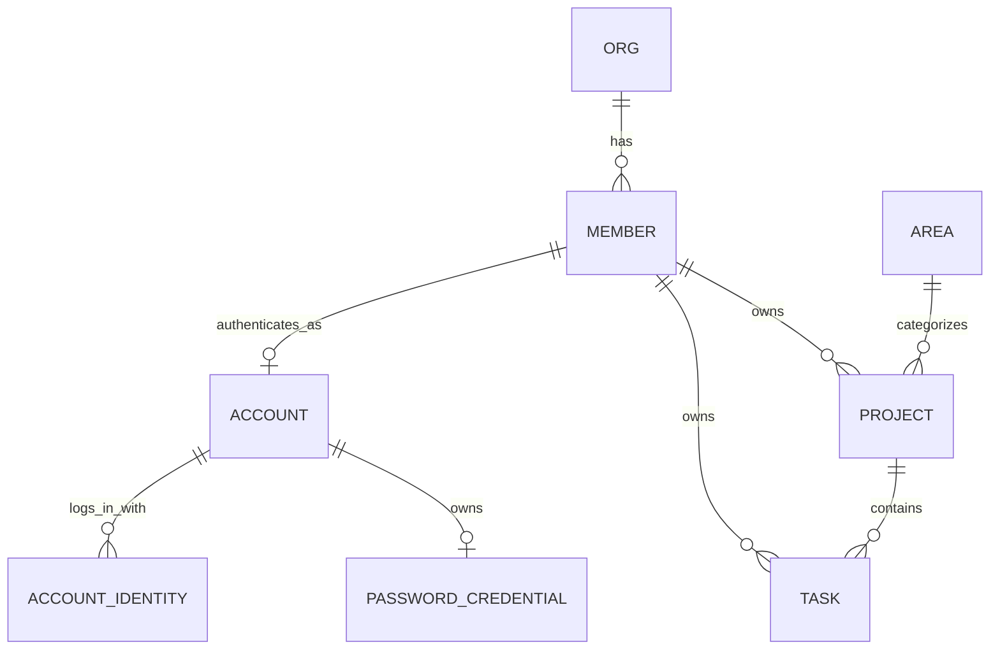
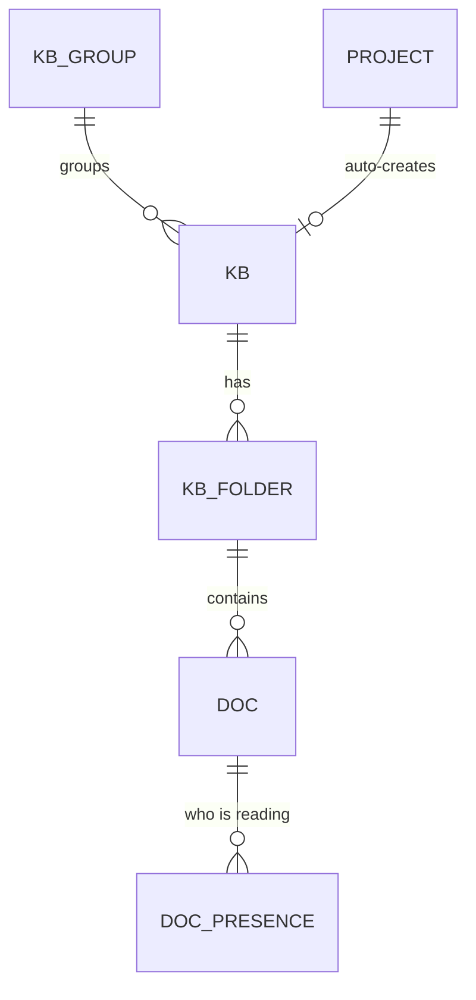

# WAO 数据模型 · 核心域（Phase 1）

来源：`init-design/WAO 架构图与ER图.dc.html` 与前端 `wao-web/src/types/domain.ts`。本轮落地 **组织 / 成员 / 领域 / 项目 / 任务** 五张核心表；知识库、文档、自动化、文件、图床、密码库、日历等域沿用相同模式在后续迭代补充（前端此前已实现，暂以 fixtures 兜底）。

## 点子库域（V83）

`idea` 是独立聚合根：可查询列保存标题、P0–P2、八阶段、创建人、负责人和可选项目，`detail_json` 保存阶段表单与只追加活动时间线。`idea_artifact` 以 `kind + doc_id` 关联原生知识文档；`idea_task_link` 用唯一 `(idea_id, task_id)` 建立不拥有任务生命周期的关系；`idea_iteration` 保存每轮目标、验收、AI Run、结果和人工反馈；`idea_research_run` 是与开发型 `ai_run` 隔离的研究队列，使用 claim token 和终态 CAS。所有子表随点子级联删除，但产品接口不提供无说明删除启动后点子的能力。

自 ADR-107 起该域只承担存量历史兼容：新“点子”直接创建 `规划中` 项目。归并时旧记录不删除，`LEGACY_ARCHIVE` 资产指向项目知识库中的历史文档，原资产只补项目出链而不移动。

## 设计取舍：关系列 + JSON 文档（混合）

项目与任务是聚合根，含大量可变长嵌套结构（里程碑、趋势、阻塞、动态、步骤、子任务、评论、自定义属性…）。本轮采取**混合建模**：

- **可查询字段**（状态、领域、负责人、截止、进度、优先级、所属项目）落成真实列，支持筛选 / 排序 / 关联查询；
- **富嵌套结构**存入 `detail_json`（MySQL `JSON`），由 Service 用 Jackson 组装为与前端一致的 DTO。

完全规范化（milestone / activity / comment 独立表）留待后续 ADR，一次性拆表会显著增加本轮体量而不改变对外契约。对外 REST 契约（`ApiResponse<ProjectDto>` 等）与最终规范化结果保持稳定。

## ER 概览

## 表与字段字典

账号、身份与共享会话表见 [ADR-016](../adr/016-unified-account-and-session.md) 和 `V12__account_auth.sql`。`account` 关联唯一成员；`account_identity` 以 `(provider, provider_subject)` 保证外部身份唯一，并由 `V86__feishu_union_identity.sql` 增加 `(provider, provider_union_subject)` 唯一约束，用于飞书跨应用身份；`password_credential` 保存 BCrypt 哈希、失败次数和锁定时间；`SPRING_SESSION*` 保存跨节点 HttpOnly 会话。

`account_login_event`（V111）从通知中心发布后逐次记录成功登录，只保存账号、成员、登录方式与毫秒级时间，供
最近 7/30 天真实登录频率使用；不记录失败尝试、IP、设备、浏览器、邮箱或外部身份标识，历史次数不回填。

### org（组织）
| 列 | 类型 | 说明 |
|---|---|---|
| id | VARCHAR(32) PK | 组织 id |
| name | VARCHAR(128) | 组织名 |
| member_count | INT | 成员数（冗余，展示用） |

### member（成员）
| 列 | 类型 | 说明 |
|---|---|---|
| id | VARCHAR(32) PK | 成员 id |
| name | VARCHAR(64) | 昵称 |
| initial | VARCHAR(4) | 头像首字 |
| color | CHAR(7) | 头像色 #RRGGBB |
| role | VARCHAR(32) | 管理员 / 成员 |

### area（人生领域）
| 列 | 类型 | 说明 |
|---|---|---|
| id | VARCHAR(32) PK | 领域 id（career/health/…） |
| name | VARCHAR(32) | 领域名 |
| color | CHAR(7) | 领域色 |

### project（项目）
| 列 | 类型 | 说明 |
|---|---|---|
| id | VARCHAR(32) PK | 项目 id |
| name | VARCHAR(128) | 名称 |
| area | VARCHAR(32) FK→area | 所属领域 |
| status | VARCHAR(16) | 进行中/有风险/规划中/已完成/已搁置；任务与 AI Run 不自动改变项目终态 |
| health | VARCHAR(16) | 良好/需要关注/风险 |
| progress | INT | 0–100 |
| owner_id | VARCHAR(32) FK→member | 负责人 |
| start_date | VARCHAR(16) | 开始（ISO） |
| due_date | VARCHAR(16) | 截止（ISO） |
| visibility | VARCHAR(64) | 可见范围文案 |
| updated_label | VARCHAR(32) | “26 分钟前”等展示文案 |
| goal | VARCHAR(512) | 一句话目标 |
| notify_enabled | TINYINT(1) NOT NULL DEFAULT 1 | 这个项目的动静是否发飞书群（V36）；关掉后新建任务、状态变化、新增子任务、评论与 AI 执行的卡片都不发，全局 webhook 开关仍然一票否决 |
| detail_json | JSON | members[], milestones[], msDates[], trend[], blockers[], docs[], files[], activity[], icon, taskGroups[]（任务分组，最多 6 个）、startedAt（首次明确推进时间，保证通知幂等） |

### task（任务）
| 列 | 类型 | 说明 |
|---|---|---|
| id | VARCHAR(32) PK | 任务 id |
| title | VARCHAR(256) | 标题 |
| project_id | VARCHAR(32) FK→project | 所属项目 |
| status | VARCHAR(16) | 待办/收集中/进行中/AI 进行中/待验证/已完成（「阻塞」已由 V16 迁到「进行中」，等待他人改由 waiting 表达；进入「收集中」会自动分享到飞书群，见 ADR-027） |
| pr | CHAR(2) | P0–P3 |
| owner_id | VARCHAR(32) FK→member | 负责人 |
| created_by | VARCHAR(32) NULL | 创建人成员 id（V30）；早期历史任务可能为空 |
| created_at | DATETIME(3) NULL | 真实创建时间（V79）；可从 `t` + 13 位 Unix 毫秒前缀稳定 id 回填的存量任务已回填，无可靠来源的极早期任务保持空值 |
| completed_at | DATETIME NULL | 最近一次进入已完成状态的时间（V33）；重新打开后清空 |
| start_date | VARCHAR(16) NULL | 开始；可在任务属性栏直接改，空串表示未排期 |
| due_date | VARCHAR(16) | 截止；同上 |
| waiting | VARCHAR(64) NULL | 等待他人标记 |
| description | MEDIUMTEXT | 描述；V60 起支持不受 4000 字人为上限的长 Markdown，图片仍应存图床并只保留稳定 URL |
| detail_json | JSON | parts[], steps[], subs[], files[]（真实文件引用含 `file_blob.id`，历史展示附件可为空）, docs[], linkTasks[], comments[], custom[], activity[]（条目含 by=操作人成员 id）, images[], groupId（所属任务分组）, startAt/endAt（可选日历时间段，格式 `yyyy-MM-ddTHH:mm`，endAt 必须晚于 startAt）, pdcaCycles[]（历史兼容数据；前端已停止新增、编辑和展示，既有轮次仍按 ADR-048 保留） |

## 内容 / 参考域（文档表，只读）

V3 的文件、图床、日历、日程、AI 建议、目标 fixtures 采用「文档表」`(id, ord, payload JSON)`：payload 存完整 JSON（与前端类型一致），`ord` 保证展示顺序。
读接口经 `ContentMapper`（`@Select payload`）+ `ContentService`（JSON 直通）返回，不为其定义 DTO。表：`file_item, image_item, calendar_event, schedule_item, suggestion, goal`。
真实图片与文件上传已分别迁入下述 `image_blob`（V11）和 `file_blob`（V15）；其它 fixture 域的后续持久化仍由各自 spec / ADR 立项。

### image_blob（V11 / V22 / V77）

| 列 | 类型 | 说明 |
|---|---|---|
| id | VARCHAR(40) PK | 图片稳定 id，正文接口按此寻址 |
| name / content_type | VARCHAR(255) / VARCHAR(100) | 安全文件名与 MIME 类型 |
| byte_size | BIGINT | 图片字节数，单张最大 10MB |
| source | VARCHAR(160) NULL | 来源描述，例如飞书群名或任务 |
| content_hash | CHAR(64) NULL（V22） | 图片正文 SHA-256；`(content_hash, byte_size)` 普通索引支持写前查重 |
| dedupe_key | CHAR(64) NULL（V77） | 仅 `deduplicate = true` 的服务端转存写 SHA-256；唯一索引 `uk_image_blob_dedupe_key` |
| created_at | DATETIME | 落库时间；索引支持图床倒序列表 |
| content | LONGBLOB | 图片二进制正文；元数据列表不读取 |

飞书聊天图片等服务端去重写入先按摘要与字节数查询；两个节点仍并发插入时，nullable 唯一键只允许一个 `dedupe_key` 获胜，冲突方按 key 读取并复用赢家 id，
不会重复保存同一 LONGBLOB。普通图床上传始终令 `dedupe_key = NULL`，利用 MySQL 唯一索引允许多个 NULL 的语义继续保留相同图片的独立记录。

知识库、自动化、密钥库已从「文档表」升级为关系表（见下），不再只读。

## 知识库域

知识库 / 文件夹 / 文档一律**软删除**：`deleted_at` 非空即在回收站，保留 7 天后由调度器物理删除（见 ADR-018）。所有读路径都要带「未删除」条件。

### kb_group（自建知识库分组）
| 列 | 类型 | 说明 |
|---|---|---|
| id | VARCHAR(32) PK | 分组 id |
| name | VARCHAR(64) | 分组名 |
| ord | INT | 展示顺序 |

### kb（知识库）
| 列 | 类型 | 说明 |
|---|---|---|
| id | VARCHAR(32) PK | 知识库 id |
| name | VARCHAR(128) | 名称 |
| icon | VARCHAR(64) | remixicon 类名 |
| color | CHAR(7) | 主题色 |
| project_id | VARCHAR(32) NULL | 关联项目（项目知识库） |
| auto | TINYINT(1) | 是否自动化沉淀知识库（名称/简介不可改） |
| description | VARCHAR(512) | 简介 |
| group_id | VARCHAR(32) FK→kb_group NULL | 所属自建分组（NULL 时前端按默认分组展示） |
| perm | VARCHAR(16) | 仅自己 / 成员可编辑 |
| ord | INT | 展示顺序 |
| notes | TINYINT(1) | 是否小记知识库（全局「新建小记」的落点，不可删除） |
| deleted_at / deleted_by | DATETIME / VARCHAR(32) NULL | 回收站：删除时间与删除人 |

### kb_folder（文件夹）
| 列 | 类型 | 说明 |
|---|---|---|
| id | VARCHAR(32) PK | 文件夹 id |
| kb_id | VARCHAR(32) FK→kb | 所属知识库 |
| name | VARCHAR(128) | 文件夹名 |
| ord | INT | 展示顺序 |
| deleted_at | DATETIME NULL | 回收站：删除时间 |
| cascade_del | TINYINT(1) | 1 = 随知识库一起被删，恢复知识库时一并恢复，回收站不单独展示 |

### doc（文档）
| 列 | 类型 | 说明 |
|---|---|---|
| id | VARCHAR(32) PK | 文档 id |
| kb_id | VARCHAR(32) FK→kb | 所属知识库（新建文档必填，即建立关联） |
| folder_id | VARCHAR(32) FK→kb_folder | 所属文件夹 |
| title | VARCHAR(256) | 标题 |
| author_id | VARCHAR(32) | 作者（成员 id 或 auto） |
| auto | TINYINT(1) | 是否自动化沉淀 |
| created_label / updated_label | VARCHAR(32) | 升级前的展示用时间文案，仅老数据还在用 |
| created_at / updated_at | DATETIME NULL | 真实时间戳，对外优先取它，缺失才回落上面的文案 |
| rev | INT | 正文版本号，每次内容更新 +1，供协同端判断服务端有没有更新的版本 |
| blocks_json | JSON | 正文块数组（call/h/p/ul/q 互斥） |
| links_json | JSON | 出链数组 `[{type, id}]`，指向 project/task/doc |
| ord | INT | 展示顺序 |
| deleted_at / deleted_by | DATETIME / VARCHAR(32) NULL | 回收站：删除时间与删除人 |
| cascade_del | TINYINT(1) | 1 = 随父级一起被删，恢复父级时一并恢复 |
| auto_sync_scope | VARCHAR(128) NULL（V77） | 自动归档稳定来源；飞书群聊写 `chat_id`，普通文档和 migration 未匹配的旧自动文档为空 |
| auto_sync_date | DATE NULL（V77） | 自动归档对应的上海自然日；与 scope 一起区分不同群的同日文档 |
| auto_sync_version | BIGINT NULL（V77） | 数据库签发的飞书自动归档抓取版本；普通文档为空，只有更大版本能 CAS 覆盖自动归档正文 |

V77 增加唯一索引 `uk_doc_auto_sync_identity(kb_id, auto_sync_scope, auto_sync_date)`，从数据库层禁止同一知识库、群和自然日出现两篇已标记归档；
MySQL 允许多个含 NULL 的组合，因此普通文档和未回填旧文档不冲突。标题仍显示 `飞书群聊 · YYYY-MM-DD`，但不再作为跨群归档身份。

### feishu_chat_archive_sequence（V77）

| 列 | 类型 | 说明 |
|---|---|---|
| id | TINYINT PK | 固定为 1 的全局序列行 |
| next_value | BIGINT | 已签发的最新飞书聊天归档版本；同步消息查询前和 scoped 归档文档 `PATCH` 前都在事务中 `SELECT ... FOR UPDATE` 后递增 |

V77 migration 读取执行当时 `system_setting` 中的 `feishu.chat-sync.kb-id / chat-id`：仅在该知识库内匹配
`auto = 1` 且标题满足 `飞书群聊 · YYYY-MM-DD` 的旧文档。同一知识库 / 标题的候选里，优先选未软删除文档的 `MIN(id)`；仅当全部候选都已软删除时，才选全部候选的 `MIN(id)`。
被选中文档回填为当前群、标题日期和版本 0，以保留一篇原文的 `docId` / 链接，并避免存活副本与恢复后的已删副本同时可见。
同标题其余旧文档及其它未匹配文档保持 NULL，运行时永不认领。

每次飞书消息查询先签发跨节点单调版本，再发外部请求。归档写事务锁定知识库父行，并按精确身份查询包含软删除在内的全部文档；没有身份才创建并初始化身份 / 版本。
命中时只有 `auto_sync_version IS NULL OR auto_sync_version < 新版本` 才原子更新正文，同时清空 `deleted_at / deleted_by`、重置 `cascade_del` 并移到目标月份目录，
因此软删除后重同步复用同一 `docId`，之后恢复也不会产生双文档。旧查询晚到会失败，不返回新文档供旧批消息绑定为复盘来源；切换群后同日同步也不会覆盖旧群文档。

已绑定身份的归档仍可手动编辑。服务端在文档 `PATCH` 修改标题、正文、链接或所在目录时，从同一全局序列签发 `nextVersion`，专用 CAS 只在
`id = ? AND auto_sync_scope = ? AND auto_sync_date = ? AND auto_sync_version = expectedVersion AND deleted_at IS NULL` 匹配时，一次更新文档可编辑字段、`rev` 和 `auto_sync_version = nextVersion`。并发同步 / `PATCH` 先胜时影响 0 行并对外返回 409，不用普通 `updateById` 绕过归档版本。
`PATCH` 修改保护于更旧的同步快照，但不改变“新一次自动同步可覆盖当日归档”的原有产品语义。完整文档树拖拽另走窄更新，只写 `folder_id / ord`，不更改正文、链接或 `auto_sync_version`、不签发序列；因此它不可能回写旧正文，且下一次自动同步可恢复固定月目录。V77 不创建数据库 trigger；旧二进制的兼容风险由首次发布的全节点静止窗口处理。

### doc_template（文档模板）
| 列 | 类型 | 说明 |
|---|---|---|
| id | VARCHAR(32) PK | 模板 id |
| name / description | VARCHAR | 模板名称与使用说明 |
| blocks_json | JSON | 创建模板时的文档正文快照 |
| source_doc_id | VARCHAR(32) NULL | 来源文档，仅用于追溯；来源删除不影响模板 |
| created_by | VARCHAR(32) | 模板创建成员；列表与增删改均按当前成员隔离 |
| created_at / updated_at | DATETIME | 真实创建、更新时间 |
| ord | INT | 模板选择面板中的顺序 |

### doc_presence（文档协同在场）
| 列 | 类型 | 说明 |
|---|---|---|
| id | VARCHAR(96) PK | 合成主键 `<doc_id>:<member_id>`，一个人对一篇文档只有一条 |
| doc_id / member_id | VARCHAR(32) | 谁在看哪篇 |
| line | INT | 光标所在的顶层块序号，-1 表示只在查看 |
| editing | TINYINT(1) | 最近一次心跳前是否在输入 |
| seen_at | DATETIME | 最后一次心跳；超过在场窗口（20 秒）即视为离开 |

在场表跨节点共享（对齐 `spring-session-jdbc` 的思路），因此落在不同节点上的两个人也能互相看见；心跳机制与并发编辑的取舍见 ADR-017。

反向链接（backlinks）不落库：`KnowledgeService` 对某文档取全部文档的 `links_json` 动态反查，当前只覆盖「文档 → 文档」的反链；项目 / 任务指向文档的反链留待这两个域也支持文档关联时再补充。

## 自动化域

### crawler_capability（爬虫能力源码资产，V130）

| 列 | 类型 | 说明 |
|---|---|---|
| id | VARCHAR(32) PK | `cc` 前缀的随机稳定 id |
| name / description | VARCHAR | 能力名称与输入、输出、限制说明 |
| language | VARCHAR(16) | `PYTHON` / `JAVASCRIPT` |
| source_code | MEDIUMTEXT | 真实源码，最大 256KB；不允许保存凭据 |
| enabled | TINYINT(1) | 是否允许后续受控执行器引用，不表示已经执行 |
| revision | INT | 每次更新 +1，用于并发写入检查 |
| created_by / updated_by | VARCHAR(32) | 服务端会话确定的创建人与最后修改人 |
| created_at / updated_at | DATETIME(3) | 上海时区创建与更新时间 |

爬虫能力与 `automation_job` 分离：前者是源码资产，后者是绑定已登记 `JobHandler` 的调度实例。
当前服务只编目源码，不直接执行任意代码；运行边界见 ADR-187。

### account_resource / verification_message（账号资源与验证码转发，V131）

`account_resource` 保存组织共享平台账号：平台、可识别名称、登录标识、规范化手机号、备注、启停状态、递增版本以及
创建/修改成员。账号密码使用 `secret_ciphertext` + `secret_nonce` 做 AES-256-GCM 加密，普通列表只返回
`hasSecret`，不返回密文或明文。

`verification_message` 保存手机转发器的真实入站：消息指纹、规范化手机号、发送方、来源、加密短信正文、加密验证码、
收到时间和飞书转发状态。`fingerprint` 唯一键阻止设备重试导致重复群消息，`(phone_number, received_at)` 支持爬虫按
手机号与时效读取最近验证码。入站/爬虫 Token 只以 SHA-256 摘要保存在 `system_setting`；飞书目标保存通用 Webhook
注册表的稳定 id。详见 [ADR-190](../adr/190-account-resource-verification-forwarding.md)。
`feishu_notification` 记录每次由自动化实际发出的飞书通知；`feishu_notification_feedback` 记录卡片按钮的真实回调（通知、事件、点击人和正/负反馈）。未点击不产生反馈行，因此报表不会伪造「没做到」。

### automation_job（任务）
| 列 | 类型 | 说明 |
|---|---|---|
| id | VARCHAR(32) PK | 任务 id |
| name | VARCHAR(128) | 名称 |
| icon | VARCHAR(64) | remixicon 类名 |
| schedule_label | VARCHAR(64) | 展示用计划文案（如「每日 06:00」） |
| cron_expr | VARCHAR(64) NULL | 标准 5 段 Cron；非空时由 `JobSchedulerService` 按计划自动执行，留空则仅手动触发 |
| status | VARCHAR(16) | 正常 / 待修复 / 已暂停 |
| last_run_label | VARCHAR(128) | 上次运行展示文案 |
| description / source / target | VARCHAR | 描述 / 数据源 / 输出目标 |
| steps_json | JSON | 执行步骤（描述性文本数组，不是可执行代码） |
| next_fire_at | DATETIME NULL | 下次计划触发时间，调度器轮询用 |
| ord | INT | 展示顺序 |
| handler | VARCHAR(64) NULL | 服务端真实执行器名（如 `feishu-chat-sync`）；为空或未登记时执行失败关闭 |

### automation_run（运行记录）
| 列 | 类型 | 说明 |
|---|---|---|
| id | VARCHAR(32) PK | 运行 id |
| job_id | VARCHAR(32) FK→automation_job | 所属任务 |
| run_time_label | VARCHAR(64) | 兼容旧数据的开始时间文案；新记录写绝对时间 |
| run_at | DATETIME NULL | 上海时区的真实开始时间；接口按当前日期动态显示“今天 / 昨天 / M月d日” |
| result | VARCHAR(64) | 结果文案（含「成功」/「失败」关键字供前端着色） |
| ai_run_id | VARCHAR(32) NULL（V118） | 本次自动化创建的真实 AI Run；跳过或执行失败时为空 |
| executor_id | VARCHAR(32) NULL | 手动触发的成员；定时任务为空，界面显示「定时任务」 |
| duration_ms | INT | 服务端用单调时钟实测的执行耗时；旧记录可为空或为历史估算值 |
| ord | INT | 顺序（0 = 最近一次） |

执行引擎：`JobSchedulerService` 每分钟轮询到期的 Cron 任务并调用 `AutomationService.executeScheduled`。下一次触发时间从原计划点推进，延迟或停机恢复后会逐次补跑而不跳过业务日期；执行器同时收到该次计划时间。任务交给 `handler` 对应的 `JobHandler` 真实执行，运行记录保存执行器返回结果与单调时钟实测耗时；`handler` 为空或未登记时写入“失败 · 未配置真实执行器”，不把 `steps_json` 描述冒充执行结果。V107 精确删除 V8 写入的四条无真实数据源演示任务及其演示运行记录，已有飞书同步、HTTP 巡检和共享聊天核对任务不受影响。

### system_setting（系统级配置，V17）
| 列 | 类型 | 说明 |
|---|---|---|
| cfg_key | VARCHAR(64) PK | 配置键，如兼容用 `feishu.webhook.url`、`feishu.chat-sync.app-secret`、`navigation.builtin-menus`（含 `TAB/NEW_PAGE` 打开方式的内置菜单注册表）、`feishu.chat-review.speakers`（当前群与两位固定发言人） |
| cfg_value | TEXT | 配置值；敏感键加密存储，密文带 `enc:` 前缀 |
| updated_at | DATETIME | 最后修改时间 |

全局唯一一份的键值配置。敏感值（兼容期默认 webhook 地址、App Secret）复用 `VaultCryptoService` 的 AES-256-GCM 加密后落库，接口只回脱敏形态（`SettingService.mask`），明文只在服务端调飞书接口时解出来用；因此真实凭据既不进 Git 也不必写进环境变量。V78 后通用机器人以独立表为准，旧 `feishu.webhook.*` 只保留为滚动发布兼容镜像。每日断网窗口使用 `network.outage-window.enabled / start / end` 三个非敏感键，未保存时默认启用上海时间 `00:00–06:00`。文件模块使用 `files.upload-max-mb / images.upload-max-mb / files.download-captcha-enabled` 保存上传限制与算术题开关；HTTP 性能巡检使用 `http.inspection.*` 保存频率、时间、指标窗口、Top N、单次治理数和启动通知 Webhook，实际 Cron 同步写回 `automation_job`。V116 将仍沿用旧默认 5/2 的巡检数量升级为 10/10，已自定义值保持不变。V112 起 `notification.policy.v1` 保存管理员维护的全组织飞书通知 JSON；当前成员的站内过滤另存 `member_preference.notification-center-policy-v1`，系统设置和成员偏好不能互相覆盖。
飞书同步配置保存多个 `feishu.chat-sync.*` 键时使用一个事务；读取 App、群、知识库和发送者映射时使用一次批量 SQL 的事务快照，避免调用方看到半套新配置。
V77 首次发布临时使用 `deployment.v77.feishu-sync-status` 保留 automation 的最初状态，并用持久键 `deployment.v77.rollout-state` 记录 `in-progress / complete`。安全窗口只在 Flyway V77 成功记录与 `complete` 同时存在时结束；`complete-v77-rollout` 只在 Flyway V77 记录、状态保存键和目标 job 均恰好存在时，才在同一事务中恢复 job、写入 `complete` 并删除保存键；前置缺失时不写完成标记。
微信公众号登录使用 `auth.wechat-official.enabled / app-id / app-secret / token`；App Secret 与回调 Token
属于敏感键并加密存储。未写入的键回退部署环境变量，保存后的数据库值在所有应用节点动态生效（ADR-168）。

### feishu_webhook_config（通用飞书机器人，V78）

| 列 | 类型 | 说明 |
|---|---|---|
| id | VARCHAR(32) PK | 稳定配置 id，供后续业务选择机器人 |
| name | VARCHAR(64) | 可辨识名称，如“WAO 主群” |
| description | VARCHAR(255) | 用途说明 |
| webhook_ciphertext / webhook_nonce | VARBINARY | AES-256-GCM 密文与随机 nonce；明文不出服务端 |
| enabled | TINYINT(1) | 业务是否可主动使用；停用项仍可手动测试 |
| default_marker | VARCHAR(16) UNIQUE NULL | `SYSTEM` 表示任务、评论和 AI 运行等既有系统通知目标；NULL 可重复 |
| created_at / updated_at | DATETIME | 创建与最后修改时间 |

V78 只把旧 `enc:<nonce>:<ciphertext>` 拆列搬运，不在 migration 中解密。注册表始终最多一个 `SYSTEM`；
删除默认项时由服务在同一事务中提升剩余项，删空后写入接管标记并停止旧环境变量回落，具体见 ADR-089。

### feishu_text_polish_run（飞书群聊润色运行，V132）

| 列 | 类型 | 说明 |
|---|---|---|
| id | VARCHAR(32) PK | WAO 润色运行稳定 id |
| message_id | VARCHAR(128) UNIQUE | 飞书原消息唯一身份；轮询重叠和双节点共用去重键 |
| chat_id / sender_open_id | VARCHAR(128) | 目标群和发言人身份，不包含飞书令牌 |
| member_id | VARCHAR(32) NULL FK→member | 已绑定的真实 WAO 成员；未绑定拒绝记录为空 |
| webhook_id | VARCHAR(32) NULL | 收下消息时选择的通用 Webhook 稳定 id，不保存地址 |
| original_text / prompt_snapshot | MEDIUMTEXT / TEXT | 已校验原文和成员提示词快照 |
| polished_text | MEDIUMTEXT NULL | AI 终态成功结果；发送成功后用于历史收口 |
| ai_run_id / record_id | VARCHAR(32) NULL | 只读 AI 运行和稳定润色历史 id |
| status | VARCHAR(24) | QUEUED → AI_PENDING → GENERATED → DELIVERED → SUCCEEDED，或 FAILED |
| error_message | VARCHAR(500) NULL | 有界失败原因，不含凭据和 Webhook 地址 |
| created_at / updated_at | DATETIME(6) | 创建和最后状态推进时间 |

入队与历史写入在数据库事务内完成，Webhook 外部发送通过 `GENERATED → SENDING` CAS 单独认领；发送状态不确定时不自动
重放。网页润色历史仍只读取 `text_polish_record`，因此飞书与网页不会形成两套历史模型。

## AI Run 域（V18）

### ai_project_config

| 列 | 类型 | 说明 |
|---|---|---|
| project_id | VARCHAR(32) PK | 项目 id |
| enabled | BOOLEAN | 是否允许该项目触发 AI Run |
| repo_url / default_branch | VARCHAR | Git 仓库与基线分支 |
| workspace_dir | VARCHAR(128) | 各 Runner 工作区根目录下的项目文件夹名 |
| default_engine | VARCHAR(24) | 默认 AI 工具：codex / claude |
| preferred_runner_id | VARCHAR(32) NULL | 固定执行电脑；空表示自动分配 |
| max_parallel_runs | INT | 同一项目最大并发 |
| updated_at | DATETIME | 最后更新时间 |

### ai_runner_node / ai_runner_pair_code

`ai_runner_node` 保存电脑名、平台、本机可用的 AI 工具（`engines`，逗号分隔，Runner 自述并在
心跳刷新）、并发槽位、令牌 SHA-256 哈希和最后心跳；不保存令牌明文。
- `max_concurrency`：Runner 本地自报的最大并发线程数。
- `admin_max_concurrency`：管理员在后台配置的线程数，存在时优先于 `max_concurrency` 生效。
- `script_hash`：Runner 心跳自报的脚本原始字节 SHA-256，与服务端当前构建内打包脚本的哈希精确比较。它不仅用于判断是否落后，也是 assistant-v2 无工具、attempt token、单调超时与清理能力的 fail-closed 门禁；未上报或不精确相等的节点不能领取该协议任务。
- `update_requested_at`：后台一键下发脚本更新的时间；节点自更新后上报最新哈希时自动清除。
- `log_tail` / `log_updated_at`（V48）：Runner 心跳上报的已脱敏日志尾部（最多 30,000 字符）及快照时间；
  完整日志仍只保留在执行电脑本机。
`ai_runner_pair_code` 保存一次性配对码哈希、过期时间和使用时间，明文只在生成接口返回一次。

### ai_task_auto_run_state（V92、V97、V110）

全局单例保存最早待办空闲自动推进策略、数据库检查窗口与最近结果。`batch_size` 表示一次触发最多创建多少条独立
AI Run，范围 1 到 10；升级时按所选项目 `max_parallel_runs` 回填。服务端保存时不允许它超过项目并发上限，
项目上限后来调低时则即时取两者较小值，避免存量策略阻塞调度。

### codex_runner_quota（V74）

| 列 | 类型 | 说明 |
|---|---|---|
| runner_id | VARCHAR(32) PK/FK | 上报快照的执行电脑；解除接入时级联删除 |
| account_email / plan | VARCHAR | Codex app-server 返回的账号标识与套餐，不含认证信息 |
| snapshot_json | TEXT NULL | 点数、通用与模型专属限额的脱敏结构化快照 |
| error_message | VARCHAR(500) NULL | 最近一次读取失败原因；失败不覆盖成功快照 |
| last_success_at / last_checked_at | DATETIME | 最近成功与最近尝试时间 |

Runner 每五分钟在本机调用 Codex app-server。服务端按规范化邮箱合并多台电脑的同一账号，只把快照用于首页
可见性；集中账号与自主进化的服务端额度门槛保持不变。详见 ADR-083。

### ai_task_run

| 列 | 类型 | 说明 |
|---|---|---|
| id / task_id / project_id | VARCHAR(32) | 运行、任务和项目 id |
| sub_id | VARCHAR(64) NULL | 本次只跑这一条子任务；整条任务的运行为空。分享清单会把已派工的子任务摘掉（见 ADR-027） |
| engine | VARCHAR(24) | 本次使用的 AI 工具：codex / claude |
| ai_account_id | VARCHAR(32) NULL（V40） | 本次固定使用的集中账号；为空时使用 Runner 本地登录态（见 ADR-032） |
| status | VARCHAR(24) | queued / running / succeeded / failed / cancelled |
| activity_type | VARCHAR(32)（V118） | 首页统一活动来源；普通任务为 FEATURE_DEVELOPMENT，HTTP 性能巡检为 AI_INSPECTION |
| delivery_stage | VARCHAR(32)（V109） | coding / waiting_deployment / deployment_succeeded / deployment_failed / code_failed；与进程状态分开，等待部署时运行仍保持 active |
| runner_id | VARCHAR(32) NULL | 实际领取的电脑 |
| requested_runner_id | VARCHAR(32) NULL | 入队时点名的电脑；优先于项目的 preferred_runner_id |
| prompt_url / branch_name | VARCHAR | Markdown 任务地址与隔离分支 |
| retry_of_run_id | VARCHAR(32) NULL | 本次重跑要修复的那一次失败运行；领取时把它的摘要交给 AI（见 ADR-025） |
| result_summary / session_id / exit_code | TEXT / VARCHAR / INT | AI CLI 最终摘要、会话 id 与退出码 |
| pending_input | TEXT | 等待 AI 会话消费的用户补充输入；排队时并入首次提示，执行中由原电脑中断当前回合并恢复同一 session（ADR-111） |
| requested_model / reasoning_effort | VARCHAR(128) / VARCHAR(16) NULL | 派工时固化的 Codex 模型与推理强度；历史、其它引擎和自定义 API 为空（V80） |
| plan_mode | BOOLEAN | 是否启用 Codex Plan 工作流；旧运行和其它引擎为 false（V81） |
| goal_mode | BOOLEAN | 是否通过 Codex app-server 建立原生持久目标；与 Plan 互斥（V119） |
| goal_objective / goal_status | VARCHAR(1000) / VARCHAR(24) NULL | 可验证目标正文及原生目标状态；非目标模式为空（V119） |
| goal_tokens_used / goal_time_used_seconds | BIGINT NULL | app-server 报告的目标累计 Token 与持续秒数，不用普通运行用量伪造（V119） |
| model / models | VARCHAR(120) / VARCHAR(500) NULL | 输出 token 最多的模型，以及本次用到的全部模型（逗号分隔） |
| input_tokens / output_tokens / cached_input_tokens / total_tokens | BIGINT NULL | 本次运行的 token 用量；续跑在同一条记录上累加 |
| ai_execution_duration_ms | BIGINT NULL（V125） | Runner 用单调时钟累计的 AI CLI / app-server 实际执行毫秒数；不包含 Git 准备、报告上传和部署等待，旧记录为空 |
| cost_usd | DECIMAL(12,6) NULL | 折算额度（美元）；Codex 不回传花费时为空（见 ADR-026） |
| latest_progress / progress_updated_at | VARCHAR(1000) / DATETIME | 首页快速读取的最近一条用户可读进展 |
| created_at / claimed_at / started_at / finished_at | DATETIME | 完整运行时间线 |

### ai_task_run_task（V91）

| 列 | 类型 | 说明 |
|---|---|---|
| run_id / task_id | VARCHAR(32) | 运行与任务的复合主键；历史单任务运行也有一条关系 |
| ord | INT | 合并上下文中的稳定顺序；同一次运行内唯一 |

`ai_task_run.task_id` 继续保存第一条任务，兼容既有跳转和 Runner 协议；真实作用域以关系表为准。合并运行只允许
同一项目的主任务，公开 `/api/share/ai-runs/{runId}.md?openOnly=true` 按 `ord` 读取真实任务内容。运行的状态流转、
档案查询、重跑和续跑都会覆盖全部关联任务。

### ai_run_progress

| 列 | 类型 | 说明 |
|---|---|---|
| id / run_id | VARCHAR(32) | 进展与所属运行 id |
| kind | VARCHAR(24) | phase / message / plan / result；Runner 的结构化 delivery 事件会先更新 delivery_stage，再以 phase 文案归档 |
| content | VARCHAR(1000) | 过滤命令和工具调用后的用户可读摘要 |
| created_at | DATETIME | 上报时间，用于实时展示与任务档案排序 |

### ai_evolution_state / ai_evolution_suggestion（V61 / V63 / V64）

自主进化调度的全局单例状态。`next_check_at` 用条件更新在主从节点间原子抢占，避免重复派发；
`last_checked_at`、`last_outcome`、`last_run_id` 和 `last_suggestion_id` 供首页解释最近一次调度结果。
V66 新增 `interval_hours` 与 `batch_size`，保存全局人工配置的空闲等待小时数和单次最多派发任务数；
默认 12 小时、1 个任务，升级后保持原有节奏。
V63 新增 `last_low_quota_key`，保存已经成功发送飞书提醒的“账号 + 周额度重置时间”键集合（重置时间缺失时使用自然周）；
额度进入新的重置周期后会生成新键，发送失败则不写入，下一轮检查继续重试。

`ai_evolution_suggestion` 按 `batch_id + ord` 保存本地 Codex 从真实知识库/飞书归档挖掘出的任务批次；
每条包含标题、说明、可直接派发的完整目标以及 `source_title / source_url`。一批一至五条在同一事务中写入，
首页只读取最新完整批次；历史随机 id 保留，使刷新前已打开的页面仍能安全派发服务端原始目标。

### ai_account（V38）

| 列 | 类型 | 说明 |
|---|---|---|
| id | VARCHAR(32) PK | 账号 id |
| provider | VARCHAR(24) | AI 工具或 API：codex / claude / qoder / deepseek / model_gateway |
| label | VARCHAR(128) | 展示名称 |
| email | VARCHAR(255) NULL | 账号邮箱或标识 |
| credential_json | TEXT | AES-256-GCM 加密后的凭据 JSON；密文带 `enc:` 前缀 |
| enabled | TINYINT(1) | 是否启用；只有启用的账号才会下发给 Runner |
| quota_status | VARCHAR(24) NULL | 额度同步状态：UNKNOWN / NO_API / SYNCED / FAILED |
| quota_message | VARCHAR(500) NULL | 额度/状态的人可读摘要 |
| quota_raw_json | TEXT NULL | 供应商返回的原始额度快照 |
| last_synced_at | DATETIME NULL | 上次手动同步时间 |
| created_at / updated_at | DATETIME | 创建与更新时间 |
| auth_method | VARCHAR(16)（V39/V40） | 凭据来源：`oauth` 登录 / `manual` 粘贴 / `api_key` 自定义 API |
| plan | VARCHAR(64) NULL（V39） | 订阅套餐，如 pro / max |
| token_expires_at | DATETIME NULL（V39） | access token 过期时间，到期前自动续期 |
| quota_window | VARCHAR(32) NULL（V39） | 最紧张的限额窗口，如 session / weekly_all |
| quota_percent | INT NULL（V39） | 该窗口已用百分比；**NULL 表示没查到，不等于 0** |
| quota_resets_at | DATETIME NULL（V39） | 该窗口的重置时间 |
| base_url | VARCHAR(512) NULL（V40） | API 根地址；自定义 Responses API 规范化为 `/v1`，供应商 API 固定可信主机/路径 |
| model | VARCHAR(128) NULL（V40） | API 默认模型；供应商类型只接受规格允许的模型 |
| api_protocol | VARCHAR(24) NULL（V40） | API 协议：`responses` / `chat_completions` |

集中管理 AI 工具账号，解决多台 Runner 重复登录和额度查看不统一的问题。
凭据加密存储，前端接口不回传明文；未绑定到运行的官方/手工凭据仍可通过 opt-in 的
`/api/ai/runner/accounts` 同步给已配对节点。V40 起，用户可以在启动运行时选择账号，只有实际领取
该运行的 Runner 才会在 claim 响应中拿到对应明文；自定义 API Key 不进入全局凭据同步。
OAuth 下发前会先把快过期的 access token 续期。
额度查询只使用真实返回：Claude 走 Anthropic 的 `/api/oauth/usage`；Codex OAuth 使用同一登录态
尽力读取 ChatGPT 的 `backend-api/wham/usage`，失败时标记 `FAILED` 并允许重试；Qoder 没有可靠接口时
标记为 `NO_API`。DeepSeek 与 `model_gateway` 供服务端文档润色使用，后者不进入 AI Run；两者都用真实
`/models` 验证权限且不把未知配额伪造成 0%。详见 ADR-030 至 ADR-032、ADR-086、ADR-128。

### quota_refresh_notification_state（V117）

真实额度上升群通知的脱敏比较基线。`source_key` 区分集中账号与 Runner 本地账号；`snapshot_json` 只保存窗口标识、
剩余百分比和重置时间，不保存 OAuth Token、Cookie 或供应商原始响应。首次采样建立基线，下降或持平时推进基线；真实发送
失败时保留旧基线供下一次采样重试（见 ADR-164）。

### ai_quota_snapshot（V121）

集中 OAuth 账号每次成功同步、Runner 每次成功上报额度时各保存一条脱敏历史点。`source_key + window_key`
标识账号额度序列，`remaining_percent / resets_at / observed_at` 保存当时真实剩余比例、供应商重置时间与采样时间；
`account_label / provider / window_label` 只用于回看展示。表内不保存供应商原始响应、OAuth Token、Cookie 或 API Key。
V121 会把集中账号已有的最新真实额度补成首条基线，未知额度不补零；数据统计页按日取最后一次采样计算下降，
并把相邻采样剩余比例上升单独解释为刷新事件。详见 ADR-174。

### ai_assistant_run（V50）

| 列 | 类型 | 说明 |
|---|---|---|
| id | VARCHAR(32) PK | 一次页面问答或服务端内部只读分析 id |
| member_id | VARCHAR(32) | 页面问答的发起成员，或内部只读分析的 `internal-*` 操作标识；同一标识只允许一个活动运行 |
| ai_capability_id | VARCHAR(64) NULL（V104） | 当次只读 AI 能力；`local-codex` 或已启用的 `ai_account.id`，不保存凭据 |
| web_search_enabled | TINYINT(1)（V108） | 仅普通页面问答允许隔离 Web Search；内部分析、复盘、润色和天人解读固定为 0 |
| conversation_id / user_message_id | VARCHAR(32) NULL（V53） | 关联持久化会话和触发本次运行的用户消息 |
| runner_id | VARCHAR(32) NULL | 实际领取问答的本地 Codex Runner |
| claim_token | VARCHAR(64) NULL（V77） | 每次 Runner 领取签发的唯一 attempt token；历史运行重排或任何终态清空 |
| status | VARCHAR(32) | Codex 页面助手与同步包装使用 queued / running；Provider 页面问答的联网阶段使用 web_search_queued / web_search_running；非阻塞 Codex 分析使用 secure_queued / secure_running；服务端 API 使用 provider_queued / provider_running；终态为 succeeded / failed |
| prompt_text | MEDIUMTEXT NULL | 拼好的页面上下文与对话；成功、失败或后台超时清理进入终态时立即清空 |
| web_context | MEDIUMTEXT NULL（V108） | Provider 最终回答前由隔离 Runner 返回的有界联网材料；终态立即清空 |
| response_text / error_text | MEDIUMTEXT / TEXT NULL | 最终答复或可读错误 |
| created_at / claimed_at / finished_at / updated_at | DATETIME(6) | 短期队列时间线；内部只读运行的入队、领取和终态全部由 MySQL `CURRENT_TIMESTAMP(6)` 写入 |

这张表只负责把一次请求可靠交给 Runner 或服务端 Provider；完成时必须以 `id + runner_id + claim_token + 当前执行中状态` 原子 CAS，防止迟到的旧 attempt 覆盖终态。
完成后仍清除拼装提示词和 `claim_token`；非阻塞 durable 内部任务由后台按 `secure_queued / secure_running` 超时阈值扫描，使用活动状态条件更新为失败并清空这两个字段，不依赖调用方继续查询。同步兼容包装使用普通 `queued / running`，保留五分钟调用等待与终止语义。
内部只读任务的 `created_at / claimed_at / finished_at / updated_at` 与超时截止比较都使用数据库时钟；过期 SQL 以
`DATE_SUB(CURRENT_TIMESTAMP(6), INTERVAL ... SECOND)` 比较 `created_at / claimed_at`，不让多 API 节点或 Runner 的本地时钟决定生命周期。`secure_running` 不经历 3 分钟 JVM stale requeue，只会正常完成或在默认 30 分钟的 DB 执行硬超时中失败。
运行时不另存 `maxRuntimeSeconds`；assistant-v2 claim 根据执行硬超时扣除保护余量计算后下发（默认 1,740 秒），Runner 用本地单调时钟执行。
长期消息由 V53 的会话表保存，见 ADR-045。

### ai_assistant_conversation / ai_assistant_message（V53）

`ai_assistant_conversation` 按 `member_id` 隔离个人历史，保存标题、最后消息摘要和更新时间；
`ai_assistant_message` 保存会话内的 `user` / `assistant` 正文并随会话级联删除。列表最多返回最近 50 个会话，
单次详情最多返回最近 200 条消息；仍在回答中的会话不能删除。

首页“给此刻的你”复用 `member_preference` 的 `daily-guidance` 键保存当前成员当天的生成结果，不写入私人聊天
历史，也不新增长期建议表；生成仍走 `ai_assistant_run` 短期队列，边界见 ADR-062。

全局音乐播放器复用 `member_preference` 的 `music-player-settings-v1` 键，以 JSON 原子保存“登录后默认打开”和“显示播放器入口”两个布尔值；新成员默认不展开面板但显示入口。

### memory_access_token（V70）

| 列 | 类型 | 说明 |
|---|---|---|
| id | VARCHAR(32) PK | 按设备令牌 id |
| member_id | VARCHAR(32) | 签发成员；页面只能管理当前成员自己的令牌 |
| name / token_prefix | VARCHAR | 设备用途与可辨识前缀，列表不返回完整令牌 |
| token_hash | CHAR(64) UNIQUE | `wao_mcp_...` 高熵令牌的 SHA-256 摘要；数据库不保存明文 |
| created_at / last_used_at / revoked_at | DATETIME | 创建、最近成功认证和吊销时间 |

V70 同时种下固定 `kb-memory / kb-memory-f` 的“共享记忆”知识库与文件夹。它保留为历史协作资料；从 V73
开始 MCP 的个人记忆读写迁移到按成员隔离的 `personal_memory`，不再向固定共享库写入，见 ADR-082。

### personal_memory（V73）

| 列 | 类型 | 说明 |
|---|---|---|
| id | VARCHAR(32) PK | 个人记忆稳定 id |
| member_id | VARCHAR(32) | 服务端从会话或 MCP 令牌推导的归属成员 |
| title / content / category | VARCHAR / TEXT | 可检索标题、人工说明与六类长期记忆分类 |
| capture_mode / media_type | VARCHAR | `manual` / `ai` 与 `text` / `image` / `audio` / `video` / `file` |
| file_name / content_type / byte_size | VARCHAR / BIGINT | 可选多模态原件元数据 |
| file_content | LONGBLOB | 可选真实原件；列表查询默认不读取 |
| created_at / updated_at | DATETIME | 创建和最后编辑时间 |

所有查询、修改、删除和附件下载都同时限定 `id + member_id`，访问其他成员的 id 按 404 处理。当前只对正文、
标题和文件名做关键词检索，不伪造向量、OCR、转写或模型训练能力。

### project_memory / ai_run_memory_read / ai_run_memory_write（V76）

| 表 | 关键字段 / 唯一约束 | 说明 |
|---|---|---|
| project_memory | project_id、固定 category、title/content、source_task_id/source_run_id、evidence_links_json、content_fingerprint；`(project_id, content_fingerprint)` 唯一 | 项目授权成员共享的工程经验，与 personal_memory 分表隔离 |
| ai_run_memory_read | id 主键、`(run_id, memory_id)` 唯一、rank_order | Runner 领取时实际注入且按顺序固化的引用 |
| ai_run_memory_write | id 主键、`(run_id, memory_id)` 唯一、rank_order | 成功运行经安全过滤和指纹去重后实际写入的引用 |

项目记忆分类固定为 `decision / convention / pitfall / verification / operation / context`。召回只在当前项目内
做有界关键词排序，最多五条、标题与正文合计不超过一万字；失败、阻塞、无证据、敏感与重复候选不落库。
权限、Runner 兼容和不可信引用边界见 ADR-087。

### personal_workspace（V75）

| 列 | 类型 | 说明 |
|---|---|---|
| id | VARCHAR(32) PK | 工作空间稳定 id（`ws` 前缀） |
| owner_member_id | VARCHAR(32) | 服务端从当前 Session 推导的归属成员；所有读写同时按此列隔离 |
| project_id | VARCHAR(32) NULL | 可选关联的当前成员可见 WAO 项目；项目删除或失去可见性后读取为空关联 |
| name / description_text | VARCHAR(60/400) | 空间名称和用途说明 |
| content_json | JSON | `version + groups[] + links[]` 的完整原子快照；服务端限制 12 组、240 个链接 |
| created_at / updated_at | DATETIME(3) | 创建和最近一次完整保存时间 |

链接快照只接受不含账号密码的 `http://` / `https://` 地址，以兼容公司内网测试环境并拒绝脚本 URL；
WAO 不主动探测、抓取或删除链接对应的外部系统。聚合边界与后续关系表拆分条件见 ADR-085。

日历的国际节日范围复用 `member_preference` 的 `holiday-international-categories` 键；新成员默认空数组，
不会自动加入全部国际节日。

`member_favorite.target_type` 除项目、任务和文档外支持 `module`；模块收藏使用前端稳定模块 id，当前允许
`workday-rhythm`，服务端实时解析为“今日节奏”，未知模块会按既有死链接清理规则移除。

“今日节奏”复用 `member_preference` 的 `workday-rhythm-config-v1` 保存个人时间块模板及今日行动通知通道、Webhook 配置 id
或飞书群 `chat_id`、重点通知与精力补给动作开关，并以
`workday-rhythm-day-YYYY-MM-DD` 保存当天默认三个、可追加至 20 个的重点栏位、按顺序的主动完成状态、时间块完成项、喝水次数、冥想和是否执行；页面同时保留未成功提交的本机草稿。

V84 在不改写上述兼容数据的前提下增加每日面板：

- `workday_rhythm_setting` 保存大小周联动、每日文档目标和卦象模块开关。
- `workday_rhythm_checklist_item` 保存可维护模板，`system_key` 只对系统联动项唯一，自定义项可有多条。
- `workday_rhythm_checklist_occurrence` 保存日期快照、完成时间和准时状态，模板修改不改写历史。
- `workday_rhythm_day` 以成员和日期为主键，保存当天工作日覆盖和唯一每日文档。
- `workday_rhythm_reminder_delivery` 以实例和通道去重，保存尝试、失败与成功时间。

每日记录还保存当时精力项目的名称/机制快照，按当前成员和有界日期键范围提供历史回顾；
没有记录的日期不生成数据，损坏记录显式计数跳过。飞书应用密钥仍在系统配置加密保存，不进入成员偏好；
见 ADR-079、ADR-081、ADR-090。

### holiday_reminder / holiday_reminder_delivery（V67）

`holiday_reminder` 按 `member_id + holiday_code` 唯一保存每年重复的节日提醒、提醒时间和开关；
`holiday_code` 是跨年份稳定的服务端定义，客户端不能自造节日名称。`holiday_reminder_delivery` 按
`reminder_id + event_date` 唯一保存发送、失败、错误与重试次数，确保多应用节点不会重复私聊。
提醒仅投递给该成员账号绑定的飞书身份，未绑定飞书或未配置自建应用时不能开启。

### family_important_date / family_important_date_delivery（V72）

`family_important_date` 按 `member_id` 隔离保存成员自己维护的生日、纪念日等重要日；`event_date`
保留原始年份，展示和提醒按公历月日逐年展开。提醒可设为当天或提前 0–30 天，并记录上海时区的发送时间。
`family_important_date_delivery` 按 `important_date_id + occurrence_date` 唯一保存一次年度投递，提前提醒也以
重要日实际发生日期作为幂等键。删除维护项时由外键级联删除投递记录。

### ai_account_oauth_session（V39）

| 列 | 类型 | 说明 |
|---|---|---|
| state | VARCHAR(64) PK | 登录会话随机标识，回填授权码或查询设备码状态时据此找回会话 |
| provider | VARCHAR(24) | claude / codex |
| code_verifier | VARCHAR(128) NULL | 授权码模式的 PKCE code_verifier，**只留服务端，不下发前端** |
| flow | VARCHAR(24)（V41） | authorization_code / device_code |
| device_auth_id | VARCHAR(128) NULL（V41） | Codex 设备码会话 id，仅服务端使用 |
| user_code | VARCHAR(32) NULL（V41） | 用户在 OpenAI 官方页面确认的一次性短码 |
| poll_interval_seconds | INT NULL（V41） | OpenAI 返回的最小轮询间隔 |
| last_polled_at | DATETIME NULL（V41） | 最近一次向 OpenAI 查询授权结果的时间，用于限制轮询频率 |
| label | VARCHAR(128) NULL | 登录完成后要给账号起的名字 |
| created_by | VARCHAR(32) NULL | 发起登录的成员 id |
| created_at / expires_at | DATETIME | 创建时间与十分钟有效期 |

一次进行中的 OAuth 登录。Claude 授权码会话十分钟有效，Codex 设备码会话十五分钟有效；换到令牌或
过期后立即删除，发起新登录时顺带清理过期行。详见 ADR-031、ADR-033。

## 密钥库域

### vault_group（分组）
| 列 | 类型 | 说明 |
|---|---|---|
| id | VARCHAR(32) PK | 分组 id |
| name | VARCHAR(64) | 分组名；可随便改，改名不影响是不是默认分组 |
| ord | INT | 展示顺序 |
| owner_member_id | VARCHAR(32) | 归属成员；`/api/vault/*` 只在自己的分组内生效（见 ADR-024） |
| is_default | TINYINT(1) | 该成员的默认分组：不可删除、新建条目的默认落点（见 ADR-036） |

条目的归属跟随所在分组，不单独记列：一个条目要么在自己的分组里，要么就不该被看见。

### vault_item（条目）
| 列 | 类型 | 说明 |
|---|---|---|
| id | VARCHAR(32) PK | 条目 id |
| group_id | VARCHAR(32) FK→vault_group | 所属分组 |
| name / icon / user_name / site / note | VARCHAR | 展示字段 |
| secret_ciphertext | VARBINARY(1024) NULL | AES-256-GCM 密文（含 GCM tag） |
| secret_nonce | VARBINARY(32) NULL | 本次加密使用的随机 nonce |
| updated_label | VARCHAR(32) | 展示用更新时间文案 |
| ord | INT | 展示顺序 |

密码加密方案见 `docs/adr/009-vault-server-side-encryption.md`：密钥来自环境变量 `WAO_VAULT_KEY`（base64 32 字节），列表 / 详情接口从不返回明文，只在 `POST /api/vault/items/{id}/reveal` 按需解密一次。这是服务端静态加密，不是零知识端到端加密。

## 个人草图域

### drawing_file（草图文件）
| 列 | 类型 | 说明 |
|---|---|---|
| id | VARCHAR(32) PK | 草图文件 id |
| owner_member_id | VARCHAR(32) | 归属成员；`/api/drawings/*` 只在当前会话成员范围内生效 |
| title | VARCHAR(128) | 草图文件名 |
| scene_json | LONGTEXT | Excalidraw 开放 JSON 场景，包含元素、画布状态与已插入图片 |
| revision | INT | 乐观锁版本；保存成功后递增，防止多页面静默覆盖 |
| created_at / updated_at | DATETIME(6) | 创建与最后保存时间 |

草图编辑器与 Vue 集成边界见 ADR-056；草稿恢复、冲突与交互规则见
`docs/specs/phase-1-personal-drawings.md`。

### drawing_file_version（草图有效版本）
| 列 | 类型 | 说明 |
|---|---|---|
| file_id / revision | VARCHAR(32) + INT PK | 关联草图及该场景生成时的单调版本号 |
| scene_json | LONGTEXT | 可恢复的 Excalidraw 场景快照 |
| created_at | DATETIME(6) | 真实内容变化并成功保存的时间 |

每次场景真实变化后写入快照并只保留版本号最大的三份；删除草图时通过外键级联删除历史。

## 通用文件

### file_blob
| 列 | 类型 | 说明 |
|---|---|---|
| id | VARCHAR(64) PK | 文件 id |
| name / content_type | VARCHAR | 安全文件名与 MIME 类型 |
| byte_size | BIGINT | 字节数，单个文件最大 50MB |
| created_by / created_at | VARCHAR / DATETIME(3) | 上传成员与上海时间 |
| content | LONGBLOB | 文件二进制正文，列表查询不读取 |

下载不落库：对外分享的是前端下载页 `/f/{id}`，答对一道人机校验题才换得到一张一次性票据（进程内存，120 秒有效、用完即废），下载接口只认票据或本人登录会话（见 ADR-020）。

### hosted_page
| 列 | 类型 | 说明 |
|---|---|---|
| id | VARCHAR(64) PK | 托管页 id |
| slug | VARCHAR(80) UNIQUE | 公网地址唯一后缀 |
| title / file_name | VARCHAR | 服务端注入的标题与原 HTML 文件名 |
| source_type | VARCHAR(32)（V119） | `MANUAL_UPLOAD` 人工上传 / `AI_RUN_REPORT` AI Run 报告；汇总列表的稳定筛选维度 |
| html_content | MEDIUMBLOB | UTF-8 单文件 HTML，最大 10MB |
| icon_content / icon_content_type | MEDIUMBLOB / VARCHAR NULL | 可选 favicon 正文与 MIME 类型，最大 1MB |
| created_by | VARCHAR(64) | 创建成员 |
| created_at / updated_at | DATETIME(3) | 创建与最后更新时间 |

公开出口 `/api/pages/{slug}` 返回注入标题与 favicon 的 HTML，并以不含 `allow-same-origin`、`allow-forms` 的 CSP sandbox 隔离 WAO 会话（见 ADR-042）。
AI Run 报告复用本表，不新增重复正文列：页面 id 为 `run-report-<run-id>`，运行列表据此批量读取元数据并
返回 `reportUrl`；报告同时固化 `AI_RUN_REPORT` 来源，用户删除页面后关联自然消失。同一次运行续跑只更新正文，人工修改过的标题与后缀保留
（见 ADR-055）。

## CalDAV 日历域

### caldav_account（账户）
| 列 | 类型 | 说明 |
|---|---|---|
| id | VARCHAR(32) PK | 账户 id（`cda` 前缀） |
| member_id | VARCHAR(32) | 归属成员；`/api/caldav/*` 只在自己的账户内生效 |
| name | VARCHAR(128) | 展示名，缺省时取服务器主机名 |
| server_url / username | VARCHAR | CalDAV 服务器地址与登录名 |
| password_ciphertext | VARBINARY(1024) | AES-256-GCM 密文（复用 `WAO_VAULT_KEY`，同 vault_item） |
| password_nonce | VARBINARY(32) | 本次加密的随机 nonce |
| status | VARCHAR(16) | `ok` / `error`，最近一次同步的结果 |
| last_sync_at / sync_error | DATETIME / VARCHAR(512) | 上次成功同步时间与最近的错误摘要 |

### caldav_calendar（订阅的日历）
| 列 | 类型 | 说明 |
|---|---|---|
| id | VARCHAR(32) PK | 日历 id（`cdc` 前缀） |
| account_id | VARCHAR(32) FK→caldav_account | 所属账户 |
| href | VARCHAR(512) | 服务器上的 collection 路径，同步时定位用 |
| name / color | VARCHAR | 展示名与颜色（服务器没给颜色时轮转内置色板） |
| enabled | TINYINT(1) | 停用后事件不再出现在日历页，也不再参与同步 |
| ord | INT | 展示顺序 |

### caldav_event（事件只读副本）
| 列 | 类型 | 说明 |
|---|---|---|
| id | VARCHAR(40) PK | 事件 id（`cde` 前缀，重复事件每次展开一行） |
| calendar_id | VARCHAR(32) FK→caldav_calendar | 所属日历 |
| uid | VARCHAR(255) | iCalendar UID |
| summary / location | VARCHAR | 标题与地点 |
| start_at / end_at | DATETIME | 开始 / 结束时间（上海时区本地时间） |
| all_day | TINYINT(1) | 全天事件 |

事件是服务端从 CalDAV 服务器单向拉取的只读副本：每 15 分钟定时同步一次，窗口为过去 90 天到未来 400 天，重复规则（RRULE）在服务端展开后落库；每次同步按日历整体重建（先删后插），因此跨节点重复执行也是幂等的。接口契约见 `docs/api/caldav.yaml`。

## 游戏厅域

### game_save（活动存档）
| 列 | 类型 | 说明 |
|---|---|---|
| id | VARCHAR(80) PK | `<memberId>:<gameKey>`，一个成员在一个游戏里只有一份活动存档 |
| member_id / game_key | VARCHAR | WAO 成员与游戏稳定标识；现有 `number-merge`、`memory-match` |
| state_json | TEXT | 游戏规则自有状态；数字熔炉保存 16 格棋盘；记忆翻牌保存服务端牌序、已配对位置、首张位置、当前步数、最佳步数与完成状态 |
| score / move_count / won | BIGINT / INT / TINYINT | 数字熔炉为当前分数/步数/达标；记忆翻牌复用为当前步数/当前步数/本局是否完成 |
| revision | INT | 乐观锁版本，每次有效移动、撤销或重开递增 |
| previous_state_json / previous_score / previous_move_count | TEXT / BIGINT / INT NULL | 最近一步的前态，撤销后清空 |
| started_at / updated_at | DATETIME(3) | 本局开始时间与最近保存时间 |

### game_run_record（历史战绩）
| 列 | 类型 | 说明 |
|---|---|---|
| id | VARCHAR(32) PK | 对局记录 id |
| member_id / game_key | VARCHAR | 按成员和游戏隔离、查询 |
| score / highest_tile / move_count | BIGINT / INT / INT | 归档时的成绩摘要 |
| outcome | VARCHAR(16) | `WON` / `GAME_OVER` / `RESTARTED` |
| started_at / ended_at | DATETIME(3) | 本局时间范围 |

数字熔炉的移动和随机出牌由服务端执行，前端只提交方向与当前 `revision`；记忆翻牌的牌序、翻牌校验、配对和计步同样由服务端执行，前端只提交位置与 `revision`，且隐藏牌面不会提前下发。契约与扩展原则见 ADR-040、ADR-049。

## 天人一卦域

### tianren_daily_reading（成员每日卦象）
| 列 | 类型 | 说明 |
|---|---|---|
| id | VARCHAR(32) PK | 每日卦象 id |
| member_id / reading_date | VARCHAR(32) / DATE | 成员与上海时区日期，组合唯一，保证每天只有一卦 |
| lines_json | VARCHAR(32) | 初爻到上爻的六个 6/7/8/9；服务端生成并在读取时校验 |
| primary_number / relating_number | TINYINT / TINYINT NULL | 文王卦序的本卦号与可选之卦号 |
| conversation_id | VARCHAR(32) FK NULL | 成员私有 AI 解读会话；会话删除后置空，不删除卦象 |
| share_token | CHAR(32) UNIQUE NULL | 成员主动分享时生成的 128 位随机公网访问凭据；空值表示尚未公开 |
| created_at / updated_at | DATETIME(6) | 起卦时间与会话关联更新时间 |

浏览器不能提交爻值和卦号；服务端模拟三枚硬币、映射六十四卦并持久化。AI 只读取服务端拼装的可信卦象上下文，
对话正文继续保存在 `ai_assistant_message`，边界见 ADR-047。

## 个人单词本域

### vocabulary_entry（成员私有单词记录）
| 列 | 类型 | 说明 |
|---|---|---|
| id | VARCHAR(32) PK | 单词记录 id（`ve` 前缀） |
| owner_member_id | VARCHAR(32) | 归属成员；所有 `/api/vocabulary/*` 读写按当前会话隔离 |
| term / normalized_term | VARCHAR(128) | 原始展示文本 / 合并空白并转小写的去重键；与成员组成唯一索引 |
| meaning_text / context_text | VARCHAR(1000/2000) | 用户自己的释义与遇见语境；系统不伪造词典数据 |
| learning_state | VARCHAR(16) | `LEARNING` / `MASTERED` |
| encounter_count / review_count | INT | 重复遇见次数 / 主动复习次数 |
| last_encountered_at / last_reviewed_at | DATETIME(6) | 最近遇见与最近复习时间 |
| created_at / updated_at | DATETIME(6) | 创建与最近活动时间 |

重复收集由数据库唯一键和 `INSERT ... ON DUPLICATE KEY UPDATE` 原子累计，避免并发请求生成重复记录。
## 个人行动计划域

### action_plan / action_plan_item

| 表 | 关键字段 | 说明 |
|---|---|---|
| action_plan | member_id、title、start_date / target_date、reminder_time / reminder_enabled、status | 成员私有长期目标；完成只改状态，不删除历史 |
| action_plan_item | plan_id、title、weekdays_json、active_from / active_until、active、ord | 周期行动的版本；有历史后调整会截止旧版本并新增当前版本，历史日期仍可还原 |

### appearance_workspace / appearance_photo（V114）

| 表 | 关键字段 / 唯一约束 | 说明 |
|---|---|---|
| appearance_workspace | member_id 主键、content_json、updated_at | 每位成员唯一的电子衣库快照；JSON 内含可扩展品类物品、穿搭、个人形象照引用、计划、带实拍的穿着记录和笔记，服务端校验所有跨记录引用并从穿着记录重算统计 |
| appearance_photo | id 主键、member_id、file_name、content_type、byte_size、file_content | 个人形象、物品、穿搭与当次穿着实拍原件；读取和删除都按当前成员校验，响应禁止公共缓存，不进入公开图床 |

### food_workspace（V115）

| 表 | 关键字段 / 唯一约束 | 说明 |
|---|---|---|
| food_workspace | member_id 主键、content_json、updated_at | 每位成员唯一的饮食管理快照；JSON 内含工作日/休息日餐次模板、实际三餐、个人观察与备餐事项，服务端校验真实记录，页面据此重算质量、耗时和食物感受汇总 |

### action_checkin / action_day_note / action_reminder_delivery

| 表 | 唯一约束 | 说明 |
|---|---|---|
| action_checkin | (item_id, checkin_date) | 用户实际点击产生的每日完成记录；未来日期不可打卡 |
| action_day_note | (plan_id, note_date) | 当天事实复盘；空正文表示删除 |
| action_reminder_delivery | (plan_id, reminder_date) | 飞书个人提醒成功/失败与最多六次重试；先抢占记录再投递，避免双节点重复发送 |

提醒通过当前成员账号绑定的飞书 `open_id` 私聊发送，缺少真实身份或自建应用配置时明确失败，绝不回退成
模拟成功或群 webhook。功能只规划和记录用户自行确认的行动，不从图片推导健康处方；边界见 ADR-057。

## 个人英语训练域

### english_learning_profile / english_learning_session

| 表 | 关键字段 / 唯一约束 | 说明 |
|---|---|---|
| english_learning_profile | member_id 唯一、goal、daily_target_minutes、start_date | 当前成员的交流目标与可持续投入；所有接口从会话确定成员 |
| english_learning_session | (member_id, study_date) 唯一、lesson_id、四项完成字段、practice_minutes、confidence、写作与复盘、completed_at | 一天唯一的真实训练过程；只有听说读写与信心齐全才写完成时间 |

## 人生回顾域（V69）

`life_review` 按 `(member_id, period_type, period_key)` 唯一保存成员的周、月、年和至今回顾。`period_start / period_end`
固定生成时的上海时区日期范围，三个计数字段记录当时纳入的已完成任务、成员私有 WAO AI 对话和飞书聊天归档覆盖；
`sources_json` 只保存来源编号、类型、标题、日期与内部链接，`report_json` 保存四段结构化回顾，不重复保存原始聊天正文。

## 共享聊天复盘域（V77）

聊天复盘的当前群与两位分析对象保存在全局 `system_setting` 键 `feishu.chat-review.speakers`，值为
`{chatId, speakerIds:[openId1,openId2]}`。不在该配置中复制展示名、飞书 App ID、Secret 或知识库凭据；群和归档知识库以当前
飞书同步配置校验，两个不同 open_id 及展示名以当前 `feishu.chat-sync.senders` 已配置成员映射校验和解析。复盘配置读写不实时调用飞书成员 API。
读取飞书同步多键配置使用一次批量 SQL 事务快照；创建运行时把群和知识库一并固化到运行记录。执行、重试和再次运行都会把当前群 / 知识库与快照比较，任一变化即失败。

### chat_review_run

`chat_review_run` 是纯追加的共享运行档案。运行进入 `SUCCEEDED` 后同一条记录就是可阅读报告；终态历史同时保留 `FAILED` 尝试。
重试和按原参数再次运行都插入新记录，不 upsert 旧报告。

| 列 | 类型 | 说明 |
|---|---|---|
| id | VARCHAR(32) PK | 不可猜测的运行 id |
| source_kind | VARCHAR(24) | `FEISHU_ARCHIVE / SHARED_CHAT`；旧记录默认前者 |
| chat_id / chat_name | VARCHAR(128) / VARCHAR(255) | 发起时唯一飞书群的 id 与展示名快照 |
| kb_id | VARCHAR(32) | 发起时飞书聊天归档知识库 id 快照；执行、重试和再次运行不得静默改用新知识库 |
| speaker_one_id / speaker_two_id | VARCHAR(128) | 两位固定发言人的 open_id 快照；提取同批飞书消息时还必须同时满足 `sender_type == user`，机器人不得进入 AI 材料 |
| speaker_one_name / speaker_two_name | VARCHAR(128) | 两人发起时的展示名快照，仅用于历史展示 |
| start_date / end_date | DATE | 包含边界的上海自然日；服务层保证不早于 1970-01-01、范围 1–31 天且 end 不晚于上海当天 |
| focus_text | VARCHAR(1000) NULL | 可选的本次重点快照；只影响分析关注点 |
| range_kind / range_value | VARCHAR(16) / INT NULL | 共享聊天模式的 `MESSAGES / HOURS` 与范围值；日期模式为空 |
| ai_capability_id / trigger_kind | VARCHAR(64) / VARCHAR(16)（V104） | 当次只读能力与 `MANUAL / AUTOMATIC` 来源；重试和再次运行复制原值 |
| source_message_ids_json | JSON NULL | 共享聊天点击时固化的消息 id 有序数组，最多 500 个；不复制正文 |
| stage | VARCHAR(16) | `WAITING / SYNCING / VERIFYING / ANALYZING / SUCCEEDED / FAILED` |
| failed_stage | VARCHAR(16) NULL | 失败时的阶段快照，成功或尚未失败时为空 |
| progress_current / progress_total | INT | 已完成同步日数 / 请求范围总日数，分母包含无有效目标消息的日期；全范围同步后 `VERIFYING / ANALYZING / SUCCEEDED` 一直保留 N/N，不改写为 0/1 或 1/1 |
| processing_date | DATE NULL | `SYNCING` 期间正在处理的日期；避免使用 MySQL `CURRENT_DATE` 保留关键字，API 仍以 `currentDate` 返回 |
| failed_date | DATE NULL | 某日同步失败时的具体日期；其它错误为空 |
| message_count | INT | 全范围按 open_id 且 `sender_type == user` 精确匹配两位发言人的有效消息总数 |
| ai_run_id | VARCHAR(32) NULL, FK→ai_assistant_run | 关联的非阻塞只读 Codex 运行；队列记录被清理时 `ON DELETE SET NULL` |
| retry_of_id | VARCHAR(32) NULL, FK→chat_review_run | 重试新运行指回原失败运行；原记录不修改，`ON DELETE SET NULL` |
| sources_json | JSON NULL | 保存全范围每日的 `S编号 / 日期 / kbId / documentId / 站内链接 / 过滤后消息数`；消息数可为 0，不保存聊天正文 |
| report_json | JSON NULL | 仅在服务端验证通过后原子写入四段报告；conclusions 含“已明确：/ 暂定：/ 未解决：”三个非空分类，recommendations 以“AI 建议：”或同名标题开头；失败运行保持空 |
| report_url / report_doc_id | VARCHAR(1024) / VARCHAR(32) NULL | 成功后幂等生成的公开托管页与“聊天复盘”知识库文档；文档删除时外键置空 |
| error_text | TEXT NULL | 真实的同步、资料或 AI / 验证错误，不含凭据或聊天正文；服务层限制为 2,000 字 |
| created_by / created_by_name | VARCHAR(32) / VARCHAR(128) | 发起成员 id 与名称快照，仅供追溯；查询不按此字段隔离 |
| worker_token / lease_until | VARCHAR(64) NULL / DATETIME(6) NULL | 双 API 节点 worker 的有期限数据库租约；领取、所有状态写入与 AI 运行关联均用它们做 fencing，并以数据库时钟续租 |
| created_at / started_at / finished_at / updated_at | DATETIME(6) | 提交、首次执行、进入终态与最近持久化更新的时间；均由 MySQL `CURRENT_TIMESTAMP(6)` 写入，尚未开始或结束的时间为空 |
| active_chat_id | VARCHAR(128) GENERATED STORED | stage 为四个活动值时固定为 `active`，终态时为 NULL；字段名保留 chat 语义但一期约束为全局活动槽位 |

发给 AI 的动态材料不把展示名当成身份键。服务端按 `speaker_one_id / speaker_two_id` 稳定映射“对象A / 对象B”，参数分别保留 `label + name`，来源消息使用“对象A（姓名）/对象B（姓名）”。
因此两个不同 open_id 即使同名，也不会在提示材料中合并。

约束与索引：

- `UNIQUE(active_chat_id)` 利用 MySQL 允许多个 NULL 的语义，从数据库层保证全局同时只有一条 `WAITING / SYNCING / VERIFYING / ANALYZING`；切换配置不会释放旧活动运行；
- `(stage, created_at)` 支持 worker 按阶段扫描早期运行，领取时再以 `lease_until / worker_token` 做条件更新；
- `(finished_at)` 支持按终态时间读取最近 60 条共享历史，`(ai_run_id)` 支持 AI 运行关联，`retry_of_id` 外键支持重试链追溯。

页面创建只插入 `WAITING`。worker claim、续租以及 `ai_run_id` 关联统一使用 MySQL `CURRENT_TIMESTAMP(6)` 判断和延长租约，不依赖 JVM 时钟；
阶段、进度、来源、报告、错误写入均使用带有效 `worker_token / lease_until` 的条件更新，影响 0 行时视为租约丢失。飞书同步在日边界、消息渲染和图片处理期间定期 heartbeat 续租。

### chat_review_auto_config（V104）

单例 `id=1` 保存全局自动复盘的启停、`interval_seconds`、消息范围、关注重点、只读 AI 能力、下次数据库计划时间和最近真实运行 id。
间隔限制为 300～604,800 秒，范围沿用共享复盘的 `MESSAGES / HOURS` 约束。保存配置从 MySQL 当前时间重算下一次触发；调度节点
只有在 `enabled=TRUE AND next_fire_at<=CURRENT_TIMESTAMP(6)` 时才能用条件更新推进计划点，随后创建 `trigger_kind=AUTOMATIC` 的普通复盘运行。
AI 运行插入与 `ai_run_id` 关联处在同一事务中，关联还要求当前阶段为 `VERIFYING`、`ai_run_id` 为空且数据库时钟下租约有效；失败时整体回滚，防止旧 worker 重复入队。
返回 API 时，`createdAt / startedAt / finishedAt` 按上海时区转为带 `+08:00` 偏移的 RFC 3339 `date-time`，不返回无时区的本地时间字符串。
不用 JVM 锁代替跨节点并发控制，外部飞书或 Codex 调用期间不持有长事务。

课程正文是代码内版本化的原创学习材料，不进入业务表；日记录保存当时的 `lesson_id`，历史课程不会因下一轮
推进而漂移。录音只保留在当前浏览器内存生成的临时 URL，不上传数据库或文件库；边界见 ADR-058。

## 网易云音乐绑定域

### netease_music_binding / netease_music_oauth_state

| 表 | 关键字段 / 唯一约束 | 说明 |
|---|---|---|
| netease_music_binding | member_id 主键、四个 token 密文/nonce 字段、token_expires_at、netease_user_id、device_id、status | 一个 WAO 成员最多绑定一个自己的网易云账号；令牌只以 AES-256-GCM 密文保存，成员主键也是所有读取与解绑的隔离边界 |
| netease_music_oauth_state | state 主键、member_id、device_id、net_status、expires_at | 一次性 OAuth 回调关联；随机 state 最长 30 字符、十分钟失效，回调消费后立即删除；授权发起时的网络类型供回调换令牌使用 |

昵称和头像只用于向当前成员确认绑定身份；播放地址、歌曲列表和播放记录不持久化到 WAO 数据库。安全与官方协议边界见 ADR-071。

## 组织共享聊天域（V96 / V98）

`shared_chat_message` 保存 WAO 与飞书群共用的消息流。WAO 消息按 `(member_id, client_token)` 去重；飞书消息按
`feishu_message_id` 去重。`source` 区分 `WAO / FEISHU`，未绑定成员的飞书消息允许 `member_id` 为空并保留稳定
外部发送者 id 与真实群成员名称。正文升级为 `MEDIUMTEXT`，WAO 主动发送仍由服务端限制 2,000 字，飞书入站
不截断真实消息。`reply_to_id` 表达站内引用；飞书 `parent_id` 能命中时关联同一父消息。

`shared_chat_message_read` 按 `(message_id, reader_key, source)` 保存 WAO 页面阅读与飞书官方已读事件；同一身份可由
绑定关系收敛到 `member:<id>`，未绑定身份保存 `feishu:<id>`，统计时按 reader key 去重，不把轮询或页面打开时间
伪装成飞书已读。`shared_chat_reaction` 按 `(message_id, reactor_key, emoji_type)` 保存表情事实及当前应用创建的
`reaction_id`，用于可靠撤销。边界见 ADR-126、ADR-127。

`system_setting.feishu.shared-chat.poll-interval-seconds` 保存共享聊天飞书入站轮询秒数，合法范围 5～3,600，缺失或损坏时回退 15 秒。
聊天复盘固定知识库 id 为 `kb-chat-reviews`、文件夹 id 为 `kb-chat-reviews-f`，文档 id 由 `crd-<runId>` 稳定派生；固定 id
用于 worker 接管后的幂等覆盖，不按名称猜测或复用用户自建同名知识库。

## 已退役的自媒体 Agent 视频生成域（Agent Flyway V4）

`agent_video_generation` 曾按工作区保存 OpenAI Videos API 任务。能力已按
[ADR-074](../adr/074-retire-api-key-video-generation.md) 退役；为遵守 Flyway 不修改已执行迁移的约束，
V4 和已有表继续保留，但应用不再写入或提供访问入口。该表属于独立的
`flyway_agent_schema_history`，版本号不与下方 WAO Server migration 混用。

## 迁移
- `V1__core_schema.sql` 核心域建表 + `V2__seed_demo.sql` 种子。
- `V3__content_schema.sql` 内容域建表 + `V4__content_seed.sql` 种子。
- `V5__knowledge_schema.sql` / `V6__knowledge_seed.sql`：知识库域关系表（替换 V3 的 `kb`/`doc` payload 表）。
- `V7__automation_schema.sql` / `V8__automation_seed.sql`：自动化域关系表（替换 V3 的 `job` payload 表）。
- `V9__vault_schema.sql` / `V10__vault_seed.sql`：密钥库域关系表（替换 V3 的 `vault_group` payload 表）。
- `V11__image_store.sql`：图片二进制存储。
- `V12__account_auth.sql`：统一账号、身份、密码凭据与共享会话。
- `V13__drop_content_demo_seed.sql`：清空「文件与图床」的演示数据。
- `V14__knowledge_enhance.sql`：小记知识库、文档真实时间戳与版本号、三张表的回收站列、`doc_presence` 在场表。
- `V15__file_store.sql`：通用文件元数据与二进制正文持久化。
- `V16__task_status_retire_blocked.sql`：任务状态改版，存量「阻塞」迁到「进行中」。
- `V17__system_setting_and_feishu_sync.sql`：系统级配置表、`automation_job.handler` 与内置的飞书群聊同步任务。
- `V18__ai_task_runner.sql`：项目级 AI 配置、执行电脑、一次性配对码与任务运行队列。
- `V19__ai_run_progress.sql`：AI 运行最新反馈与可归档的摘要时间线。
- `V20__ai_run_engine.sql`：节点可用 AI 工具、项目默认 AI 工具、运行使用的工具与按次指定的电脑。
- `V21__chat_sync_icon.sql`：将飞书群聊同步任务修正为前端稳定支持的聊天图标。
- `V22__image_content_hash.sql`：图床按内容摘要去重，避免同一天聊天记录重复同步堆出重复副本。
- `V23__vault_group_owner.sql`：密码库分组归属到人；存量分组统一归到管理员 `wg`（见 ADR-024）。
- `V24__ai_run_retry.sql`：AI 运行记录指回被修复的那一次失败运行（见 ADR-025）。
- `V25__ai_run_continuation.sql`：保存待原 AI 会话消费的用户补充输入。
- `V26__ai_run_usage.sql`：记录每次运行的模型、token 用量与折算额度（见 ADR-026）。
- `V27__automation_run_executor.sql`：记录自动化任务每次手动运行的执行成员，定时任务保持为空。
- `V28__reclassify_unsupported_ai_runs.sql`：把已经合并上线、仅因拒绝伪造非必要功能而误判失败的 AI Run 修正为成功，并将对应任务送回待验证。
- `V29__feishu_quick_collect_and_sub_runs.sql`：AI 运行记录可指向单条子任务（见 ADR-027）。
- `V30__task_creator.sql`：记录任务创建人。
- `V31__runner_admin_concurrency.sql`：管理员可覆盖 Runner 自报并发数。
- `V32__runner_wake_on_lan.sql`：保存 Runner 唤醒信息。
- `V33__task_completed_at_and_webhook_switch.sql`：任务完成时间与 webhook 开关。
- `V34__runner_script_update.sql`：Runner 脚本版本和更新请求。
- `V35__runner_online_state.sql`：Runner 在线状态通知时间线。
- `V36__project_notify_switch.sql`：项目级通知开关。
- `V37__site_filing_settings.sql`：站点备案设置。
- `V38__ai_account.sql`：集中 AI 账号及加密凭据。
- `V39__ai_account_oauth.sql`：AI 账号 OAuth 会话、令牌续期和额度窗口。
- `V40__codex_oauth_custom_api.sql`：Codex OAuth、自定义 Responses API 配置与单次运行账号路由（见 ADR-032）。
- `V41__codex_device_login.sql`：Codex 设备码会话和服务端轮询状态（见 ADR-033）。
- `V42__caldav_accounts.sql`：CalDAV 账户、订阅日历与事件只读副本。
- `V43__feishu_notification_feedback.sql`：飞书定时通知的回执与反馈（见 ADR-035）。
- `V44__member_favorite_preference.sql`：成员收藏与个人偏好。
- `V45__vault_group_is_default.sql`：密码库默认分组改为按 `is_default` 标记识别，存量按 id 还原（见 ADR-036）。
- `V46__super_admin_roles.sql`：把初始维护者角色升级为超级管理员，作为组织级配置权限根。
- `V47__game_hall_persistence.sql`：新增通用游戏活动存档与历史战绩表（见 ADR-040）。
- `V48__runner_log_snapshot.sql`：保存 Runner 最近一段安全诊断日志，供控制台按需查看。
- `V49__automation_run_timestamp.sql`：保存自动化运行真实时间，并从飞书同步结果恢复可确认日期的历史记录。
- `V50__ai_assistant_run.sql`：页面 AI 助手短期队列，由本地 Codex Runner 只读执行（见 ADR-041、ADR-044）。
- `V51__hosted_html_page.sql`：单文件 HTML 托管正文、唯一公开后缀与可选 icon（见 ADR-042）。
- `V52__remove_default_project_knowledge.sql`：移除项目初始化时自动生成的示例知识。
- `V53__assistant_conversation_history.sql`：成员级 AI 助手会话、消息及短期运行关联（见 ADR-045）。
- `V54__tianren_daily_reading.sql`：成员每日唯一卦象及其私有 AI 会话关联（见 ADR-047）。
- `V55__personal_drawing_file.sql`：个人草图文件、Excalidraw 场景与乐观版本。
- `V56__drawing_file_versions.sql`：草图有效版本快照与最近三版滚动留存。
- `V57__personal_vocabulary_notebook.sql`：成员私有单词、个人释义、遇见与主动复习计数。
- `V58__personal_action_plan.sql`：成员私有长期目标、周期行动版本、每日打卡、事实复盘与飞书私聊投递状态。
- `V59__english_learning_practice.sql`：成员私有英语目标、每日听说读写训练、信心与迭代复盘。
- `V60__expand_task_description.sql`：任务描述升级为 `MEDIUMTEXT`，完整承载长 Markdown 自主目标。
- `V61__ai_autonomous_evolution.sql`：保存双节点共享的自主进化调度和最近派发状态。
- `V63__ai_evolution_low_quota_reminder.sql`：按账号与额度重置周期去重飞书低额度提醒。
- `V64__ai_evolution_mined_suggestions.sql`：保存从真实 WAO 资产挖掘且可追溯的自主进化任务建议批次。
- `V66__ai_evolution_schedule.sql`：保存自主进化人工设置的空闲间隔与单次任务数。
- `V67__holiday_preferences_and_reminders.sql`：保存成员节日提醒及按节日日期去重的飞书私聊投递状态。
- `V72__family_important_dates.sql`：保存成员家庭重要日、提前提醒配置与按年度发生日期去重的飞书投递状态。
- `V68__netease_music_binding.sql`：保存成员独立的网易云 OAuth 加密令牌、稳定设备标识和十分钟授权 state（见 ADR-071）。
- `V69__life_review.sql`：成员私有的证据化周、月、年和至今回顾存档（见 ADR-072）。
- `V70__shared_memory_mcp.sql`：Codex MCP 按设备令牌摘要与可核对的共享记忆知识库（见 ADR-078）。
- `V71__document_templates.sql`：按成员隔离的文档模板正文快照（见 ADR-080）。
- `V73__personal_multimodal_memory.sql`：保存按成员隔离的文字与多模态个人记忆原件（见 ADR-082）。
- `V74__runner_codex_quota.sql`：保存 Runner 本地 Codex 脱敏额度，并触发现有 Codex 节点获取新版脚本（见 ADR-083）。
- `V75__personal_workspace.sql`：保存按成员隔离、可关联项目的工作空间导航快照（见 ADR-085）。
- `V76__project_engineering_memory.sql`：保存项目工程记忆及 AI Run 实际读写引用（见 ADR-087）。
- `V77__chat_review.sql`：为 `doc` 增加群 / 自然日唯一归档身份、旧标题归档一次性回填、数据库单调版本与 CAS 栅栏，为服务端图片去重增加 nullable SHA-256 唯一键，
  保存带知识库快照的共享聊天复盘运行，并为页面 / 内部 AI 队列增加领取 attempt token（见 ADR-088）。
- `V78__feishu_webhook_configs.sql`：新增加密的通用飞书机器人注册表，并从 V17 单例密文无损迁移系统默认项（见 ADR-089）。
- `V79__task_created_at.sql`：新增任务真实创建时间，按稳定 id 的 13 位毫秒时间戳前缀回填可确认的存量任务；无可靠来源的极早期数据保持空值。
- `V80__ai_run_model_selection.sql`：固化每次 Codex AI Run 选择的模型与推理强度（见 ADR-091）。
- `V81__ai_run_plan_mode.sql`：固化每次 Codex AI Run 的 Plan 工作流选择，Runner 在问题出现时自动采用推荐项（见 ADR-093）。
- `V82__skill_market.sql`：Skill 市场发布者、版本、审核、收藏与下载统计。
- `V83__idea_library.sql`：成员私有想法、处理快照和任务转化关系。
- `V84__workday_rhythm_daily_dashboard.sql`：今日节奏设置、清单模板与日实例、每日文档绑定及通知去重。
- `V85__feishu_personal_quick_capture.sql`：飞书 @机器人 个人任务收集事件的持久去重与结果记录（见 ADR-102）。
- `V86__feishu_union_identity.sql`：保存跨飞书应用统一身份映射（见 ADR-104）。
- `V87__http_request_metric.sql`：保存浏览器端 HTTP 请求体验指标。
- `V88__system_periodic_report.sql`：保存系统日/周/月报告生成状态、快照与发布信息（见 ADR-109）。
- `V89__unified_memory_center.sql`：建立个人、组织、项目共用的权威记忆文档、不可变版本、来源、附件、设备授权、outbox 与使用审计，并把旧个人/项目/共享记忆迁为已发布 v1（见 ADR-110）。
- `V94__network_outage_window.sql`：把 HTTP 性能巡检调整到默认断网窗口后的每日 06:30（见 ADR-121）。
- `V97__configurable_task_auto_run.sql`：为最早任务空闲自动派发增加单项目、多来源状态与通用 Webhook 目标；
  存量策略默认回填“Wa All in One”和“待办”（见 ADR-114）。
- `V98__shared_chat_feishu_bridge.sql`：共享聊天飞书外部身份、消息幂等 id、引用关系、真实已读与表情事实（见 ADR-127）。
- `V100__shared_chat_review_integration.sql`：聊天复盘共享消息范围、托管报告与知识库文档关联（见 ADR-130）。
- `V101__configurable_system_periodic_report.sql`：为系统周期报告补充当次汇总项快照，存量报告回填任务与 AI Run 全量汇总语义（见 ADR-109）。
- `V104__configurable_chat_review_ai.sql`：固化问问 AI / 复盘的只读能力，新增全局自动复盘策略和调度索引（见 ADR-137）。
- `V107__remove_mock_automation_jobs.sql`：删除 V8 的四条演示自动化及演示运行记录；未知执行器由服务层失败关闭。
- `V108__assistant_web_search.sql`：固化普通页面问答的联网开关，并为所选 API Provider 暂存有界搜索材料；终态清除（见 ADR-142）。
- `V109__ai_run_delivery_stage.sql`：把 AI Run 的代码、等待部署与部署终态分开持久化，并只把历史成功回填为已部署（见 ADR-144）。
- `V110__batch_oldest_task_auto_run.sql`：为最早待办空闲自动推进增加单次推进数，并按所选项目并发上限回填（见 ADR-152）。
- `V111__notification_center_login_events.sql`：逐次记录成功登录的最小事实，供通知中心统计真实成员使用频率（见 ADR-153）。
- `V112__feishu_reaction_ai_run_trigger.sql`：飞书原消息飞机表情触发 AI Run 的事件级持久幂等；运行被清理后仍保留去重事实（见 ADR-155）。
- `V114__appearance_management.sql`：保存成员私有形象管理工作区和按会话鉴权的衣物、穿搭实拍原件。
- `V115__food_management.sql`：保存成员私有饮食管理工作区，不预置演示餐单或医疗结论。
- `V116__http_inspection_top_ten.sql`：将缺失或仍为旧默认 5/2 的 HTTP 巡检数量升级为 10/10，保留管理员已自定义的其他值（见 ADR-162）。
- `V118__ai_inspection_activity_history.sql`：固化 AI Run 活动来源和自动化到 AI Run 的真实关联，并回填可证明的既有 HTTP 巡检记录（见 ADR-166）。
- `V119__ai_run_goal_mode.sql`：固化 Codex 原生目标模式、可验证目标、状态与累计用量（见 ADR-169）。
- `V120__hosted_page_source_type.sql`：固化人工托管页与 AI Run 报告来源，并按稳定报告 id 回填存量页面（见 ADR-170）。
- `V121__ai_quota_snapshot_history.sql`：保存真实额度的脱敏采样历史，并回填集中账号已有最新基线（见 ADR-174）。
- `V125__ai_run_execution_duration.sql`：保存 Runner 单调时钟实测的 AI CLI 执行耗时，与领取到终态总耗时分开（见 ADR-181）。
- `V129__repair_feishu_html_task_titles.sql`：只对有快速收集事件关系且标题混入 HTML 的历史任务，
  从原描述第一段重新提取纯文本标题；普通任务和原描述不变。换行替换值显式转换为 `utf8mb4`，避免
  MySQL 9.7 把 `CHAR(10)` 视为 binary 后拒绝 `REGEXP_REPLACE`；提取前清除段落标签产生的开头换行，
  保证首段不是空字符串。
- `V132__feishu_text_polish_bot.sql`：按飞书原消息持久化成员润色、AI、Webhook 交付与历史收口状态（见 ADR-191）。
- 已执行的 migration 不可修改；后续数据库变更新增 migration。

V77 的 MySQL 专属生成列、唯一 NULL 语义、租约 / CAS 与数据库时钟不能只靠 H2 或文本断言验收。`mysql:9.7.0` Testcontainers 用例在 Docker 可用时执行完整 V1–V89 链路，
并覆盖全局活动唯一抢占、lease、归档身份与同步 / scoped 文档 `PATCH` 的全局版本 CAS、树拖拽窄更新不回写正文或版本、AI 入队关联回滚和 DB-time 超时清理；开发机 Docker 不可用时显式跳过，Jenkins 必须挂载 Docker socket 并确认两个 MySQL 契约测试均未跳过。
