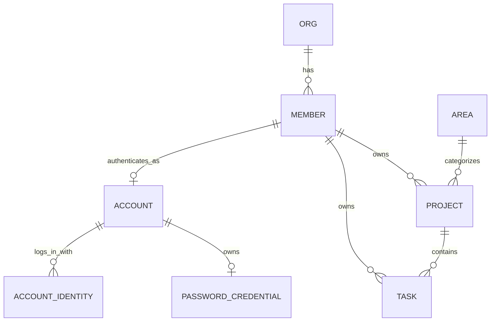
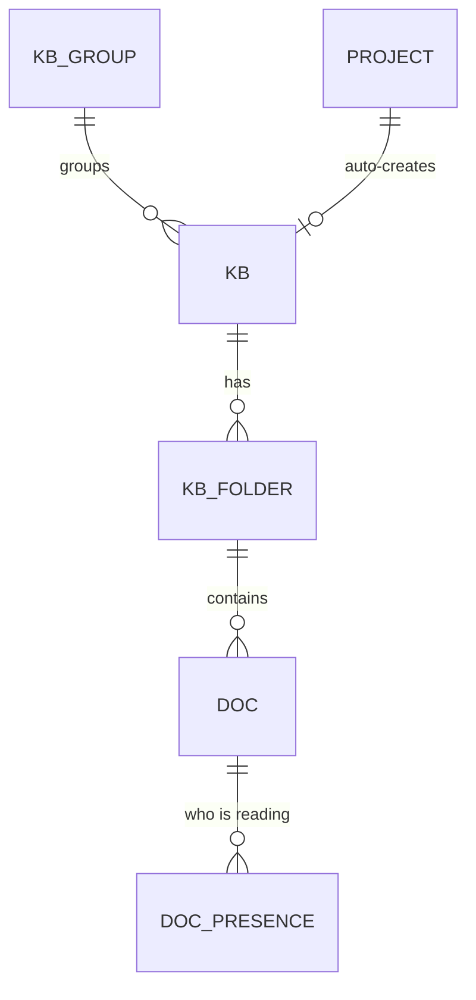

# WAO 数据模型 · 核心域（Phase 1）

来源：`init-design/WAO 架构图与ER图.dc.html` 与前端 `wao-web/src/types/domain.ts`。本轮落地 **组织 / 成员 / 领域 / 项目 / 任务** 五张核心表；知识库、文档、自动化、文件、图床、密码库、日历等域沿用相同模式在后续迭代补充（前端此前已实现，暂以 fixtures 兜底）。

## 设计取舍：关系列 + JSON 文档（混合）

项目与任务是聚合根，含大量可变长嵌套结构（里程碑、趋势、阻塞、动态、步骤、子任务、评论、自定义属性…）。本轮采取**混合建模**：

- **可查询字段**（状态、领域、负责人、截止、进度、优先级、所属项目）落成真实列，支持筛选 / 排序 / 关联查询；
- **富嵌套结构**存入 `detail_json`（MySQL `JSON`），由 Service 用 Jackson 组装为与前端一致的 DTO。

完全规范化（milestone / activity / comment 独立表）留待后续 ADR，一次性拆表会显著增加本轮体量而不改变对外契约。对外 REST 契约（`ApiResponse<ProjectDto>` 等）与最终规范化结果保持稳定。

## ER 概览

## 表与字段字典

账号、身份与共享会话表见 [ADR-016](../adr/016-unified-account-and-session.md) 和 `V12__account_auth.sql`。`account` 关联唯一成员；`account_identity` 以 `(provider, provider_subject)` 保证外部身份唯一；`password_credential` 保存 BCrypt 哈希、失败次数和锁定时间；`SPRING_SESSION*` 保存跨节点 HttpOnly 会话。

### org（组织）
| 列 | 类型 | 说明 |
|---|---|---|
| id | VARCHAR(32) PK | 组织 id |
| name | VARCHAR(128) | 组织名 |
| member_count | INT | 成员数（冗余，展示用） |

### member（成员）
| 列 | 类型 | 说明 |
|---|---|---|
| id | VARCHAR(32) PK | 成员 id |
| name | VARCHAR(64) | 昵称 |
| initial | VARCHAR(4) | 头像首字 |
| color | CHAR(7) | 头像色 #RRGGBB |
| role | VARCHAR(32) | 管理员 / 成员 |

### area（人生领域）
| 列 | 类型 | 说明 |
|---|---|---|
| id | VARCHAR(32) PK | 领域 id（career/health/…） |
| name | VARCHAR(32) | 领域名 |
| color | CHAR(7) | 领域色 |

### project（项目）
| 列 | 类型 | 说明 |
|---|---|---|
| id | VARCHAR(32) PK | 项目 id |
| name | VARCHAR(128) | 名称 |
| area | VARCHAR(32) FK→area | 所属领域 |
| status | VARCHAR(16) | 进行中/有风险/规划中/已完成 |
| health | VARCHAR(16) | 良好/需要关注/风险 |
| progress | INT | 0–100 |
| owner_id | VARCHAR(32) FK→member | 负责人 |
| start_date | VARCHAR(16) | 开始（ISO） |
| due_date | VARCHAR(16) | 截止（ISO） |
| visibility | VARCHAR(64) | 可见范围文案 |
| updated_label | VARCHAR(32) | “26 分钟前”等展示文案 |
| goal | VARCHAR(512) | 一句话目标 |
| notify_enabled | TINYINT(1) NOT NULL DEFAULT 1 | 这个项目的动静是否发飞书群（V36）；关掉后新建任务、状态变化、新增子任务、评论与 AI 执行的卡片都不发，全局 webhook 开关仍然一票否决 |
| detail_json | JSON | members[], milestones[], msDates[], trend[], blockers[], docs[], files[], activity[], icon, taskGroups[]（任务分组，最多 6 个） |

### task（任务）
| 列 | 类型 | 说明 |
|---|---|---|
| id | VARCHAR(32) PK | 任务 id |
| title | VARCHAR(256) | 标题 |
| project_id | VARCHAR(32) FK→project | 所属项目 |
| status | VARCHAR(16) | 待办/收集中/进行中/AI 进行中/待验证/已完成（「阻塞」已由 V16 迁到「进行中」，等待他人改由 waiting 表达；进入「收集中」会自动分享到飞书群，见 ADR-027） |
| pr | CHAR(2) | P0–P3 |
| owner_id | VARCHAR(32) FK→member | 负责人 |
| start_date | VARCHAR(16) NULL | 开始；可在任务属性栏直接改，空串表示未排期 |
| due_date | VARCHAR(16) | 截止；同上 |
| waiting | VARCHAR(64) NULL | 等待他人标记 |
| description | MEDIUMTEXT | 描述；V60 起支持不受 4000 字人为上限的长 Markdown，图片仍应存图床并只保留稳定 URL |
| detail_json | JSON | parts[], steps[], subs[], files[]（真实文件引用含 `file_blob.id`，历史展示附件可为空）, docs[], linkTasks[], comments[], custom[], activity[]（条目含 by=操作人成员 id）, images[], groupId（所属任务分组）, startAt/endAt（可选日历时间段，格式 `yyyy-MM-ddTHH:mm`，endAt 必须晚于 startAt）, pdcaCycles[]（多轮计划、检查、改进行动与闭环时间，见 ADR-048） |

## 内容 / 参考域（文档表，只读）

文件、图床、日历、日程、AI 建议、目标仍以纯展示为主，采用「文档表」`(id, ord, payload JSON)`：payload 存完整 JSON（与前端类型一致），`ord` 保证展示顺序。读接口经 `ContentMapper`（`@Select payload`）+ `ContentService`（JSON 直通）返回，不为其定义 DTO。表：`file_item, image_item, calendar_event, schedule_item, suggestion, goal`。这些域当前只读；实际的文件上传存储、AI 建议生成等超出本轮范围，留待各自的 spec/ADR 立项。

知识库、自动化、密钥库已从「文档表」升级为关系表（见下），不再只读。

## 知识库域

知识库 / 文件夹 / 文档一律**软删除**：`deleted_at` 非空即在回收站，保留 7 天后由调度器物理删除（见 ADR-018）。所有读路径都要带「未删除」条件。

### kb_group（自建知识库分组）
| 列 | 类型 | 说明 |
|---|---|---|
| id | VARCHAR(32) PK | 分组 id |
| name | VARCHAR(64) | 分组名 |
| ord | INT | 展示顺序 |

### kb（知识库）
| 列 | 类型 | 说明 |
|---|---|---|
| id | VARCHAR(32) PK | 知识库 id |
| name | VARCHAR(128) | 名称 |
| icon | VARCHAR(64) | remixicon 类名 |
| color | CHAR(7) | 主题色 |
| project_id | VARCHAR(32) NULL | 关联项目（项目知识库） |
| auto | TINYINT(1) | 是否自动化沉淀知识库（名称/简介不可改） |
| description | VARCHAR(512) | 简介 |
| group_id | VARCHAR(32) FK→kb_group NULL | 所属自建分组（NULL 时前端按默认分组展示） |
| perm | VARCHAR(16) | 仅自己 / 成员可编辑 |
| ord | INT | 展示顺序 |
| notes | TINYINT(1) | 是否小记知识库（全局「新建小记」的落点，不可删除） |
| deleted_at / deleted_by | DATETIME / VARCHAR(32) NULL | 回收站：删除时间与删除人 |

### kb_folder（文件夹）
| 列 | 类型 | 说明 |
|---|---|---|
| id | VARCHAR(32) PK | 文件夹 id |
| kb_id | VARCHAR(32) FK→kb | 所属知识库 |
| name | VARCHAR(128) | 文件夹名 |
| ord | INT | 展示顺序 |
| deleted_at | DATETIME NULL | 回收站：删除时间 |
| cascade_del | TINYINT(1) | 1 = 随知识库一起被删，恢复知识库时一并恢复，回收站不单独展示 |

### doc（文档）
| 列 | 类型 | 说明 |
|---|---|---|
| id | VARCHAR(32) PK | 文档 id |
| kb_id | VARCHAR(32) FK→kb | 所属知识库（新建文档必填，即建立关联） |
| folder_id | VARCHAR(32) FK→kb_folder | 所属文件夹 |
| title | VARCHAR(256) | 标题 |
| author_id | VARCHAR(32) | 作者（成员 id 或 auto） |
| auto | TINYINT(1) | 是否自动化沉淀 |
| created_label / updated_label | VARCHAR(32) | 升级前的展示用时间文案，仅老数据还在用 |
| created_at / updated_at | DATETIME NULL | 真实时间戳，对外优先取它，缺失才回落上面的文案 |
| rev | INT | 正文版本号，每次内容更新 +1，供协同端判断服务端有没有更新的版本 |
| blocks_json | JSON | 正文块数组（call/h/p/ul/q 互斥） |
| links_json | JSON | 出链数组 `[{type, id}]`，指向 project/task/doc |
| ord | INT | 展示顺序 |
| deleted_at / deleted_by | DATETIME / VARCHAR(32) NULL | 回收站：删除时间与删除人 |
| cascade_del | TINYINT(1) | 1 = 随父级一起被删，恢复父级时一并恢复 |

### doc_template（文档模板）
| 列 | 类型 | 说明 |
|---|---|---|
| id | VARCHAR(32) PK | 模板 id |
| name / description | VARCHAR | 模板名称与使用说明 |
| blocks_json | JSON | 创建模板时的文档正文快照 |
| source_doc_id | VARCHAR(32) NULL | 来源文档，仅用于追溯；来源删除不影响模板 |
| created_by | VARCHAR(32) | 模板创建成员；列表与增删改均按当前成员隔离 |
| created_at / updated_at | DATETIME | 真实创建、更新时间 |
| ord | INT | 模板选择面板中的顺序 |

### doc_presence（文档协同在场）
| 列 | 类型 | 说明 |
|---|---|---|
| id | VARCHAR(96) PK | 合成主键 `<doc_id>:<member_id>`，一个人对一篇文档只有一条 |
| doc_id / member_id | VARCHAR(32) | 谁在看哪篇 |
| line | INT | 光标所在的顶层块序号，-1 表示只在查看 |
| editing | TINYINT(1) | 最近一次心跳前是否在输入 |
| seen_at | DATETIME | 最后一次心跳；超过在场窗口（20 秒）即视为离开 |

在场表跨节点共享（对齐 `spring-session-jdbc` 的思路），因此落在不同节点上的两个人也能互相看见；心跳机制与并发编辑的取舍见 ADR-017。

反向链接（backlinks）不落库：`KnowledgeService` 对某文档取全部文档的 `links_json` 动态反查，当前只覆盖「文档 → 文档」的反链；项目 / 任务指向文档的反链留待这两个域也支持文档关联时再补充。

## 自动化域

`feishu_notification` 记录每次由自动化实际发出的飞书通知；`feishu_notification_feedback` 记录卡片按钮的真实回调（通知、事件、点击人和正/负反馈）。未点击不产生反馈行，因此报表不会伪造「没做到」。

### automation_job（任务）
| 列 | 类型 | 说明 |
|---|---|---|
| id | VARCHAR(32) PK | 任务 id |
| name | VARCHAR(128) | 名称 |
| icon | VARCHAR(64) | remixicon 类名 |
| schedule_label | VARCHAR(64) | 展示用计划文案（如「每日 06:00」） |
| cron_expr | VARCHAR(64) NULL | 标准 5 段 Cron；非空时由 `JobSchedulerService` 按计划自动执行，留空则仅手动触发 |
| status | VARCHAR(16) | 正常 / 待修复 / 已暂停 |
| last_run_label | VARCHAR(128) | 上次运行展示文案 |
| description / source / target | VARCHAR | 描述 / 数据源 / 输出目标 |
| steps_json | JSON | 执行步骤（描述性文本数组，不是可执行代码） |
| next_fire_at | DATETIME NULL | 下次计划触发时间，调度器轮询用 |
| ord | INT | 展示顺序 |
| handler | VARCHAR(64) NULL | 服务端真实执行器名（如 `feishu-chat-sync`）；为空表示模拟运行 |

### automation_run（运行记录）
| 列 | 类型 | 说明 |
|---|---|---|
| id | VARCHAR(32) PK | 运行 id |
| job_id | VARCHAR(32) FK→automation_job | 所属任务 |
| run_time_label | VARCHAR(64) | 兼容旧数据的开始时间文案；新记录写绝对时间 |
| run_at | DATETIME NULL | 上海时区的真实开始时间；接口按当前日期动态显示“今天 / 昨天 / M月d日” |
| result | VARCHAR(64) | 结果文案（含「成功」/「失败」关键字供前端着色） |
| executor_id | VARCHAR(32) NULL | 手动触发的成员；定时任务为空，界面显示「定时任务」 |
| duration_ms | INT | 模拟耗时 |
| ord | INT | 顺序（0 = 最近一次） |

执行引擎：`JobSchedulerService` 每分钟轮询到期的 Cron 任务并调用 `AutomationService.executeScheduled`。下一次触发时间从原计划点推进，延迟或停机恢复后会逐次补跑而不跳过业务日期；执行器同时收到该次计划时间。`handler` 非空的任务交给对应的 `JobHandler` 真的执行（目前只有 `feishu-chat-sync`，见 ADR-019），运行记录写执行器返回的结果；`handler` 为空的任务仍是「真实触发时机 + 模拟执行结果」——`steps_json` 只是描述性文本，NAS / 邮箱等外部系统尚未接入。

### system_setting（系统级配置，V17）
| 列 | 类型 | 说明 |
|---|---|---|
| cfg_key | VARCHAR(64) PK | 配置键，如 `feishu.webhook.url`、`feishu.chat-sync.app-secret`、`navigation.builtin-menus`（内置菜单名称、图标、分组、排序和显隐注册表） |
| cfg_value | TEXT | 配置值；敏感键加密存储，密文带 `enc:` 前缀 |
| updated_at | DATETIME | 最后修改时间 |

全局唯一一份的键值配置。敏感值（webhook 地址、App Secret）复用 `VaultCryptoService` 的 AES-256-GCM 加密后落库，接口只回脱敏形态（`SettingService.mask`），明文只在服务端调飞书接口时解出来用；因此真实凭据既不进 Git 也不必写进环境变量。

## AI Run 域（V18）

### ai_project_config

| 列 | 类型 | 说明 |
|---|---|---|
| project_id | VARCHAR(32) PK | 项目 id |
| enabled | BOOLEAN | 是否允许该项目触发 AI Run |
| repo_url / default_branch | VARCHAR | Git 仓库与基线分支 |
| workspace_dir | VARCHAR(128) | 各 Runner 工作区根目录下的项目文件夹名 |
| default_engine | VARCHAR(24) | 默认 AI 工具：codex / claude |
| preferred_runner_id | VARCHAR(32) NULL | 固定执行电脑；空表示自动分配 |
| max_parallel_runs | INT | 同一项目最大并发 |
| updated_at | DATETIME | 最后更新时间 |

### ai_runner_node / ai_runner_pair_code

`ai_runner_node` 保存电脑名、平台、本机可用的 AI 工具（`engines`，逗号分隔，Runner 自述并在
心跳刷新）、并发槽位、令牌 SHA-256 哈希和最后心跳；不保存令牌明文。
- `max_concurrency`：Runner 本地自报的最大并发线程数。
- `admin_max_concurrency`：管理员在后台配置的线程数，存在时优先于 `max_concurrency` 生效。
- `script_hash`：Runner 心跳自报的脚本 SHA-256，用于判断是否落后于服务端打包的最新版。
- `update_requested_at`：后台一键下发脚本更新的时间；节点自更新后上报最新哈希时自动清除。
- `log_tail` / `log_updated_at`（V48）：Runner 心跳上报的已脱敏日志尾部（最多 30,000 字符）及快照时间；
  完整日志仍只保留在执行电脑本机。
`ai_runner_pair_code` 保存一次性配对码哈希、过期时间和使用时间，明文只在生成接口返回一次。

### ai_task_run

| 列 | 类型 | 说明 |
|---|---|---|
| id / task_id / project_id | VARCHAR(32) | 运行、任务和项目 id |
| sub_id | VARCHAR(64) NULL | 本次只跑这一条子任务；整条任务的运行为空。分享清单会把已派工的子任务摘掉（见 ADR-027） |
| engine | VARCHAR(24) | 本次使用的 AI 工具：codex / claude |
| ai_account_id | VARCHAR(32) NULL（V40） | 本次固定使用的集中账号；为空时使用 Runner 本地登录态（见 ADR-032） |
| status | VARCHAR(24) | queued / running / succeeded / failed / cancelled |
| runner_id | VARCHAR(32) NULL | 实际领取的电脑 |
| requested_runner_id | VARCHAR(32) NULL | 入队时点名的电脑；优先于项目的 preferred_runner_id |
| prompt_url / branch_name | VARCHAR | Markdown 任务地址与隔离分支 |
| retry_of_run_id | VARCHAR(32) NULL | 本次重跑要修复的那一次失败运行；领取时把它的摘要交给 AI（见 ADR-025） |
| result_summary / session_id / exit_code | TEXT / VARCHAR / INT | AI CLI 最终摘要、会话 id 与退出码 |
| pending_input | TEXT | 等待原 AI 会话消费的用户补充输入；仅由原执行电脑恢复 |
| model / models | VARCHAR(120) / VARCHAR(500) NULL | 输出 token 最多的模型，以及本次用到的全部模型（逗号分隔） |
| input_tokens / output_tokens / cached_input_tokens / total_tokens | BIGINT NULL | 本次运行的 token 用量；续跑在同一条记录上累加 |
| cost_usd | DECIMAL(12,6) NULL | 折算额度（美元）；Codex 不回传花费时为空（见 ADR-026） |
| latest_progress / progress_updated_at | VARCHAR(1000) / DATETIME | 首页快速读取的最近一条用户可读进展 |
| created_at / claimed_at / started_at / finished_at | DATETIME | 完整运行时间线 |

### ai_run_progress

| 列 | 类型 | 说明 |
|---|---|---|
| id / run_id | VARCHAR(32) | 进展与所属运行 id |
| kind | VARCHAR(24) | phase / message / plan / result |
| content | VARCHAR(1000) | 过滤命令和工具调用后的用户可读摘要 |
| created_at | DATETIME | 上报时间，用于实时展示与任务档案排序 |

### ai_evolution_state / ai_evolution_suggestion（V61 / V63 / V64）

自主进化调度的全局单例状态。`next_check_at` 用条件更新在主从节点间原子抢占，避免重复派发；
`last_checked_at`、`last_outcome`、`last_run_id` 和 `last_suggestion_id` 供首页解释最近一次调度结果。
V66 新增 `interval_hours` 与 `batch_size`，保存全局人工配置的空闲等待小时数和单次最多派发任务数；
默认 12 小时、1 个任务，升级后保持原有节奏。
V63 新增 `last_low_quota_key`，保存已经成功发送飞书提醒的“账号 + 周额度重置时间”键集合（重置时间缺失时使用自然周）；
额度进入新的重置周期后会生成新键，发送失败则不写入，下一轮检查继续重试。

`ai_evolution_suggestion` 按 `batch_id + ord` 保存本地 Codex 从真实知识库/飞书归档挖掘出的任务批次；
每条包含标题、说明、可直接派发的完整目标以及 `source_title / source_url`。一批一至五条在同一事务中写入，
首页只读取最新完整批次；历史随机 id 保留，使刷新前已打开的页面仍能安全派发服务端原始目标。

### ai_account（V38）

| 列 | 类型 | 说明 |
|---|---|---|
| id | VARCHAR(32) PK | 账号 id |
| provider | VARCHAR(24) | AI 工具：codex / claude / qoder |
| label | VARCHAR(128) | 展示名称 |
| email | VARCHAR(255) NULL | 账号邮箱或标识 |
| credential_json | TEXT | AES-256-GCM 加密后的凭据 JSON；密文带 `enc:` 前缀 |
| enabled | TINYINT(1) | 是否启用；只有启用的账号才会下发给 Runner |
| quota_status | VARCHAR(24) NULL | 额度同步状态：UNKNOWN / NO_API / SYNCED / FAILED |
| quota_message | VARCHAR(500) NULL | 额度/状态的人可读摘要 |
| quota_raw_json | TEXT NULL | 供应商返回的原始额度快照 |
| last_synced_at | DATETIME NULL | 上次手动同步时间 |
| created_at / updated_at | DATETIME | 创建与更新时间 |
| auth_method | VARCHAR(16)（V39/V40） | 凭据来源：`oauth` 登录 / `manual` 粘贴 / `api_key` 自定义 API |
| plan | VARCHAR(64) NULL（V39） | 订阅套餐，如 pro / max |
| token_expires_at | DATETIME NULL（V39） | access token 过期时间，到期前自动续期 |
| quota_window | VARCHAR(32) NULL（V39） | 最紧张的限额窗口，如 session / weekly_all |
| quota_percent | INT NULL（V39） | 该窗口已用百分比；**NULL 表示没查到，不等于 0** |
| quota_resets_at | DATETIME NULL（V39） | 该窗口的重置时间 |
| base_url | VARCHAR(512) NULL（V40） | 自定义 Responses API 根地址，服务端规范化为 `/v1` 结尾 |
| model | VARCHAR(128) NULL（V40） | 自定义 API 的默认 Codex 模型 |
| api_protocol | VARCHAR(24) NULL（V40） | 自定义 API 协议，目前固定为 `responses` |

集中管理 AI 工具账号，解决多台 Runner 重复登录和额度查看不统一的问题。
凭据加密存储，前端接口不回传明文；未绑定到运行的官方/手工凭据仍可通过 opt-in 的
`/api/ai/runner/accounts` 同步给已配对节点。V40 起，用户可以在启动运行时选择账号，只有实际领取
该运行的 Runner 才会在 claim 响应中拿到对应明文；自定义 API Key 不进入全局凭据同步。
OAuth 下发前会先把快过期的 access token 续期。
额度查询只使用真实返回：Claude 走 Anthropic 的 `/api/oauth/usage`；Codex OAuth 使用同一登录态
尽力读取 ChatGPT 的 `backend-api/wham/usage`，失败时标记 `FAILED` 并允许重试；Qoder 没有可靠接口时
标记为 `NO_API`。任何未知额度都不伪造成 0%。详见 ADR-030 至 ADR-032。

### ai_assistant_run（V50）

| 列 | 类型 | 说明 |
|---|---|---|
| id | VARCHAR(32) PK | 一次页面问答 id |
| member_id | VARCHAR(32) | 发起成员；同一成员只允许一个活动问答 |
| conversation_id / user_message_id | VARCHAR(32) NULL（V53） | 关联持久化会话和触发本次运行的用户消息 |
| runner_id | VARCHAR(32) NULL | 实际领取问答的本地 Codex Runner |
| status | VARCHAR(16) | queued / running / succeeded / failed |
| prompt_text | MEDIUMTEXT NULL | 拼好的页面上下文与对话；完成后立即清空 |
| response_text / error_text | MEDIUMTEXT / TEXT NULL | 最终答复或可读错误 |
| created_at / claimed_at / finished_at / updated_at | DATETIME(6) | 短期队列时间线 |

这张表只负责把一次请求可靠交给 Runner；完成后仍清除拼装提示词。长期消息由 V53 的会话表保存，见 ADR-045。

### ai_assistant_conversation / ai_assistant_message（V53）

`ai_assistant_conversation` 按 `member_id` 隔离个人历史，保存标题、最后消息摘要和更新时间；
`ai_assistant_message` 保存会话内的 `user` / `assistant` 正文并随会话级联删除。列表最多返回最近 50 个会话，
单次详情最多返回最近 200 条消息；仍在回答中的会话不能删除。

首页“给此刻的你”复用 `member_preference` 的 `daily-guidance` 键保存当前成员当天的生成结果，不写入私人聊天
历史，也不新增长期建议表；生成仍走 `ai_assistant_run` 短期队列，边界见 ADR-062。

全局音乐播放器复用 `member_preference` 的 `music-player-settings-v1` 键，以 JSON 原子保存“登录后默认打开”和“显示播放器入口”两个布尔值；新成员默认不展开面板但显示入口。

### memory_access_token（V70）

| 列 | 类型 | 说明 |
|---|---|---|
| id | VARCHAR(32) PK | 按设备令牌 id |
| member_id | VARCHAR(32) | 签发成员；页面只能管理当前成员自己的令牌 |
| name / token_prefix | VARCHAR | 设备用途与可辨识前缀，列表不返回完整令牌 |
| token_hash | CHAR(64) UNIQUE | `wao_mcp_...` 高熵令牌的 SHA-256 摘要；数据库不保存明文 |
| created_at / last_used_at / revoked_at | DATETIME | 创建、最近成功认证和吊销时间 |

V70 同时种下固定 `kb-memory / kb-memory-f` 的“共享记忆”知识库与文件夹。MCP 的 `save_memory` 每次写入一篇
普通文档，成员可核对、修订和删除；检索继续读取权威 `doc` 表，不维护第二份隐藏记忆或空向量索引。契约与安全
边界见 ADR-078。

日历的国际节日范围复用 `member_preference` 的 `holiday-international-categories` 键；新成员默认空数组，
不会自动加入全部国际节日。

“今日节奏”复用 `member_preference` 的 `workday-rhythm-config-v1` 保存个人时间块模板及精力补给通知目标/动作开关，并以
`workday-rhythm-day-YYYY-MM-DD` 保存当天三个重点、时间块完成项、喝水次数、冥想和是否执行；页面同时保留
未成功提交的本机草稿。飞书应用密钥仍在系统配置加密保存，不进入成员偏好；见 ADR-079、ADR-081。

### holiday_reminder / holiday_reminder_delivery（V67）

`holiday_reminder` 按 `member_id + holiday_code` 唯一保存每年重复的节日提醒、提醒时间和开关；
`holiday_code` 是跨年份稳定的服务端定义，客户端不能自造节日名称。`holiday_reminder_delivery` 按
`reminder_id + event_date` 唯一保存发送、失败、错误与重试次数，确保多应用节点不会重复私聊。
提醒仅投递给该成员账号绑定的飞书身份，未绑定飞书或未配置自建应用时不能开启。

### family_important_date / family_important_date_delivery（V72）

`family_important_date` 按 `member_id` 隔离保存成员自己维护的生日、纪念日等重要日；`event_date`
保留原始年份，展示和提醒按公历月日逐年展开。提醒可设为当天或提前 0–30 天，并记录上海时区的发送时间。
`family_important_date_delivery` 按 `important_date_id + occurrence_date` 唯一保存一次年度投递，提前提醒也以
重要日实际发生日期作为幂等键。删除维护项时由外键级联删除投递记录。

### ai_account_oauth_session（V39）

| 列 | 类型 | 说明 |
|---|---|---|
| state | VARCHAR(64) PK | 登录会话随机标识，回填授权码或查询设备码状态时据此找回会话 |
| provider | VARCHAR(24) | claude / codex |
| code_verifier | VARCHAR(128) NULL | 授权码模式的 PKCE code_verifier，**只留服务端，不下发前端** |
| flow | VARCHAR(24)（V41） | authorization_code / device_code |
| device_auth_id | VARCHAR(128) NULL（V41） | Codex 设备码会话 id，仅服务端使用 |
| user_code | VARCHAR(32) NULL（V41） | 用户在 OpenAI 官方页面确认的一次性短码 |
| poll_interval_seconds | INT NULL（V41） | OpenAI 返回的最小轮询间隔 |
| last_polled_at | DATETIME NULL（V41） | 最近一次向 OpenAI 查询授权结果的时间，用于限制轮询频率 |
| label | VARCHAR(128) NULL | 登录完成后要给账号起的名字 |
| created_by | VARCHAR(32) NULL | 发起登录的成员 id |
| created_at / expires_at | DATETIME | 创建时间与十分钟有效期 |

一次进行中的 OAuth 登录。Claude 授权码会话十分钟有效，Codex 设备码会话十五分钟有效；换到令牌或
过期后立即删除，发起新登录时顺带清理过期行。详见 ADR-031、ADR-033。

## 密钥库域

### vault_group（分组）
| 列 | 类型 | 说明 |
|---|---|---|
| id | VARCHAR(32) PK | 分组 id |
| name | VARCHAR(64) | 分组名；可随便改，改名不影响是不是默认分组 |
| ord | INT | 展示顺序 |
| owner_member_id | VARCHAR(32) | 归属成员；`/api/vault/*` 只在自己的分组内生效（见 ADR-024） |
| is_default | TINYINT(1) | 该成员的默认分组：不可删除、新建条目的默认落点（见 ADR-036） |

条目的归属跟随所在分组，不单独记列：一个条目要么在自己的分组里，要么就不该被看见。

### vault_item（条目）
| 列 | 类型 | 说明 |
|---|---|---|
| id | VARCHAR(32) PK | 条目 id |
| group_id | VARCHAR(32) FK→vault_group | 所属分组 |
| name / icon / user_name / site / note | VARCHAR | 展示字段 |
| secret_ciphertext | VARBINARY(1024) NULL | AES-256-GCM 密文（含 GCM tag） |
| secret_nonce | VARBINARY(32) NULL | 本次加密使用的随机 nonce |
| updated_label | VARCHAR(32) | 展示用更新时间文案 |
| ord | INT | 展示顺序 |

密码加密方案见 `docs/adr/009-vault-server-side-encryption.md`：密钥来自环境变量 `WAO_VAULT_KEY`（base64 32 字节），列表 / 详情接口从不返回明文，只在 `POST /api/vault/items/{id}/reveal` 按需解密一次。这是服务端静态加密，不是零知识端到端加密。

## 个人草图域

### drawing_file（草图文件）
| 列 | 类型 | 说明 |
|---|---|---|
| id | VARCHAR(32) PK | 草图文件 id |
| owner_member_id | VARCHAR(32) | 归属成员；`/api/drawings/*` 只在当前会话成员范围内生效 |
| title | VARCHAR(128) | 草图文件名 |
| scene_json | LONGTEXT | Excalidraw 开放 JSON 场景，包含元素、画布状态与已插入图片 |
| revision | INT | 乐观锁版本；保存成功后递增，防止多页面静默覆盖 |
| created_at / updated_at | DATETIME(6) | 创建与最后保存时间 |

草图编辑器与 Vue 集成边界见 ADR-056；草稿恢复、冲突与交互规则见
`docs/specs/phase-1-personal-drawings.md`。

### drawing_file_version（草图有效版本）
| 列 | 类型 | 说明 |
|---|---|---|
| file_id / revision | VARCHAR(32) + INT PK | 关联草图及该场景生成时的单调版本号 |
| scene_json | LONGTEXT | 可恢复的 Excalidraw 场景快照 |
| created_at | DATETIME(6) | 真实内容变化并成功保存的时间 |

每次场景真实变化后写入快照并只保留版本号最大的三份；删除草图时通过外键级联删除历史。

## 通用文件

### file_blob
| 列 | 类型 | 说明 |
|---|---|---|
| id | VARCHAR(64) PK | 文件 id |
| name / content_type | VARCHAR | 安全文件名与 MIME 类型 |
| byte_size | BIGINT | 字节数，单个文件最大 50MB |
| created_by / created_at | VARCHAR / DATETIME(3) | 上传成员与上海时间 |
| content | LONGBLOB | 文件二进制正文，列表查询不读取 |

下载不落库：对外分享的是前端下载页 `/f/{id}`，答对一道人机校验题才换得到一张一次性票据（进程内存，120 秒有效、用完即废），下载接口只认票据或本人登录会话（见 ADR-020）。

### hosted_page
| 列 | 类型 | 说明 |
|---|---|---|
| id | VARCHAR(64) PK | 托管页 id |
| slug | VARCHAR(80) UNIQUE | 公网地址唯一后缀 |
| title / file_name | VARCHAR | 服务端注入的标题与原 HTML 文件名 |
| html_content | MEDIUMBLOB | UTF-8 单文件 HTML，最大 10MB |
| icon_content / icon_content_type | MEDIUMBLOB / VARCHAR NULL | 可选 favicon 正文与 MIME 类型，最大 1MB |
| created_by | VARCHAR(64) | 创建成员 |
| created_at / updated_at | DATETIME(3) | 创建与最后更新时间 |

公开出口 `/api/pages/{slug}` 返回注入标题与 favicon 的 HTML，并以不含 `allow-same-origin`、`allow-forms` 的 CSP sandbox 隔离 WAO 会话（见 ADR-042）。
AI Run 报告复用本表，不新增重复正文列：页面 id 为 `run-report-<run-id>`，运行列表据此批量读取元数据并
返回 `reportUrl`；用户删除页面后关联自然消失。同一次运行续跑只更新正文，人工修改过的标题与后缀保留
（见 ADR-055）。

## CalDAV 日历域

### caldav_account（账户）
| 列 | 类型 | 说明 |
|---|---|---|
| id | VARCHAR(32) PK | 账户 id（`cda` 前缀） |
| member_id | VARCHAR(32) | 归属成员；`/api/caldav/*` 只在自己的账户内生效 |
| name | VARCHAR(128) | 展示名，缺省时取服务器主机名 |
| server_url / username | VARCHAR | CalDAV 服务器地址与登录名 |
| password_ciphertext | VARBINARY(1024) | AES-256-GCM 密文（复用 `WAO_VAULT_KEY`，同 vault_item） |
| password_nonce | VARBINARY(32) | 本次加密的随机 nonce |
| status | VARCHAR(16) | `ok` / `error`，最近一次同步的结果 |
| last_sync_at / sync_error | DATETIME / VARCHAR(512) | 上次成功同步时间与最近的错误摘要 |

### caldav_calendar（订阅的日历）
| 列 | 类型 | 说明 |
|---|---|---|
| id | VARCHAR(32) PK | 日历 id（`cdc` 前缀） |
| account_id | VARCHAR(32) FK→caldav_account | 所属账户 |
| href | VARCHAR(512) | 服务器上的 collection 路径，同步时定位用 |
| name / color | VARCHAR | 展示名与颜色（服务器没给颜色时轮转内置色板） |
| enabled | TINYINT(1) | 停用后事件不再出现在日历页，也不再参与同步 |
| ord | INT | 展示顺序 |

### caldav_event（事件只读副本）
| 列 | 类型 | 说明 |
|---|---|---|
| id | VARCHAR(40) PK | 事件 id（`cde` 前缀，重复事件每次展开一行） |
| calendar_id | VARCHAR(32) FK→caldav_calendar | 所属日历 |
| uid | VARCHAR(255) | iCalendar UID |
| summary / location | VARCHAR | 标题与地点 |
| start_at / end_at | DATETIME | 开始 / 结束时间（上海时区本地时间） |
| all_day | TINYINT(1) | 全天事件 |

事件是服务端从 CalDAV 服务器单向拉取的只读副本：每 15 分钟定时同步一次，窗口为过去 90 天到未来 400 天，重复规则（RRULE）在服务端展开后落库；每次同步按日历整体重建（先删后插），因此跨节点重复执行也是幂等的。接口契约见 `docs/api/caldav.yaml`。

## 游戏厅域

### game_save（活动存档）
| 列 | 类型 | 说明 |
|---|---|---|
| id | VARCHAR(80) PK | `<memberId>:<gameKey>`，一个成员在一个游戏里只有一份活动存档 |
| member_id / game_key | VARCHAR | WAO 成员与游戏稳定标识；现有 `number-merge`、`memory-match` |
| state_json | TEXT | 游戏规则自有状态；数字熔炉保存 16 格棋盘；记忆翻牌保存服务端牌序、已配对位置、首张位置、当前步数、最佳步数与完成状态 |
| score / move_count / won | BIGINT / INT / TINYINT | 数字熔炉为当前分数/步数/达标；记忆翻牌复用为当前步数/当前步数/本局是否完成 |
| revision | INT | 乐观锁版本，每次有效移动、撤销或重开递增 |
| previous_state_json / previous_score / previous_move_count | TEXT / BIGINT / INT NULL | 最近一步的前态，撤销后清空 |
| started_at / updated_at | DATETIME(3) | 本局开始时间与最近保存时间 |

### game_run_record（历史战绩）
| 列 | 类型 | 说明 |
|---|---|---|
| id | VARCHAR(32) PK | 对局记录 id |
| member_id / game_key | VARCHAR | 按成员和游戏隔离、查询 |
| score / highest_tile / move_count | BIGINT / INT / INT | 归档时的成绩摘要 |
| outcome | VARCHAR(16) | `WON` / `GAME_OVER` / `RESTARTED` |
| started_at / ended_at | DATETIME(3) | 本局时间范围 |

数字熔炉的移动和随机出牌由服务端执行，前端只提交方向与当前 `revision`；记忆翻牌的牌序、翻牌校验、配对和计步同样由服务端执行，前端只提交位置与 `revision`，且隐藏牌面不会提前下发。契约与扩展原则见 ADR-040、ADR-049。

## 天人一卦域

### tianren_daily_reading（成员每日卦象）
| 列 | 类型 | 说明 |
|---|---|---|
| id | VARCHAR(32) PK | 每日卦象 id |
| member_id / reading_date | VARCHAR(32) / DATE | 成员与上海时区日期，组合唯一，保证每天只有一卦 |
| lines_json | VARCHAR(32) | 初爻到上爻的六个 6/7/8/9；服务端生成并在读取时校验 |
| primary_number / relating_number | TINYINT / TINYINT NULL | 文王卦序的本卦号与可选之卦号 |
| conversation_id | VARCHAR(32) FK NULL | 成员私有 AI 解读会话；会话删除后置空，不删除卦象 |
| share_token | CHAR(32) UNIQUE NULL | 成员主动分享时生成的 128 位随机公网访问凭据；空值表示尚未公开 |
| created_at / updated_at | DATETIME(6) | 起卦时间与会话关联更新时间 |

浏览器不能提交爻值和卦号；服务端模拟三枚硬币、映射六十四卦并持久化。AI 只读取服务端拼装的可信卦象上下文，
对话正文继续保存在 `ai_assistant_message`，边界见 ADR-047。

## 个人单词本域

### vocabulary_entry（成员私有单词记录）
| 列 | 类型 | 说明 |
|---|---|---|
| id | VARCHAR(32) PK | 单词记录 id（`ve` 前缀） |
| owner_member_id | VARCHAR(32) | 归属成员；所有 `/api/vocabulary/*` 读写按当前会话隔离 |
| term / normalized_term | VARCHAR(128) | 原始展示文本 / 合并空白并转小写的去重键；与成员组成唯一索引 |
| meaning_text / context_text | VARCHAR(1000/2000) | 用户自己的释义与遇见语境；系统不伪造词典数据 |
| learning_state | VARCHAR(16) | `LEARNING` / `MASTERED` |
| encounter_count / review_count | INT | 重复遇见次数 / 主动复习次数 |
| last_encountered_at / last_reviewed_at | DATETIME(6) | 最近遇见与最近复习时间 |
| created_at / updated_at | DATETIME(6) | 创建与最近活动时间 |

重复收集由数据库唯一键和 `INSERT ... ON DUPLICATE KEY UPDATE` 原子累计，避免并发请求生成重复记录。
## 个人行动计划域

### action_plan / action_plan_item

| 表 | 关键字段 | 说明 |
|---|---|---|
| action_plan | member_id、title、start_date / target_date、reminder_time / reminder_enabled、status | 成员私有长期目标；完成只改状态，不删除历史 |
| action_plan_item | plan_id、title、weekdays_json、active_from / active_until、active、ord | 周期行动的版本；有历史后调整会截止旧版本并新增当前版本，历史日期仍可还原 |

### action_checkin / action_day_note / action_reminder_delivery

| 表 | 唯一约束 | 说明 |
|---|---|---|
| action_checkin | (item_id, checkin_date) | 用户实际点击产生的每日完成记录；未来日期不可打卡 |
| action_day_note | (plan_id, note_date) | 当天事实复盘；空正文表示删除 |
| action_reminder_delivery | (plan_id, reminder_date) | 飞书个人提醒成功/失败与最多六次重试；先抢占记录再投递，避免双节点重复发送 |

提醒通过当前成员账号绑定的飞书 `open_id` 私聊发送，缺少真实身份或自建应用配置时明确失败，绝不回退成
模拟成功或群 webhook。功能只规划和记录用户自行确认的行动，不从图片推导健康处方；边界见 ADR-057。

## 个人英语训练域

### english_learning_profile / english_learning_session

| 表 | 关键字段 / 唯一约束 | 说明 |
|---|---|---|
| english_learning_profile | member_id 唯一、goal、daily_target_minutes、start_date | 当前成员的交流目标与可持续投入；所有接口从会话确定成员 |
| english_learning_session | (member_id, study_date) 唯一、lesson_id、四项完成字段、practice_minutes、confidence、写作与复盘、completed_at | 一天唯一的真实训练过程；只有听说读写与信心齐全才写完成时间 |

## 人生回顾域（V69）

`life_review` 按 `(member_id, period_type, period_key)` 唯一保存成员的周、月、年和至今回顾。`period_start / period_end`
固定生成时的上海时区日期范围，三个计数字段记录当时纳入的已完成任务、成员私有 WAO AI 对话和飞书聊天归档覆盖；
`sources_json` 只保存来源编号、类型、标题、日期与内部链接，`report_json` 保存四段结构化回顾，不重复保存原始聊天正文。

课程正文是代码内版本化的原创学习材料，不进入业务表；日记录保存当时的 `lesson_id`，历史课程不会因下一轮
推进而漂移。录音只保留在当前浏览器内存生成的临时 URL，不上传数据库或文件库；边界见 ADR-058。

## 网易云音乐绑定域

### netease_music_binding / netease_music_oauth_state

| 表 | 关键字段 / 唯一约束 | 说明 |
|---|---|---|
| netease_music_binding | member_id 主键、四个 token 密文/nonce 字段、token_expires_at、netease_user_id、device_id、status | 一个 WAO 成员最多绑定一个自己的网易云账号；令牌只以 AES-256-GCM 密文保存，成员主键也是所有读取与解绑的隔离边界 |
| netease_music_oauth_state | state 主键、member_id、device_id、net_status、expires_at | 一次性 OAuth 回调关联；随机 state 最长 30 字符、十分钟失效，回调消费后立即删除；授权发起时的网络类型供回调换令牌使用 |

昵称和头像只用于向当前成员确认绑定身份；播放地址、歌曲列表和播放记录不持久化到 WAO 数据库。安全与官方协议边界见 ADR-071。

## 已退役的自媒体 Agent 视频生成域（Agent Flyway V4）

`agent_video_generation` 曾按工作区保存 OpenAI Videos API 任务。能力已按
[ADR-074](../adr/074-retire-api-key-video-generation.md) 退役；为遵守 Flyway 不修改已执行迁移的约束，
V4 和已有表继续保留，但应用不再写入或提供访问入口。该表属于独立的
`flyway_agent_schema_history`，版本号不与下方 WAO Server migration 混用。

## 迁移
- `V1__core_schema.sql` 核心域建表 + `V2__seed_demo.sql` 种子。
- `V3__content_schema.sql` 内容域建表 + `V4__content_seed.sql` 种子。
- `V5__knowledge_schema.sql` / `V6__knowledge_seed.sql`：知识库域关系表（替换 V3 的 `kb`/`doc` payload 表）。
- `V7__automation_schema.sql` / `V8__automation_seed.sql`：自动化域关系表（替换 V3 的 `job` payload 表）。
- `V9__vault_schema.sql` / `V10__vault_seed.sql`：密钥库域关系表（替换 V3 的 `vault_group` payload 表）。
- `V11__image_store.sql`：图片二进制存储。
- `V12__account_auth.sql`：统一账号、身份、密码凭据与共享会话。
- `V13__drop_content_demo_seed.sql`：清空「文件与图床」的演示数据。
- `V14__knowledge_enhance.sql`：小记知识库、文档真实时间戳与版本号、三张表的回收站列、`doc_presence` 在场表。
- `V15__file_store.sql`：通用文件元数据与二进制正文持久化。
- `V16__task_status_retire_blocked.sql`：任务状态改版，存量「阻塞」迁到「进行中」。
- `V17__system_setting_and_feishu_sync.sql`：系统级配置表、`automation_job.handler` 与内置的飞书群聊同步任务。
- `V18__ai_task_runner.sql`：项目级 AI 配置、执行电脑、一次性配对码与任务运行队列。
- `V19__ai_run_progress.sql`：AI 运行最新反馈与可归档的摘要时间线。
- `V20__ai_run_engine.sql`：节点可用 AI 工具、项目默认 AI 工具、运行使用的工具与按次指定的电脑。
- `V21__chat_sync_icon.sql`：将飞书群聊同步任务修正为前端稳定支持的聊天图标。
- `V22__image_content_hash.sql`：图床按内容摘要去重，避免同一天聊天记录重复同步堆出重复副本。
- `V23__vault_group_owner.sql`：密码库分组归属到人；存量分组统一归到管理员 `wg`（见 ADR-024）。
- `V24__ai_run_retry.sql`：AI 运行记录指回被修复的那一次失败运行（见 ADR-025）。
- `V25__ai_run_continuation.sql`：保存待原 AI 会话消费的用户补充输入。
- `V26__ai_run_usage.sql`：记录每次运行的模型、token 用量与折算额度（见 ADR-026）。
- `V27__automation_run_executor.sql`：记录自动化任务每次手动运行的执行成员，定时任务保持为空。
- `V28__reclassify_unsupported_ai_runs.sql`：把已经合并上线、仅因拒绝伪造非必要功能而误判失败的 AI Run 修正为成功，并将对应任务送回待验证。
- `V29__feishu_quick_collect_and_sub_runs.sql`：AI 运行记录可指向单条子任务（见 ADR-027）。
- `V30__task_creator.sql`：记录任务创建人。
- `V31__runner_admin_concurrency.sql`：管理员可覆盖 Runner 自报并发数。
- `V32__runner_wake_on_lan.sql`：保存 Runner 唤醒信息。
- `V33__task_completed_at_and_webhook_switch.sql`：任务完成时间与 webhook 开关。
- `V34__runner_script_update.sql`：Runner 脚本版本和更新请求。
- `V35__runner_online_state.sql`：Runner 在线状态通知时间线。
- `V36__project_notify_switch.sql`：项目级通知开关。
- `V37__site_filing_settings.sql`：站点备案设置。
- `V38__ai_account.sql`：集中 AI 账号及加密凭据。
- `V39__ai_account_oauth.sql`：AI 账号 OAuth 会话、令牌续期和额度窗口。
- `V40__codex_oauth_custom_api.sql`：Codex OAuth、自定义 Responses API 配置与单次运行账号路由（见 ADR-032）。
- `V41__codex_device_login.sql`：Codex 设备码会话和服务端轮询状态（见 ADR-033）。
- `V42__caldav_accounts.sql`：CalDAV 账户、订阅日历与事件只读副本。
- `V43__feishu_notification_feedback.sql`：飞书定时通知的回执与反馈（见 ADR-035）。
- `V44__member_favorite_preference.sql`：成员收藏与个人偏好。
- `V45__vault_group_is_default.sql`：密码库默认分组改为按 `is_default` 标记识别，存量按 id 还原（见 ADR-036）。
- `V46__super_admin_roles.sql`：把初始维护者角色升级为超级管理员，作为组织级配置权限根。
- `V47__game_hall_persistence.sql`：新增通用游戏活动存档与历史战绩表（见 ADR-040）。
- `V48__runner_log_snapshot.sql`：保存 Runner 最近一段安全诊断日志，供控制台按需查看。
- `V49__automation_run_timestamp.sql`：保存自动化运行真实时间，并从飞书同步结果恢复可确认日期的历史记录。
- `V50__ai_assistant_run.sql`：页面 AI 助手短期队列，由本地 Codex Runner 只读执行（见 ADR-041、ADR-044）。
- `V51__hosted_html_page.sql`：单文件 HTML 托管正文、唯一公开后缀与可选 icon（见 ADR-042）。
- `V52__remove_default_project_knowledge.sql`：移除项目初始化时自动生成的示例知识。
- `V53__assistant_conversation_history.sql`：成员级 AI 助手会话、消息及短期运行关联（见 ADR-045）。
- `V54__tianren_daily_reading.sql`：成员每日唯一卦象及其私有 AI 会话关联（见 ADR-047）。
- `V55__personal_drawing_file.sql`：个人草图文件、Excalidraw 场景与乐观版本。
- `V56__drawing_file_versions.sql`：草图有效版本快照与最近三版滚动留存。
- `V57__personal_vocabulary_notebook.sql`：成员私有单词、个人释义、遇见与主动复习计数。
- `V58__personal_action_plan.sql`：成员私有长期目标、周期行动版本、每日打卡、事实复盘与飞书私聊投递状态。
- `V59__english_learning_practice.sql`：成员私有英语目标、每日听说读写训练、信心与迭代复盘。
- `V60__expand_task_description.sql`：任务描述升级为 `MEDIUMTEXT`，完整承载长 Markdown 自主目标。
- `V61__ai_autonomous_evolution.sql`：保存双节点共享的自主进化调度和最近派发状态。
- `V63__ai_evolution_low_quota_reminder.sql`：按账号与额度重置周期去重飞书低额度提醒。
- `V64__ai_evolution_mined_suggestions.sql`：保存从真实 WAO 资产挖掘且可追溯的自主进化任务建议批次。
- `V66__ai_evolution_schedule.sql`：保存自主进化人工设置的空闲间隔与单次任务数。
- `V67__holiday_preferences_and_reminders.sql`：保存成员节日提醒及按节日日期去重的飞书私聊投递状态。
- `V72__family_important_dates.sql`：保存成员家庭重要日、提前提醒配置与按年度发生日期去重的飞书投递状态。
- `V68__netease_music_binding.sql`：保存成员独立的网易云 OAuth 加密令牌、稳定设备标识和十分钟授权 state（见 ADR-071）。
- `V69__life_review.sql`：成员私有的证据化周、月、年和至今回顾存档（见 ADR-072）。
- `V70__shared_memory_mcp.sql`：Codex MCP 按设备令牌摘要与可核对的共享记忆知识库（见 ADR-078）。
- `V71__document_templates.sql`：按成员隔离的文档模板正文快照（见 ADR-080）。
- 已执行的 migration 不可修改；后续数据库变更新增 migration。
