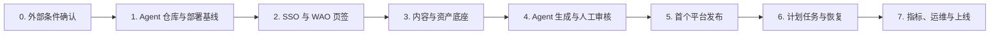

# 自媒体自动化 Agent 执行清单

本清单把 [规格](../specs/phase-1-media-automation-agent.md) 和
[技术架构方案](../architecture/media-automation-agent.md) 拆成可以逐项验收的交付阶段。每个阶段按“一项需求一个
PR”执行，不把 Agent 新仓库初始化、WAO 接入和业务纵向链路塞进同一个 PR。

## 总体顺序

## 阶段 0：确认外部条件

在写业务代码前确定以下内容，并写入 Agent 仓库首份规格或 ADR：

- [ ] GitHub 仓库最终名称；默认 `wao-media-agent`。
- [ ] `agent.wayuwa.cn` 的 DNS、证书和云节点静态目录权限。
- [ ] 首个真实平台及其正式 API、OAuth 权限、回调域名、发布限制和审核要求。
- [ ] 首个模型供应商、预算上限、数据保留和内容安全要求。
- [ ] S3 兼容对象存储实现、区域、容量、生命周期和备份策略。
- [ ] 首版工作区成员与应用内角色映射，不直接继承 WAO 管理员权限。

完成标准：没有权限的平台明确排除在首版发布链路外；不能用 mock 替代未取得的授权。

## 阶段 1：建立 Agent 独立工程与部署基线

### 交付 1.1：仓库骨架

- [ ] 创建独立 GitHub 仓库和 `agent-web`、`agent-server`、`agent-worker`、`deploy`、`docs` 目录。
- [ ] 添加 `AGENTS.md`、Conventional Commits、分支保护、依赖更新和 Secret 管理规则。
- [ ] 固定 Java、Node、Python、MySQL、Redis 和对象存储兼容性基线。
- [ ] 建立本地 Compose：Agent MySQL database、Redis、S3 兼容存储、API 与 Worker。

验收：全新电脑按 README 可启动；Git 中没有真实 `.env`、Token、私钥或平台凭据。

### 交付 1.2：独立 CI/CD

- [ ] PR 执行三端检查和构建，`main` 只部署 Agent。
- [ ] 配置 `agent.wayuwa.cn` 独立 Nginx server block、证书、静态目录和 API upstream。
- [ ] 实现不可变制品、原子静态目录切换、容器健康检查和独立回滚。
- [ ] Agent 通知和运行链接与 WAO 主站发布通知区分。

验收：只提交 Agent 仓库即可更新 `agent.wayuwa.cn`；WAO GitHub Actions 没有运行，WAO 页面和 API 健康。

## 阶段 2：打通身份与 WAO 页签

### 交付 2.1：Agent 侧 Session

- [ ] 建立 `agent_user`、`workspace`、`workspace_member` 与应用内角色。
- [ ] 实现 `/api/auth/session`、`/api/auth/logout` 和 `/api/auth/wao/exchange`。
- [ ] Agent Cookie、CSRF、会话过期、审计和越权测试完成。

### 交付 2.2：WAO 一次性票据

- [ ] 新增 `/api/integrations/media-agent/sso/tickets` 和服务端 exchange 接口。
- [ ] 票据摘要存 Redis，60 秒过期，绑定 client、account、origin、nonce，原子单次消费。
- [ ] 覆盖过期、重放、错误 client、错误 origin、未登录和并发兑换测试。

### 交付 2.3：菜单、页签与 iframe

- [ ] WAO 新增“自媒体 Agent”菜单、`/media-agent` 路由和顶部可关闭页签。
- [ ] iframe 首次渲染直接就位，覆盖加载、超时、重试、不可用和窄屏状态。
- [ ] 完成版本化 `postMessage` 握手、严格 origin/source 校验与“在新窗口打开”。
- [ ] 配置双方 CSP；验证浏览器控制台没有 frame、Cookie 或 mixed-content 错误。

验收：两个不同 WAO 账号分别进入对应 Agent 本地用户；刷新、页签关闭重开和新窗口均可用，票据重放失败。

## 阶段 3：内容、素材与平台连接底座

### 交付 3.1：内容版本与草稿防丢

- [ ] 建立 topic、content、content_version 和乐观锁。
- [ ] 页面实现空数据、自动保存、保存中、已保存、失败重试和冲突合并提示。
- [ ] 浏览器刷新、断网恢复、定时同步均不能覆盖未保存输入。

### 交付 3.2：媒体资产

- [ ] 使用预签名上传或受控上传接口，服务端确认对象元数据和归属。
- [ ] 校验 MIME、大小、哈希与工作区配额；实现孤儿对象回收。
- [ ] 图片、音频、视频不进入 Git、容器层或 MySQL Blob。

### 交付 3.3：连接中心

- [ ] 实现首个模型供应商和首个平台的 Adapter 接口。
- [ ] 平台 OAuth 回调校验 state；凭据加密、刷新与撤销可审计。
- [ ] 列表只显示连接状态、账号标识和有效期，不返回 Token。

验收：真实连接检测成功；撤销后立即不可调用；日志和浏览器响应中搜索不到凭据。

## 阶段 4：Agent 生成与人工审核纵向链路

- [ ] 建立 workflow、run、step_run、review_request 与 outbox 表。
- [ ] Java 在事务中创建运行和 outbox；Publisher 写 Redis Stream；Python Worker 消费并回报状态。
- [ ] 完成输入校验、提纲、正文、平台变体与人工审核步骤。
- [ ] SSE 展示实时进度；断线重连按事件 id 补读，不丢最终状态。
- [ ] 支持取消、基于原版本重试、失败原因和用量记录。
- [ ] Agent 结果产生新内容版本，不覆盖审核者正在编辑的版本。

验收：从 WAO 进入后创建一个真实选题，完成生成、人工修改和批准；Worker 中途重启后运行可恢复且不重复步骤。

## 阶段 5：首个平台发布

- [ ] 只接入阶段 0 已确认具有正式权限的平台。
- [ ] 建立 publish_plan、publication、平台格式校验和发布幂等键。
- [ ] 发布前验证内容版本仍是审核批准版本，连接有效且会话近期确认。
- [ ] 网络超时后先查询远端结果；不确定时显示“结果待确认”，不能直接重发。
- [ ] 多平台逐项落结果，支持部分成功与只重试失败项。
- [ ] 未取得发布接口的平台提供结构化导出，并明确标识为“未发布”。

验收：在平台测试环境或真实受控账号完成一次发布，平台远端 id 与本地记录一致；重复点击只产生一条内容。

## 阶段 6：计划任务、限流与故障恢复

- [ ] 调度器使用数据库计划和 Redis 租约，只生成一次到期运行。
- [ ] 按工作区、模型、平台连接配置并发和速率限制，遇到 429 按平台建议退避。
- [ ] Worker 心跳、任务租约、死信状态和人工重放入口完成。
- [ ] 数据库、Redis、对象存储和 Worker 分别注入故障，验证 outbox 重扫和幂等恢复。
- [ ] 取消计划不会删除历史运行；时区统一存 UTC，页面按用户时区展示。

验收：重启 API、Worker 或 Redis 后不丢草稿、不丢已提交计划、不重复发布。

## 阶段 7：指标、运维与正式上线

- [ ] 只采集平台真实提供的指标，保存来源与抓取时间；未知值显示未知，不显示 0。
- [ ] 建立 API、队列、Worker、平台限流、发布失败、对象存储和 outbox 告警。
- [ ] 完成 Agent 独立备份、恢复演练、密钥轮换、审计查询和数据删除演练。
- [ ] 执行桌面与移动端真实用户链路，覆盖 iframe 与新窗口模式。
- [ ] 制定灰度名单、回滚标准和正式开放步骤。

上线门禁：规格中的全部首版验收项有证据；WAO 与 Agent 均可独立回滚；任何 Secret 未进入源码、制品日志或
浏览器；没有用演示数据冒充真实业务结果。

## 建议的 PR 拆分

1. Agent 仓库初始化与本地纵向健康链路。
2. Agent 独立 CI/CD 和 `agent.wayuwa.cn`。
3. Agent 本地 Session、用户和工作区。
4. WAO SSO 一次性票据。
5. WAO 菜单、页签、iframe 与浏览器握手。
6. 内容版本和草稿防丢。
7. 对象存储资产链路。
8. 首个模型连接与生成 Worker。
9. 人工审核闭环。
10. 首个平台连接与导出。
11. 首个平台真实发布与幂等。
12. 调度、恢复、指标和上线门禁。

每个 PR 只关闭一个可独立验收的需求。实际开发中若某一项仍过大，应按用户可观察的结果继续拆分，而不是按
前端、后端、数据库横向拆成无法单独验收的 PR。
